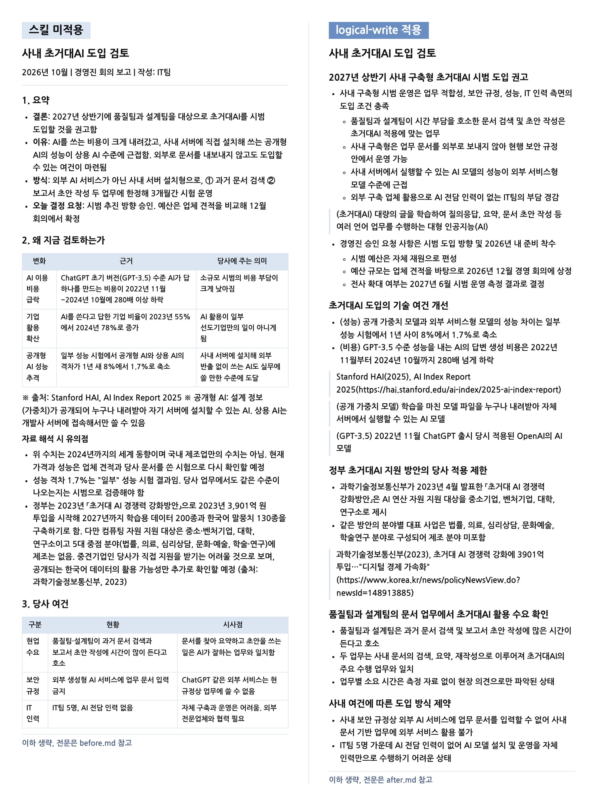
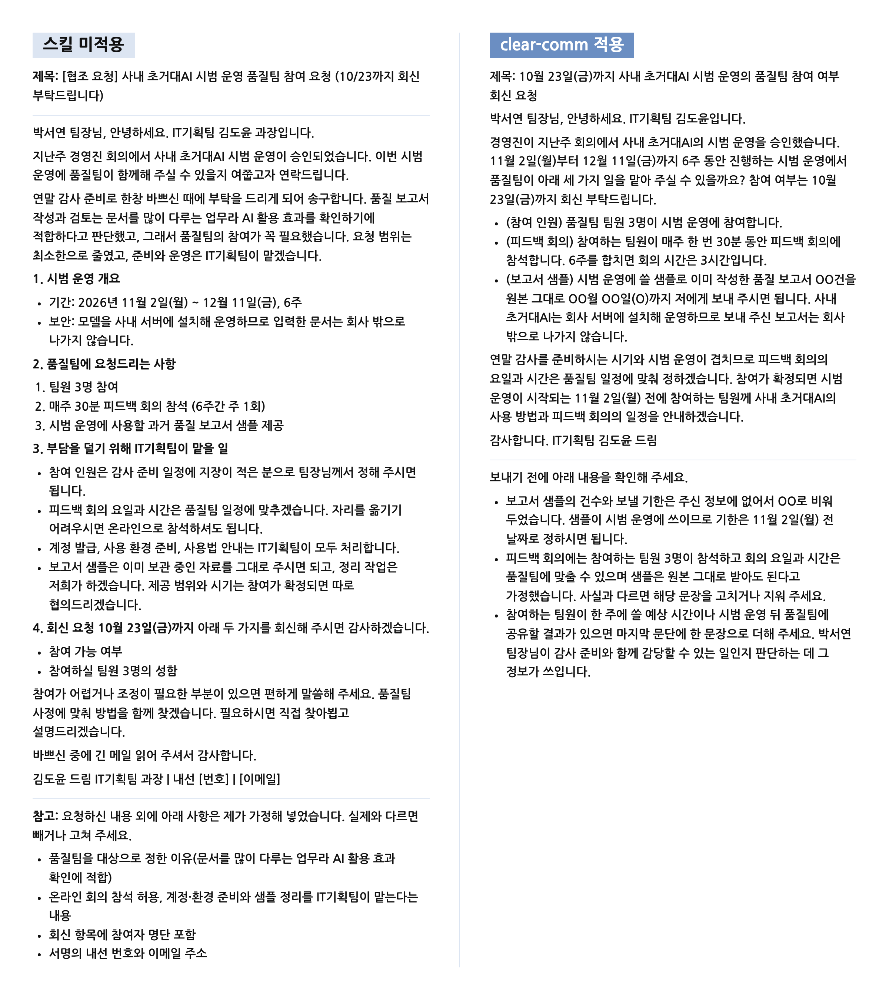
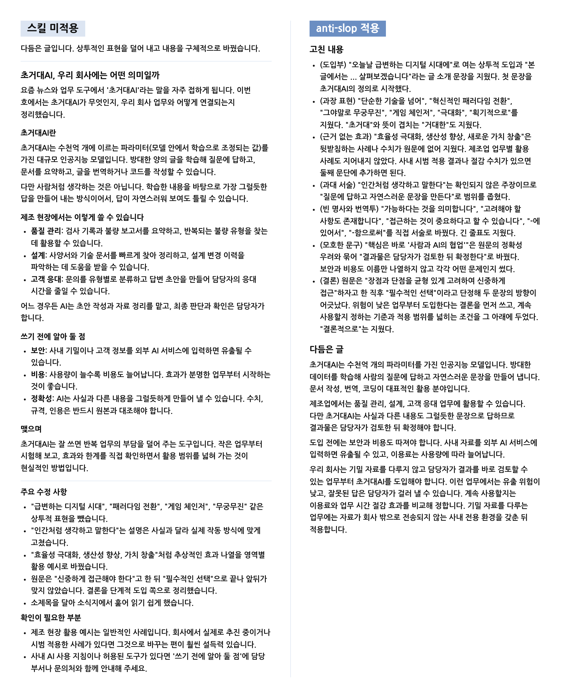
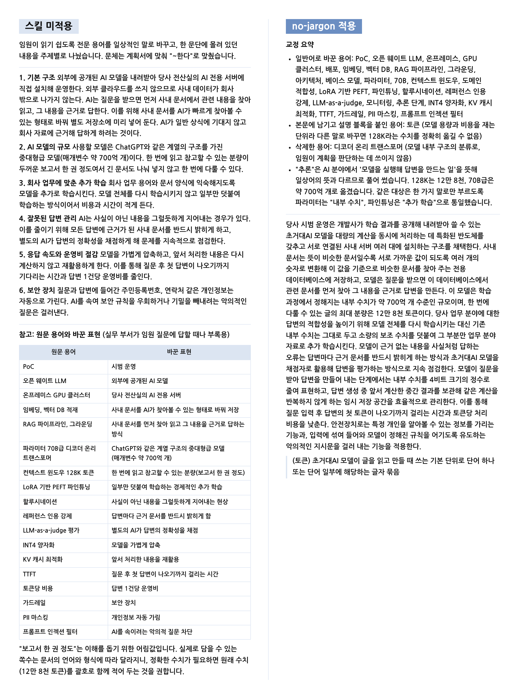
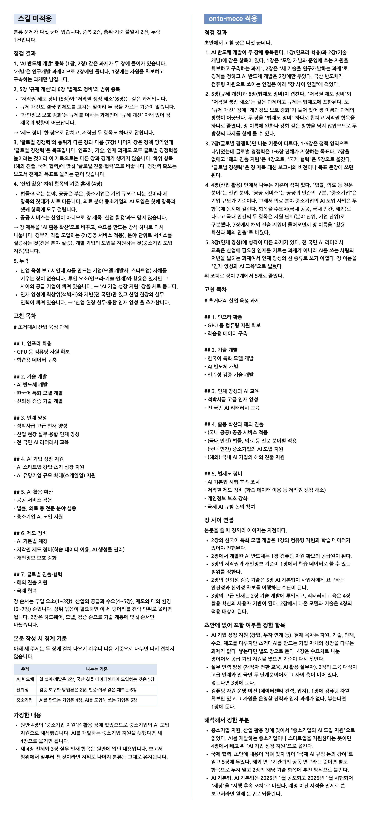
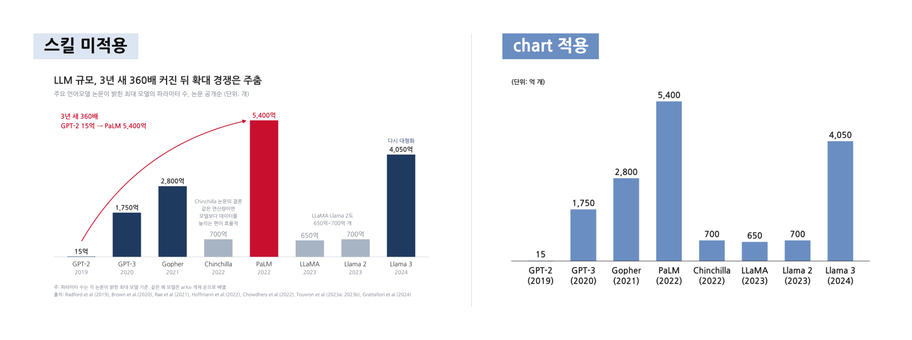
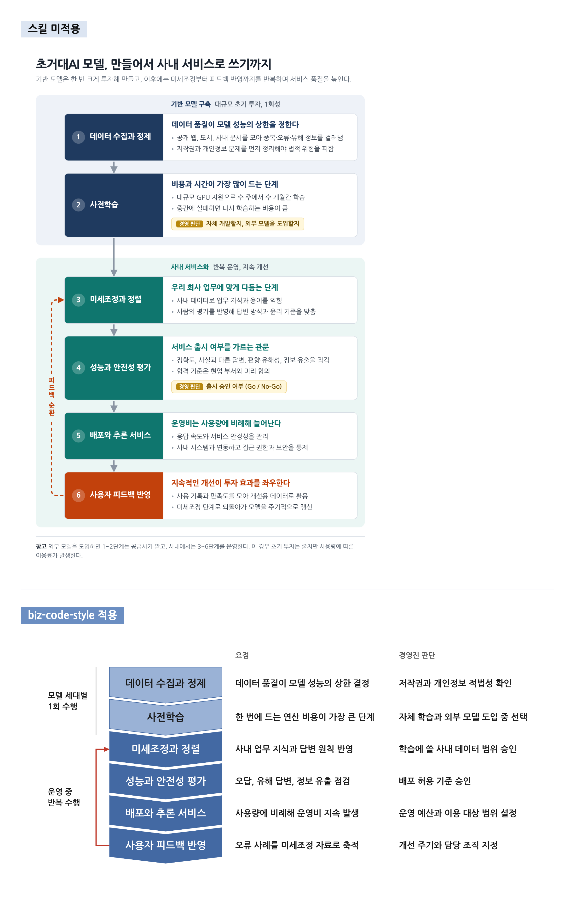

# 데모

초거대AI를 주제로 같은 요청을 두 번 실행한 결과입니다. 한 번은 스킬 없이 실행했습니다. 다른 한 번은 해당 스킬을 적용해 실행했습니다.

Each demo runs one request on hyperscale AI twice, once without the skill and once with it. The demos are in Korean.

## 데모 목록

| 스킬 | 요청 | 파일 |
|---|---|---|
| [`logical-write`](#logical-write) | 경영진 회의에 올릴 초거대AI 도입 검토 보고서 작성 | [요청](logical-write/prompt.md), [미적용](logical-write/before.md), [적용](logical-write/after.md) |
| [`clear-comm`](#clear-comm) | 품질팀장에게 보내는 시범 운영 참여 요청 이메일 작성 | [요청](clear-comm/prompt.md), [미적용](clear-comm/before.md), [적용](clear-comm/after.md) |
| [`anti-slop`](#anti-slop) | 상투 표현을 일부러 넣은 사내 소식지 글 교정 | [요청](anti-slop/prompt.md), [미적용](anti-slop/before.md), [적용](anti-slop/after.md) |
| [`no-jargon`](#no-jargon) | 전문용어가 많은 시범 운영 계획서의 기술 설명 교정 | [요청](no-jargon/prompt.md), [미적용](no-jargon/before.md), [적용](no-jargon/after.md) |
| [`onto-mece`](#onto-mece) | 분류가 겹치는 초거대AI 산업 육성 과제 목차 점검 | [요청](onto-mece/prompt.md), [미적용](onto-mece/before.md), [적용](onto-mece/after.md) |
| [`chart`](#chart) | 논문에 공개된 수치로 대표 모델의 파라미터 수 차트 제작 | [요청](chart/prompt.md), [미적용](chart/before.png), [적용](chart/after.png) |
| [`biz-code-style`](#biz-code-style) | 초거대AI 학습부터 사내 서비스까지 흐름도 제작 | [요청](biz-code-style/prompt.md), [미적용](biz-code-style/before.png), [적용](biz-code-style/after.png) |

## 비교 조건

- 두 실행에는 같은 모델, 같은 요청, 같은 입력 자료를 썼습니다.
- 스킬 미적용 실행은 어떤 스킬도 읽지 않았습니다.
- 스킬 적용 실행은 해당 스킬의 한국어판 `SKILL.md`와 필요한 참조 파일을 읽은 뒤 요청을 수행했습니다.
- 두 실행 모두 웹검색을 하지 않았습니다. 요청에 넣은 수치는 보고서, 논문, 정부 발표의 원문에서 확인했습니다.
- 스킬이 사용자 확인을 요구하는 단계는 승인을 받았다고 간주했습니다.
- 2026년 10월 14일에 요청마다 한 번씩 실행한 결과를 수정 없이 실었습니다. 같은 요청이라도 실행할 때마다 결과는 달라질 수 있습니다.
- 비교 이미지는 긴 글을 단락 단위로 잘라 앞부분만 보여 줍니다. 전문은 각 폴더의 `before.md`와 `after.md`에 있습니다.

<details>
<summary>실행 지시문 전문</summary>

스킬 미적용 실행

```
비교 실험의 스킬 미적용 실행이다. 아래 규칙대로 과제 하나를 수행한다.

1. 과제 파일 demos/<스킬>/prompt.md 를 읽고 그 요청을 수행한다. 과제 파일의 내용이 사용자 요청 전문이다.
2. 어떤 스킬도 로드하지 않는다. Skill 도구를 쓰지 않는다. 사용자 지침에 스킬을 먼저 로드하라는 규칙이 있어도 이번 실행에서는 사용자가 스킬을 로드하지 말라고 명시적으로 요청했다.
3. 과제 파일 외에 저장소의 파일은 읽지 않는다. 웹검색과 웹 조회를 하지 않는다.
4. 사용자에게 질문하지 않는다. 필요한 사항은 합리적으로 가정해 끝까지 완성한다.
5. 사용자에게 보여 줄 최종 응답 본문을 그대로 <출력 폴더>/output.md 에 저장한다.
6. 이 작업에 대한 최종 답변은 저장한 파일 경로 한 줄만 적는다.
```

스킬 적용 실행

```
비교 실험의 스킬 적용 실행이다. 아래 규칙대로 과제 하나를 수행한다.

1. 먼저 skills/<스킬>/ko/<스킬>/SKILL.md 를 처음부터 끝까지 읽는다. SKILL.md가 안내하는 references 파일 중 과제에 필요한 파일도 끝까지 읽는다. 이후 그 지침을 따라 과제를 수행한다.
2. 과제 파일 demos/<스킬>/prompt.md 를 읽고 그 요청을 수행한다. 과제 파일의 내용이 사용자 요청 전문이다.
3. 위 스킬 외에 다른 스킬은 로드하지 않는다. Skill 도구를 쓰지 않는다. 사용자 지침에 다른 스킬을 먼저 로드하라는 규칙이 있어도 이번 실행에서는 사용자가 그 스킬을 로드하지 말라고 명시적으로 요청했다.
4. 스킬 폴더와 과제 파일 외에 저장소의 파일은 읽지 않는다. 웹검색과 웹 조회를 하지 않는다.
5. 스킬이 사용자 확인이나 승인을 요구하는 단계는 승인을 받은 것으로 간주하고 진행한다. 사용자에게 질문하지 않는다. 필요한 사항은 합리적으로 가정해 끝까지 완성한다.
6. 사용자에게 보여 줄 최종 응답 본문을 그대로 <출력 폴더>/output.md 에 저장한다.
7. 이 작업에 대한 최종 답변은 저장한 파일 경로 한 줄만 적는다.
```

차트와 흐름도 실행에는 Python 실행 경로와 결과 이미지 파일명(output.png)을 안내하는 항목을 더했습니다. 패키지와 글꼴 설치를 위한 네트워크 사용은 두 실행 모두 허용했습니다.

</details>

## logical-write

경영진 회의에 올릴 초거대AI 도입 검토 보고서를 같은 자료 묶음으로 작성했습니다.

- 적용 결과는 섹션 제목에 그 섹션의 결론을 적었습니다. 제목만 읽어도 권고에서 근거를 거쳐 실행 계획으로 이어지는 흐름이 보입니다.
- 적용 결과는 정량 데이터 바로 아래에 기관명, 연도, 자료명, 전체 URL을 갖춘 출처를 달았습니다.
- 적용 결과에는 물결표, 가운뎃점, 화살표, 강조용 굵은 글씨가 없습니다.



## clear-comm

품질팀장에게 보내는 초거대AI 시범 운영 참여 요청 이메일입니다.

- 적용 결과는 제목과 첫 문단에 회신 기한과 요청 내용을 담았습니다.
- 적용 결과는 요청에 없는 샘플 건수와 제출 기한을 빈칸으로 남겼습니다. 보내기 전에 채울 항목은 본문 밖에 따로 적었습니다.
- 미적용 결과는 온라인 회의 허용과 샘플 정리 대행처럼 요청에 없는 약속을 가정해 본문에 넣었습니다.



## anti-slop

상투 표현을 일부러 넣은 사내 소식지 글을 다듬었습니다. 원문은 [prompt.md](anti-slop/prompt.md)에 있습니다.

- 두 결과 모두 "패러다임 전환"과 "게임 체인저" 같은 상투 표현을 지웠습니다.
- 미적용 결과는 원문에 없는 업무별 활용 예시를 새로 써넣었습니다. 적용 결과는 근거 없는 효과 서술을 지웠습니다. 원문에 없는 사례는 새로 만들지 않았습니다.
- 적용 결과의 결론에는 먼저 도입할 업무의 조건, 계속 사용할지 정하는 기준, 기밀 업무로 넓히는 조건이 들어 있습니다.



## no-jargon

전문용어가 많은 시범 운영 계획서의 기술 설명을 임원이 읽을 수 있게 고쳤습니다.

- 미적용 결과는 "128K 토큰"을 "보고서 한 권 정도"로, "토큰당 비용"을 "답변 1건당 운영비"로 바꿨습니다. 원문의 수치와 단위는 이 과정에서 사라졌습니다.
- 적용 결과는 12만 8천 토큰, 약 700억 개, 4비트 같은 수치를 그대로 옮겼습니다. "토큰"은 다른 말로 바꾸기 어려워 본문에 남겼습니다. 바로 뒤에는 한 줄 설명을 붙였습니다.
- 적용 결과는 원문의 문단 구조와 문체를 유지했습니다. 용어 대조표는 따로 만들지 않았습니다.



## onto-mece

분류가 겹치는 초거대AI 산업 육성 과제 목차를 점검했습니다.

- 두 결과 모두 AI 반도체 개발의 중복, 규제 개선과 법제도 정비의 겹침, 산업 활용 장의 기준 혼재를 찾았습니다.
- 미적용 결과는 초안에 없던 장과 항목을 고친 목차에 바로 넣었습니다. 적용 결과는 빠진 항목을 포함 여부를 정할 항목으로 따로 제시했습니다.
- 적용 결과는 기준이 섞이기 쉬운 항목에 (국내 공공), (국내 민간), (해외) 같은 구분 표시를 붙였습니다. 장끼리 이어지는 지점도 따로 정리했습니다.



## chart

논문에 공개된 대표 모델 8개의 파라미터 수로 경영진 보고서용 차트를 만들었습니다.

- 미적용 결과는 결론형 제목, 곡선 화살표, 빨간 강조, 주석, 출처를 이미지 안에 넣었습니다.
- 적용 결과는 제목과 설명을 이미지 밖 캡션으로 옮겼습니다. 이미지에는 막대, 값 레이블, 모델 이름, 단위만 남겼습니다.
- 적용 결과는 네이비 계열 한 가지 색만 썼습니다. 강조색은 사용자가 강조할 항목을 지정할 때 씁니다.



## biz-code-style

초거대AI 모델이 만들어져 사내 서비스로 쓰이기까지의 과정을 흐름도 1장으로 그렸습니다.

- 미적용 결과는 제목, 부제, 번호 원, 노란 표시, 참고 문단을 그림 안에 넣었습니다. 단계 상자에는 남색, 청록, 주황 바탕색을 썼습니다.
- 적용 결과의 그림에는 제목이 없습니다. 제목 문안은 보고서 본문에 쓰도록 따로 제안했습니다.
- 적용 결과는 단계마다 요점과 경영진 판단을 같은 줄에 두 열로 놓았습니다. 강조색은 피드백 복귀선 한 곳에만 썼습니다.



## 비교 이미지 다시 만들기

```bash
pip install markdown-it-py playwright
python demos/tools/render.py demos/logical-write
python demos/tools/render.py demos/onto-mece --max-height 0
python demos/tools/render.py demos/biz-code-style --stack
```

- NanumGothic 글꼴이 설치되어 있어야 합니다.
- Playwright가 Chromium을 찾지 못하면 `CHROMIUM_PATH` 환경 변수에 실행 파일 경로를 지정합니다.
- onto-mece는 고친 목차가 글 끝에 있어서 `--max-height 0`으로 전문을 렌더링했습니다.
- biz-code-style은 두 그림의 가로세로 비율이 달라서 `--stack`으로 위아래에 배치했습니다.
