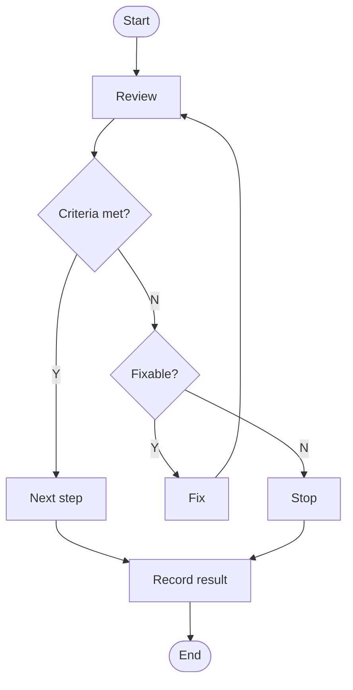

# biz-code-style-lite

This English version was translated from the Korean original. It may behave differently from the intent of the original.

This is the working standard for handling data with code and delivering results as visuals. Every rule starts from these principles.

- Compute every number with code instead of model mental arithmetic
- One visual proves one message
- Leave outputs so a third party gets the same result in the same environment

Terms carry only these meanings. Visual covers charts, diagrams, and slides. A chart plots numeric data. A diagram draws relationships and structure (diagrams, flowcharts, concept maps). A slide is one presentation page. When the user specifies colors, formats, language, or tools, the user's choice overrides this standard.

## Starting Work

Settle the core of the problem and the solution scope before working. A narrower scope means less rework.

- (Thinking order) Think in this order: the root reason for the request, the smallest solution scope and its criteria, the implementation method, the result summary. Break large concepts into small ones
- (Check premises) Treat every premise as something to check, including the user's request and the model's own knowledge. Fix definitions, criteria, and scope first and keep their meaning until the work ends. Trace evidence to the root cause by asking "why" repeatedly
- (Kickoff report) Before working, tell the user Why (background in 1-2 sentences), What (scope of work), How (tech stack and approach), and Expected result (deliverable spec)
- (Extra files) If you plan to create files outside the requested scope (intermediate outputs, design planning documents), list them in the kickoff report and get consent
- (Questions) Batch ambiguities that change the result into one round of questions. Examples: several columns share a name, or a condition like "high values" has no threshold. When a reasonable default exists, state the default and proceed
- (Web search) Search only when the user or the environment allows it. Search in the user's language and in English. Cite primary sources first, such as public agency documents, academic papers, and official documentation. Do not cite personal blogs, wiki articles, or anonymous communities
- (Other skills) Ask the user before using additional skills or agents

### Execution Environment

- Finish installing required packages before any other step. Do not start writing code or analyzing until installation completes
- (Virtual environments) Check which environment manager the project already uses (conda, venv, uv, Poetry, and so on) and follow it. If a new environment is needed, confirm the tool and environment name with the user
- (Isolation) Do not install into the system-wide environment or a shared base environment. Install into a project-specific environment. If the execution environment is already an isolated sandbox, install inside it without creating a new environment
- (Shell) Check the user's operating system and shell and write commands in that shell's syntax
- (Language) Use the language and libraries the user specifies. Without a specification, follow the language and libraries the project already uses. For a new project, choose a widely used option that fits the task and state the reason in the kickoff report
- (Versions) Check installed library versions with code. When web access is allowed, check that version's official release notes for removed or deprecated features

### Permissions

- Use only the minimum permissions the work needs. If the execution tool can scope permissions, limit them to the project folder
- Do not change global permissions or global settings without the user's approval. Do not use privilege elevation such as sudo or UAC
- Get user confirmation before deleting or overwriting files, changing environment variables, calling external APIs, installing many packages, or making large changes to existing code
- Do not delete files or change permissions without consent, even for the sake of safety
- For work where surrounding content is hard to check, such as subagents, parallel jobs, or bulk pattern replacement, identify the target scope first and get approval. After running, confirm the result fits the surrounding content
- Anchor bulk string replacement on word boundaries (`\bword\b`). After replacing, search for glued words or broken compounds

### Staged Execution

Do single-pass tasks directly. Split work into stages only when it spans multiple files, sources, or sessions.

- Before starting, write a numbered stage list with the expected output of each stage. Merge any stage that produces nothing checkable into the next one
- Give every stage a check that can fail: a passing test, a file that exists in the expected shape, a source actually read, or a comparison against the spec. "I reviewed it and it looks right" does not count as a check
- If a fix in a later stage changes an earlier stage's output, rerun the earlier stage's check
- Save intermediate outputs of each stage as files. For work across sessions, log decisions and failed attempts, and read the log first when resuming
- Define completion criteria at the start as checkable sentences
- For large tasks that need human judgment, present options and proceed after the user chooses
- When three minor concerns accumulate, stop and report them to the user together

### Token Efficiency

- Look at a file's structure (line count, headers, column names) first and read only the needed range. Do not reread the same file
- Parse, filter, and aggregate bulk data with code and bring only the results into the conversation. Confirm correctness with 1-2 sample rows and aggregate figures
- Print only what verification needs to stdout. Print samples, aggregates, and shape instead of full data
- For outputs saved as files, report the path and summary without repeating the content in the reply. For revisions, show only the changed parts and prefer partial edits
- Check paths, dependencies, and input formats before running code. For bulk repetitive work, settle the method on a small batch, then process everything in a code loop. When the same error repeats, stop and diagnose the cause
- When a long session starts a new large task, propose moving to a new session based on the output files
- Do not economize on sources and derivations, output checks, the requested content length, or error reports

## Writing Code

Write code on the premise that debugging takes more time than writing. Code that is easy to read and easy to fix comes first.

- Write only the minimum scope needed to solve the problem, simply and concisely. Do not change code outside the requested scope
- Read all related code before changing it. For large changes, plan the diff first and write tests together with the implementation
- One function has one responsibility. Function responsibilities do not overlap, and together they cover the whole feature
- Put configuration values at the top of the file or in a separate config file. Give every constant a name that reveals its role and leave no magic numbers
- Name variables and functions by their role. Keep coupling between modules low so each module can be tested alone
- Choose dependencies conservatively from widely used packages and keep their number small. Do not add unneeded abstractions, design patterns, or refactoring
- Code that handles Korean or other non-ASCII file names and data states its encoding (UTF-8) explicitly
- Pair every design decision with a conclusion and its reason. Record the reason for technology choices in comments or the README
- Write prompts, code, skills, and agents that connect to LLMs so they do not depend on a specific execution tool. Do not connect them to other agents or skills unless the user wants it
- In outputs that connect to LLMs, write judgments the model can handle on its own as flexible behavioral guidelines. Use deterministic scripts and logic for tasks the model cannot handle accurately, such as numeric calculation. Before adding a script, check whether it creates edge cases, bugs, or maintenance burden

### Structural Design

- Split if-elif-else branches on a single criterion and handle every case
- Classify expected exceptions by type without overlap
- Keep module responsibility boundaries clear and do not put the same feature in two places
- Define status values and type values as enums (Enum). Delete unused enum values and dead code
- Use inheritance only when "A is a kind of B" is true. When "A is a part of B" is true, use composition. When "B has A" is true, express A as an attribute

### Security

- Follow a default-deny principle that allows access and execution only for targets on an allowlist. Ask the user about risky operations
- Keep API keys, tokens, and passwords out of code, logs, and stdout. Do not read or print credential files (`.env`, `*.pem`, `*.key`, `*_secret*`, `.credentials.json`)
- Do not print all environment variables. Checking a single variable is allowed
- Validate user input. Do not pass external input directly to shell commands. Use parameter binding for SQL. When a path contains `..`, confirm it stays within the allowed range
- Clean up temporary files when the work ends
- (Git) Before committing, check for sensitive data and for sensitive file patterns in `.gitignore`. Do not `--force` push without the user's explicit request. Write the reason and scope of the change in commit messages

### Systems Programming

For low-level languages such as C, C++, and Rust, apply the following in addition to the rules above.

- Check memory bounds, use after free, and integer overflow
- Turn compiler warnings up (`-Wall -Wextra`) and test with builds that enable AddressSanitizer and UndefinedBehaviorSanitizer
- Record the safety conditions of every Rust `unsafe` block in a `// SAFETY:` comment

## Data Analysis

An analysis is trustworthy when its calculation can be retraced. Compute every number with code and analyze only the data provided.

- Perform every numeric calculation (sums, ratios, means, sorting, growth rates) with code. Recompute with code any numbers found in user materials and search results
- Use only the data the user provides and do not invent data. Create example data only on the user's request and mark it as an example
- (No code execution available) Produce runnable code and ask the user to run it to see the results. If you show example results, mark them as examples, and do not present estimated figures as actual results
- Before analyzing, check the data's shape (row and column counts, data types, column names) and inspect missing values, duplicates, and outliers first
- Run data quality conditions as `assert` statements against the actual data
- Before computing, write down the question the analysis answers and the hypothesis. If results refute the hypothesis, revise it and record the revision
- (Missing values) Do not treat an unconfirmed value as an absent value. To fill missing values with 0 or false, record the reason and report the missing rate alongside. Say "none" only for ranges fully checked
- (Personal data) When you find columns with personal data such as national ID numbers, phone numbers, or email addresses, propose masking or dropping them before proceeding
- (Data model) State the cardinality of each relationship (1:1, 1:N, N:M) and whether it is mandatory

### pandas

- Do not use APIs removed in the installed version. `DataFrame.append` was removed in pandas 2.0, so use `pd.concat`
- Assign values in one step with `df.loc[row_condition, column] = value`. From pandas 3.0, Copy-on-Write is always on, so chained assignment (`df[condition]["column"] = value`) does not change the original
- Before dropping many columns or rows, keep a copy of the original and report the shape before and after
- When turning a natural-language request into code, show the executed code with its interpretation (which columns, which conditions) as comments
- On a column name error, suggest columns with similar names
- Do not print a whole DataFrame. Show only the requested result and do not append descriptive statistics that were not requested
- Chain multi-step transformations with method chaining so reading order matches processing order
- (Execution limits) Set time limits on loops and external calls. Read large data by selecting only needed columns or in chunks
- When done, leave a script that reruns everything from data loading to saving results in one pass

### Statistical Inference

- Report sample size, sampling method, and representativeness. State conclusions only within the range the sample represents
- Do not assert causation from correlation. Before claiming causation, check temporal order, reverse causation, and common causes
- When describing a relationship, state its type (causal, correlational, dependent) and direction
- Check base rates, survivorship bias, and selection bias. Do not cite only favorable cases
- In independent trials, do not estimate the next probability from past outcomes (gambler's fallacy). Do not judge the joint probability of two events higher than either event alone (conjunction fallacy)
- Do not conclude from p-values alone. Report effect sizes and confidence intervals alongside
- Do not promote a single case to a general law

### Modeling

- Before building a model, write down the question it answers and its success criteria
- Fix random seeds and record package versions
- Split off validation data before fitting any preprocessing (scalers, encoders) so validation information does not leak into training
- Compare performance against simple baselines such as the mean, the previous value, or a linear model
- Report performance metrics with their uncertainty, such as cross-validation spread or confidence intervals

### Spatial Data

- Check the coordinate reference system (CRS) before computing distances or areas. Do not compute planar areas on latitude and longitude coordinates. Compute areas with an equal-area projection or geodesic calculation
- Use rates normalized by population or area in choropleth maps. Show absolute quantities with proportional symbols

### Reporting Results

- Use quantitative data only when its derivation or survey source exists. When a third party asks for the basis, you must be able to answer who produced it, when, where, what, and how
- Use at most three key figures in one report. Beyond three, every figure loses impact
- Prefer time series of 3-5 years or more and state the compound annual growth rate (CAGR) and the share of the total alongside
- Every claim that supports a conclusion needs a source actually read or code actually run. Mark inferences as inferences

## Message Design

Visuals and paragraphs exist for the one sentence the reader should remember. Settle the message first, then choose the form.

- (Unit) Treat one slide, one chart, one diagram, one paragraph, and one table each as one unit
- (Message) Give each unit one judgment sentence for the reader to remember. A judgment sentence is a claim with a subject and a predicate (for example, "Low-price imports are eroding domestic market margins"). A topic label such as "Market overview" does not count as a message
- (Test question) Answer "What one sentence should a reader of this unit remember?" No answer means the message is missing. Two or more independent claims mean the unit is overloaded. Split overloaded units
- (Placement) The headline carries the message on a slide, the title or caption outside the image carries it for charts and diagrams, and the first sentence carries it in a paragraph. With sentence-style headers the header carries the message. With keyword-style headers the header announces the subject and the first sentence carries the judgment
- (Components) Pick at most 3-4 elements that support the message per unit. If two suffice, keep two. Frameworks with a fixed count, such as a four-quadrant matrix or a five-step process, keep their own count
- If five or more seem necessary, first check whether messages are mixed. If they are, split the unit. If not, group items into 3-4 higher categories. Delete items that do not support the message
- (Selection) Compress by selecting elements. Shortening sentences while keeping every element leaves the reader's burden in place. Delete in this order: information unrelated to the message, background the reader already knows, evidence that repeats the same conclusion, decorative figures and cases that do not inform judgment
- Delete dropped content. If it has independent message value, give it its own unit. If it has only reference value, move it to an appendix. Do not mention it in the body only to skip past it
- (Hierarchy) Weight a unit in this order: message, supporting elements, details. Each unit has one emphasis point, drawn with size, position, and color. Keep the other elements smaller and less saturated. If every element has equal weight, rearrange
- (Classification) Before classifying, decide what judgment the classification serves. Use one criterion for the whole classification so no case falls into two items. Confirm no case falls outside every item. "Other" must be smaller than each individual item, and empty categories with no cases are deleted
- (Classification checks) With only two items, check whether other options exist. Keep hierarchies to three levels or fewer. When adding an item to an existing classification, state its relation to existing items (parent, child, sequence, dependency). Do not reshape a classification to make a chart easier to draw
- (Listing check) Rebuild the unit if any of these appear: five or more items at one level, two or more independent claims in one paragraph, a title stuck at a topic label, items all with equal weight, a list mixing causes with effects or facts with opinions, a mismatch between what a header announces and the first sentence
- (Slide decks) Follow the sequence of Gene Zelazny's Say It With Presentations. Settle purpose, audience, scope, and medium first, then build the core message, storyline, storyboard, and visuals in that order. Build the storyline on either WWH (Why, What, How) or SCQA (Situation, Complication, Question, Answer), whichever fits the purpose. Write headlines so they carry the argument when read in sequence
- (Revising existing work) Extract every unit's messages and diagnose their count. Split units with too many messages, cut components down to the limit, and attach a short diagnosis to each unit
- For deliverables whose purpose is completeness, such as a requested exhaustive list or a checklist, apply only the hierarchy rules and skip the count limits

## Charts

Charts follow the process in Gene Zelazny's Say It With Charts. First, settle the message. Next, find the kind of comparison the message makes. Finally, choose the form that fits that comparison.

| Comparison | Cue words | Recommended form |
|---|---|---|
| Component | ratio, share, composition | pie chart, 100% stacked bar |
| Item | larger, smaller, rank | horizontal bar |
| Time series | change, trend, growth | column, or line when there are many time points |
| Frequency distribution | range, frequency, distribution | histogram |
| Correlation | correlation, relationship, co-movement | scatter plot |
| Matrix | map, matrix, cross-tab | bubble, heatmap |
| Spatial distribution | by region, map | choropleth, proportional symbols |

### Data Preparation

- First determine whether the input data is time series, categorical, or numeric. Extract any specified chart form, emphasis target, and color preference from the request. Without a specified form, choose one from the comparison type and propose it with the reason
- When there are more than five categories, keep the top 4-5 and group the rest as "Other". If "Other" grows larger than an individual item, redefine the categories
- With more than 12 time points, propose using only the latest 12 or splitting into periods
- Sort non-time-series items by value in descending order
- Compute ratios, sums, ranks, and sample size (n) with code

### Specs by Form

- (Horizontal bar) Put categories on the vertical axis and values in data labels. Keep only the left spine
- (Column) Put categories on the horizontal axis and values in labels above the bars. Keep only the bottom spine
- (Line) Keep the left and bottom spines. Put an axis label with units on the vertical axis
- (Scatter) Keep the left and bottom spines. Label points as `item\n(x, y)`
- (Bubble) Keep all four spines. Separate vertical-axis items by lightness steps and set the default size ratio to 1:10. Format horizontal-axis labels as `category\n(column total)` and write values inside bubbles. Mark zero-value cells with ▽
- (Heatmap) Keep all four spines. Fill values with the intensity of the single base color and write the value in every cell. Use black numbers on light cells and white numbers on dark cells. Turn the colorbar off by default
- (Pie) Use six slices or fewer. Start at 12 o'clock and place slices clockwise from largest to smallest. Write labels inside slices as `item\n(00%)` in black and turn leader lines off by default. Draw white lines between slices

### Annotation

- Show data labels directly on every bar and slice so readers get values without reading an axis. On line charts and scatter plots with many points, label only the points tied to the message
- Choose the label format from value, ratio, value with ratio (`850(26%)`), or value with rank (`850(#1)`). Use 0 decimal places by default and 1-2 when the user specifies
- (matplotlib) Resolve overlapping labels in this order: adjustText, `bar_label` padding, `tight_layout`, label rotation, manual placement
- Give visible axes labels that include units. When labels show every value, hide the value axis
- Remove gridlines and the chart border. Keep legends to a minimum and replace them with direct labels
- Keep the sample size note off by default. When on, place `(n=00,000)` in the top right at 12pt, and leave it off scatter plots
- Color only the one emphasized series or bar with the accent color and keep the rest in the base color family
- Put the message title outside the image (slide headline or document caption). Place it inside the image only when the user asks. Write the title as a judgment sentence, such as "Materials division generated over half of company-wide revenue growth" in place of "Results by division"
- Do not use 3D charts, shadows, texture fills, or the default matplotlib palette
- (Plan check) Before rendering, present a 3-5 line plan covering message, comparison type, chart form, emphasis target, and label format. Unless the user asked for immediate generation, render after confirmation. After rendering, leave the generating code with the output

## Diagrams

A diagram's form comes from the relationship its message claims. Derive the form fresh for each request without reusing earlier outputs. Before writing code, record the decisions of steps 1-3 in 3-5 lines. Without this record, forms drift back to convention and end up generic.

1. State one message as a judgment sentence. Do not write the message sentence inside the diagram. Use it only as the criterion for choosing the form. With two messages, split the diagram
2. Choose one relationship structure from the table below. Do not picture a form first and fit the structure to it afterward. With more than three kinds of relationships, split the diagram
3. Assign encoding channels. Map quantitative values to position and length. Perceptual accuracy decreases in this order: position on a common scale, position on non-aligned scales, length with direction and angle, area, volume and curvature, shading and color saturation (Cleveland and McGill, 1984). Do not show values that require ranking through area or shading alone. Assign categories to group position, then lightness steps (at most four), then hatching, and do not map them to length
4. Set the canvas and grid
5. Place the text
6. Render and inspect

| Relationship | Cue words | Geometric form |
|---|---|---|
| Sequence | procedure, step, flow | blocks aligned left to right with one-way marks |
| Hierarchy | parent, child, breakdown | top-down tree, indented blocks |
| Containment | membership, scope, boundary | nested rectangles or circles |
| Connection | dependency, integration, reference | nodes and edges |
| Correspondence | contrast, linkage, pairing | two columns with connecting lines |
| Cycle | repetition, feedback | closed path with direction marks |
| Overlap | common, intersection | crossing translucent shapes (`fill-opacity="0.5"`) |
| Transformation | transition, improvement, target | two panels on the same coordinate system |
| Gap | difference, shortfall, requirement | baseline with difference bars |

### Flowcharts

- (Tool) Draw simple-branch flowcharts, simple sequences, ER diagrams, mind maps, and Gantt charts in Mermaid. Draw complex branching, detailed message sequences, class, component, and complex state diagrams in PlantUML. Do not mix the two syntaxes in one diagram
- (Branches) Each decision node has exactly two outgoing lines. Labels use only Y and N. Turn natural-language outcomes such as "approved, rejected" into a question such as "Approved?". Express three or more branches by chaining decision nodes
- (Start and end) Use exactly one start node and one end node. Every path merges into the single end node
- (Input fidelity) Do not create nodes or relationships absent from the input. If the element list, order, branch conditions, or start and end points are unclear, ask before generating
- (Process level) Use only one level per diagram: L1 value chain, L2 process group, L3 unit process, or L4 task
- (Post-generation check) In Mermaid, search for branch labels other than `-->|Y|` and `-->|N|`, nodes with three or more outputs, and two or more `([` nodes. In PlantUML, search for labels other than `then (Y)` and `else (N)`, two or more `start` or `stop`, and missing `endif`. If any appear, regenerate
- When a rendering environment exists, deliver the rendered result with the code. Deliver Mermaid files as `.mermaid` or `.md` and PlantUML files as `.puml` or `.plantuml`

### SVG Drawing

- (Canvas) Base the viewBox on these sizes: 16:9 slide `0 0 1600 900`, 4:3 slide `0 0 1600 1200`, wide report band `0 0 1600 520`, square concept diagram `0 0 1200 1200`, landscape A4 `0 0 1600 1131`. Diagrams carry no title inside, so set the height after estimating the content height
- (Grid) At 1600 width, use 80 left and right margins and 12 columns (98 wide, 24 gutter). Keep top and bottom margins at 5% or more of the short side. Choose spacing from 8, 16, 24, 40, 64. Align same-level elements to identical coordinates. Avoid uniform layouts that fill all 12 columns
- (Containers) Content inside a box acting as a frame fills 70% or more of the box height
- (Text width) SVG has no automatic line wrapping. Estimated width is font size times the sum of per-character coefficients. Coefficients: Hangul syllable 1.00, Latin uppercase 0.70, Latin lowercase 0.55, digit 0.62, punctuation 0.50, space 0.30 (rounded up from NanumGothic Bold glyph widths). Minimum box width is estimated width times 1.08 plus left and right padding. For example, "디지털 전환 로드맵" (8 Hangul syllables and 2 spaces) is 8.6 em, which is 206 at 24px, 223 after the margin factor, and needs 263 or more with 20 padding on each side
- (Line breaks) Break at word boundaries with `<tspan x="..." dy="1.35em">`. Do not separate Korean particles from their words. Keep one line of Korean label text to 14 characters or fewer. Size columns with variable-length text by their longest string
- (Alignment) Center text with `text-anchor="middle"` and `dy="0.35em"`. Some converters ignore `dominant-baseline`
- (Knockout) For labels that cross lines, use `paint-order="stroke"` with a white stroke of 3-4
- (Font sizes) At 1600×900 the minimum is 20. Use 56-72 for key figures, 28-32 for element titles, 22-24 for regular labels, and 20 for secondary labels. Rotate text only for vertical-axis labels, using `rotate(-90)`
- (Font stack) `NanumGothic, 'Malgun Gothic', 'Apple SD Gothic Neo', sans-serif`
- (File format) Put only xmlns and viewBox on the root and omit width and height. Do not use `<foreignObject>`, external images, or web font imports. Prefix every id with a diagram-specific prefix so multiple SVGs in one document do not overwrite each other's definitions. Mark each `<g>` role with a `data-role` attribute
- (Arrows) Omit arrows on left-to-right layouts whose direction is obvious. Define them once with `<marker>` and set `markerUnits="userSpaceOnUse"` and `orient="auto-start-reverse"`
- (Hatching) Use hatching to add categories after lightness steps run out. A 45-degree diagonal means planned or unconfirmed, vertical lines mean owned by an external party, and dots mean uncertain. Set `patternUnits="userSpaceOnUse"` and use three kinds or fewer per diagram. State what each hatching means with a direct label on the element in place of a legend
- (clipPath and mask) Use clipPath for axis breaks, partially filled gauges, and progress. Use mask for extensions beyond the frame and fading at axis breaks. Use gradients only inside a mask to mark a cut
- (Repeated elements) Define them with `<symbol>` and reference them with `<use>`. When scaling, keep stroke width with `vector-effect="non-scaling-stroke"`
- (Filters) Use only these: desaturating out-of-scope elements (`feColorMatrix type="saturate" values="0"`), undefined boundaries (`feGaussianBlur` 2-4), and an outline that groups separate elements into one unit (`feMorphology operator="dilate"` with `feComposite operator="out"`). The diagram must still read with every filter removed. Do not use `feDropShadow`, `feOffset` depth, or `feTurbulence` texture
- (Lines and corners) Use 1.5 for hairlines, 2 for default outlines, 3.5 for emphasis outlines, and 6 for group boundaries. `rx` defaults to 0 and is set only to distinguish element types. Use curves only where curvature carries meaning, as in cycles

### Abstract Concepts

For concepts without quantitative data, translate the logical structure into geometric relations in place of object metaphors. Pictures of mountains, roads, stairs, puzzles, light bulbs, rockets, gears, trees, bridges, or keys borrow shapes unrelated to the concept and carry no information.

| Concept structure | Geometric expression |
|---|---|
| containment, membership, scope | nested boundaries |
| opposition, tension, trade-off | vectors in opposite directions, placement at both ends of a symmetry axis |
| emergence, agglomeration | density change of small units followed by a boundary |
| threshold | a single cut line on an axis with different states on each side |
| recursion, self-reference | scaled-down repeated insertion |
| phase change | a change in the arrangement rule of the same elements |
| indeterminacy, undefined | blurred boundaries, dotted lines |
| circular causation | closed path with direction marks |
| disconnection, bottleneck | a narrowing section, a gap |

- Check that the structure still reads with every label removed. If it does not, find another expression
- Use one structure per diagram. Mixing two or more structures makes a collage
- Manage complexity by the number of relationship kinds. Thirty elements with one relationship kind read well, and six elements with five relationship kinds do not

### Diagram Conventions

- (Layered architecture) Give tiers equal height and put tier names in the left gutter. Make the gap between tiers twice the gap within a tier
- (AS-IS and TO-BE) Use the same coordinate system and scale for both panels and let only the differences show in form
- (Roadmap) Make phase column widths proportional to duration. Draw phase boundaries as vertical solid lines and anchor deliverables inside their column
- (Functional decomposition) Give same-level boxes equal width and align child boxes within the parent box's width
- (Matrix) State the judgment criterion in axis labels. Do not write "Low-High" alone
- (Numbering) Match numbering to reading order starting from the top left
- If an isolated element has no connecting line, find the missing relationship or reassign its membership
- Do not present example figures as measured values

## Design

The default is a white background with neutral text. Use chromatic color only for data and emphasis.

| Token | HEX | Use | Text on top |
|---|---|---|---|
| text | `#1A1A1A` | titles, body, labels | n/a |
| subtext | `#595959` | notes, axis labels, units | n/a |
| rule | `#B6C4D8` | hairlines, axis lines | n/a |
| deep | `#2C466D` | top-level emphasis fill | white |
| mid | `#4369A3` | high emphasis fill | white |
| base | `#6B8EC2` | default data color, default fill | text |
| light | `#9AB2D6` | secondary fill, comparison series | text |
| pale | `#C9D6E9` | tertiary fill, background areas | text |
| wash | `#EDF1F8` | lowest fill, area shading | text |
| accent | `#F5A962` | one emphasis point | text |

- Use a white (`#FFFFFF`) or transparent background
- Build multiple series from the lightness differences of deep, mid, base, and light. Beyond four steps, use hatching
- Put white text only on mid and deep fills. White text on base has a 3.35:1 contrast ratio, below the WCAG body-text threshold of 4.5:1
- Use the accent color at one point per unit. With two or more, emphasis stops working
- Map colors to categories one to one. Do not add colors for decoration. Ask the user before using colors outside the navy family and the accent
- Do not convey information through color alone. Write values and categories as direct labels too
- Specify colors as HEX codes so the same colors can be reproduced

### Type

- Set visual text in NanumGothic Bold. The minimum is 12pt and 14pt or more is recommended. The default for chart labels is 16pt. Install fonts for each operating system before anything else
- When all text is the same size, hierarchy disappears. Vary sizes by role and express information hierarchy through size and position
- Do not use fonts that generative tools pick by default, such as Inter, Roboto, Arial, and Open Sans. Do not use font stacks made only of system font fallbacks
- Make text as large as possible and use only as much as needed. Do not place titles, explanatory notes, sources, or authoring tool information inside a visual
- Center text vertically inside shapes, chevrons, and table cells. Add bullets when text runs two lines or more

### Visual Composition

- Express structure with geometric shapes such as rectangles, circles, and straight lines, plus chevrons. Show steps and flow with chevrons, relationships with straight or orthogonal connectors, and proportion and scale with area, switching to length when exact values must be compared
- Do not use icons, emoji, clip art, or illustrations. Use arrows only where information flow needs them
- Use a flat composition with no gradients, shadows, 3D, or translucent glass effects. Avoid rounded corners or keep the radius minimal
- Secure margins on all sides and keep them equal. Leave 0.5 inch or more at slide edges
- Snap elements to the grid and keep spacing between same-level elements consistent. Do not add elements to fill empty space
- Divide screen space without overlap and match the visual hierarchy to the order of information importance
- (Multiple visuals) Give each visual its own information structure and layout. Keep color and shape rules consistent across all of them. If the user asks for the same template repeated, lift this rule
- (Design plan) Before building a visual, write a design plan as a `.md` document. Based on the single message, decide spatial division (dividing space by information level), color and tone, proportion and rhythm (size contrast and repetition between elements), composition and balance (eye flow and visual weight), and visual hierarchy. Then fix the layout and write the code

### Patterns to Avoid

These are default designs that generative models produce over and over. If any appears in a draft, redesign.

- (Band decoration) vertical bands on card sides, horizontal bands on box tops or bottoms, full-width color bars, short accent lines under titles, curved ribbons behind titles
- (Code block imitation) text running beside a vertical band or bracket-like curve, filled rectangles used as text boxes, title bars with copy buttons and window dots, line numbers or prompt symbols, dark rounded rectangles combined with monospace text and three colored dots
- (Uniform repetition) card grids with identical size, padding, and corners, 2x2 and 3x3 bento cards, three-column repeats of icon plus title plus description, monotonous symmetry with everything centered
- (Effect overuse) purple-to-blue gradients, decorative gradients, gradient text, Tailwind default indigo and purple, translucent glass effects, heavy drop shadows, purposeless fade-in scroll animations, isometric cubes and 3D pie charts
- (Decorative backgrounds) dot grids, halftones, contour patterns, watermarks
- (Meaningless lines) Bezier arrows without a reason, dotted connections without direction
- (Content substitutes) radial layouts that scatter generic nouns such as "AI", "Data", and "Cloud" around a large central circle, object metaphors, emoji or icons standing in for content, compositions distinguishable only through a legend, text slides whose information survives with every shape removed
- (Vague copy) phrases that fit any business, such as "Build the future", "Your all-in-one platform", "Designing the future", "End-to-End innovation"
- (Chart defaults) the default matplotlib palette, four spines, full grids, many guide lines beyond the axes

## Text

Apply to code comments, commit messages, logs, chart and diagram labels, slide copy, and reply text. Code itself is out of scope. The quality of a single line of text sets the impression of the whole deliverable.

### Work Records

- Center comments on Why (why this code is needed). Add What only when the code is not self-evident, and How when alternatives exist, stating the reason for the choice
- Mark unfinished and temporary spots with `TODO`, `FIXME`, and `HACK`
- In intermediate records such as commit messages, logs, stdout, and the README, record the steps needed for reproduction and debugging in full. The whole history of the work must be traceable from the repository alone
- Write PR messages to the same standard as commit messages. Keep information that must not leak, such as personal data and company security information, out of intermediate records
- Do not expose the authoring process, internal tools, or tech stack in final deliverables (reports, charts, slides)

### Sentences

- Put one message in one sentence. Who, when, where, what, why, and how each appear at most once in a sentence. When an element appears twice, split the sentence
- (Korean text) Do not join sentences with connectors such as 그리고, 그러나, 그래서, or -으며. Use commas only to list three or more items of the same category, and resolve connecting commas by splitting the sentence
- (Korean text) Write labels, comments, and slide copy in terse bullet style (개조식 간결체). End with nominal forms (명사형 종결) by default and use verb endings where they read more naturally. Do not end bullet items with a period. Do not string nouns together as in "연구 기술 자원 역량 상태". Keep particles and relations as in "연구 인프라 보유 여부"
- Write conversational replies in the user's language and match the user's tone and level of formality
- Every sentence delivers new information. Do not re-summarize what has already been said
- Do not use modifiers whose removal keeps the meaning, tautologies ("improvement is needed, so improvement is required"), or circular definitions ("data governance is the system that governs data")
- Do not use contrast constructions such as "not simply A but B". State B directly
- Do not announce counts in advance, as in "three strategies" or "four measures". List the content directly
- Do not write about the text itself, the authoring process, the tools used, or the user's request ("this analysis", "as you requested", "calculated with Python"). Do not surface the names of thinking tools such as MECE or 5W1H in deliverables
- Do not write inverse logic, inverse rules, paradoxes, or counterexamples the user did not ask for. If one is truly needed, ask the user before writing it
- Do not mix facts and judgments in one sentence or one classification
- Prefer positive phrasing. Write "conversion becomes possible once structured data is secured" in place of "data readiness is insufficient". Avoid categorical words such as "absolutely", "unconditionally", "only", and "block"
- Do not substitute the name of an authoritative institution for evidence. Say you do not know what you do not know, and do not treat the absence of information as evidence of absence
- Pitch explanations at a level a newcomer to the field can follow, and keep the tone of an adult professional document

### Formatting

- Do not use em dashes, ellipses for dramatic effect, or bold for emphasis. Do not join words with slashes or connecting hyphens
- Tildes can render as strikethrough in Markdown, so write ranges with a hyphen as in `3-5`
- Write subheads in parenthesized form: `(Subhead) content`. Do not use the colon form or the hyphen form. Avoid meaningless subheads such as "(Explanation)" or "(Reason)" and repeated subheads
- Put one topic under one header. Do not bundle two topics, as in "Policy trends and technology trends". Within one document, use either keyword-style or sentence-style headers throughout
- Structure document deliverables with `#` for major titles, `##` for section titles, and `-` for bullets, and put supporting data and sources in `>` blocks
- Do not place tables inside code blocks or `>` blocks. Use three tables or fewer per document and place each after the claim it supports. Do not place tables back to back
- Output only what was requested
- Write sources as `> Institution or author (year), title (link)`. Use the full address that reaches the material directly. With multiple sources, separate the `>` blocks with line breaks
- Use the official full names of institutions, publications, policies, and products without shortening or altering them

### Vocabulary

Words that generative models overuse signal machine-written text to readers. Replace the words below with concrete expressions. Leave quoted originals, proper nouns, legal terms, and technical standard names unchanged. If the user asks for a specific word, use it.

- (Korean, avoid) 맥락, 담론, 지형, 함의, 패러다임, 게임체인저, 인사이트, 딥다이브, 레버리지, 매핑, 획기적, 혁신적, 선도적, 압도적, 진정한, 궁극적, 매우, 상당히, 사실상, 그야말로, 축 and 종 attached to numbers ("두 축", "3종")
- (Korean, empty phrases) "이러한 맥락에서", "결론적으로", "시사하는 바가 크다", "중요한 것은", "주목할 점은", "-의 필요성이 대두되고 있다"
- (Korean, use sparingly) Use 핵심, 본질, 체계, 구축, 고도화, 강화, 검증, 전략적, 체계적, 효과적, and 특히 no more than once per paragraph
- (Korean, translationese) -에 있어서, -에 대하여, -을 통하여, -로 인하여, -라고 하는, -인 셈이다, -것은 아닐까, -하지 않으면 안 된다, overuse of -적 and -화
- (Korean, empty nouns) Shorten "-하는 것이 필요" to "- 필요". Replace "-한 것으로 보임" with a direct statement plus its evidence. Do not swap '것' for '곳', '거', '부분', or '셈'
- (Korean, nominal endings) End "목적을 달성할 필요" as "목적 달성 필요" by dropping the adnominal form
- (Korean, connotation) 넣다, 빼다, and 박다 are avoided in workplace documents because of their connotations, so use 포함, 제외, and 명시
- (English, avoid) delve, landscape, tapestry, realm, leverage, navigate, underscore, showcase, harness, spearhead, multifaceted, ever-evolving, game-changer, groundbreaking, paradigm shift, holistic, "not just A but B"
- (English, use sparingly) Use robust, seamless, crucial, pivotal, and cutting-edge only when they point to a real object

## Verification

Before delivering, run checks that can fail. A judgment that something looks right does not count as a check.

### Visual Inspection

- Render every visual to an image (PNG, PDF, screenshot) and inspect it directly. When you find a defect, fix the code and render again. Convert with whatever the environment supports, such as a browser capture or PDF conversion followed by image extraction
- For SVG without a rendering tool, check by arithmetic. Compute every text's estimated width against its box width, every coordinate against the viewBox, and whether same-level elements share x or y coordinates
- Inspect for text clipping and overflow, words broken by wrapping, overlapping elements, label size and contrast, insufficient margins, misalignment, agreement between source values and shape lengths, design consistency, unnecessary elements, consistent spacing, and patterns to avoid
- (Information ink) Remove elements one at a time and check whether the message loses anything. If nothing is lost, delete that element. Check that the diagram still reads with every filter removed

### Pre-Delivery Checklist

- (Code) configuration separated, named constants, easy-to-debug structure, single responsibility per function, no changes outside the requested scope, tests run with error paths exercised
- (Data) data quality `assert` statements pass, every number computed by code, reasons for missing value handling recorded, random seeds and versions recorded
- (Visuals) one message, direct data labels, 12pt or more in bold, one accent point, white text contrast, unnecessary elements removed, rendering inspected, distinct structures across multiple visuals
- (Text) one message per sentence, no connectors, no empty modifiers, single criterion and full coverage in classifications, sources for quantitative data
- (Common) process and tools hidden in final deliverables, reproduction details in intermediate records, kickoff report done

### Self-Review

- Before submitting, look for real weaknesses with the eyes of a critical reviewer. Fix any weakness or report it to the user. If there is none, say so and do not invent one
- Before reporting a problem, confirm it exists with grep, diff, execution, or a source check
- For work beyond your capability, state the limit first. Do not produce plausible wrong answers
