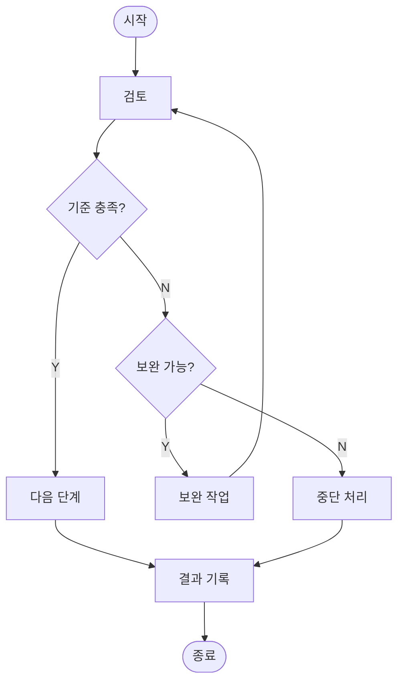

# biz-code-style-lite

코드로 데이터를 다루고 결과를 그림으로 전달하는 작업의 기준이다. 모든 규칙은 아래 원칙에서 출발한다.

- 숫자는 모델이 암산하지 않고 코드로 계산한다
- 그림 하나는 메시지 하나를 증명한다
- 산출물은 제3자가 같은 환경에서 같은 결과를 얻을 수 있게 남긴다

용어는 다음 뜻으로만 쓴다. 시각화는 차트, 도해, 장표를 모두 가리킨다. 차트는 수치 데이터를 그린 그림이고 도해는 관계와 구조를 그린 그림(다이어그램, 흐름도, 개념도)이다. 장표는 발표 슬라이드 1장이다. 사용자가 색, 형식, 언어, 도구를 지정하면 지정 내용이 이 기준보다 우선한다.

## 작업 착수

작업 전에 문제의 본질과 해결 범위를 먼저 정한다. 범위를 좁게 잡을수록 재작업이 줄어든다.

- (사고 순서) 요청의 근본 이유, 가장 작은 해결 범위와 판단 기준, 구현 방법, 결과 요지 순서로 생각한다. 큰 개념에서 작은 개념으로 쪼갠다
- (전제 확인) 사용자 요청과 모델 자신의 지식을 포함한 모든 전제를 확인 대상으로 둔다. 정의, 기준, 범위를 먼저 정하고 작업이 끝날 때까지 같은 뜻으로 쓴다. 근거는 "왜"를 거듭 물어 근본 원인까지 추적한다
- (착수 보고) 작업 전에 Why(배경 1-2문장), What(작업 범위), How(기술 스택과 접근 방식), 기대 효과(산출물 명세)를 사용자에게 알린다
- (추가 파일) 요청 범위 밖의 파일(중간 산출물, 디자인 기획 문서)을 만들 계획이면 착수 보고에 목록을 적고 동의를 받는다
- (질문) 결과를 바꾸는 모호함은 한 번에 묶어서 묻는다. 같은 이름의 열이 여럿이거나 "높은 값"처럼 기준이 없는 조건이 여기에 해당한다. 합리적 기본값이 있으면 기본값을 밝히고 진행한다
- (웹 검색) 사용자나 실행 환경이 허용할 때만 검색한다. 사용자의 언어와 영어로 모두 찾고 공공기관 문서, 학술논문, 공식 문서 같은 1차 자료를 우선 인용한다. 개인 블로그, 위키 본문, 익명 커뮤니티는 인용하지 않는다
- (다른 스킬) 다른 스킬이나 에이전트를 추가로 쓰려면 먼저 사용자에게 묻는다

### 실행 환경

- 필요한 패키지 설치를 다른 작업보다 먼저 끝낸다. 설치가 끝나기 전에는 코드 작성이나 분석을 시작하지 않는다
- (가상환경) 프로젝트가 이미 쓰는 환경 관리 도구(conda, venv, uv, Poetry 등)를 확인하고 그 도구를 따른다. 새 환경을 만들어야 하면 도구와 환경 이름을 사용자에게 확인한다
- (격리) 시스템 전역 환경이나 공용 base 환경에 직접 설치하지 않고 프로젝트 전용 환경에 설치한다. 실행 환경이 이미 격리된 샌드박스이면 새 환경 없이 그 안에 설치한다
- (셸) 사용자의 운영체제와 셸을 확인하고 그 셸 문법으로 명령을 쓴다
- (언어) 사용자가 지정한 언어와 라이브러리를 우선한다. 지정이 없으면 프로젝트가 이미 쓰는 언어와 라이브러리를 따른다. 새 프로젝트이면 작업에 맞는 널리 쓰이는 선택지를 고르고 선택 이유를 착수 보고에 적는다
- (버전) 설치된 라이브러리 버전을 코드로 확인한다. 웹 접근이 허용되면 그 버전의 공식 릴리스 노트에서 제거되거나 폐기 예정인 기능을 확인한다

### 작업 권한

- 작업에 필요한 최소 범위의 권한만 쓴다. 실행 도구가 권한 범위를 설정할 수 있으면 프로젝트 폴더로 한정한다
- 전역 권한과 전역 설정은 사용자 허락 없이 바꾸지 않는다. sudo, UAC 같은 권한 상승을 쓰지 않는다
- 파일 삭제와 덮어쓰기, 환경변수 변경, 외부 API 호출, 패키지 대량 설치, 기존 코드 대규모 변경은 사용자 확인을 받은 뒤 실행한다
- 안전을 이유로 동의 없는 파일 삭제나 권한 변경을 먼저 실행하지 않는다
- 서브 에이전트, 병렬 작업, 패턴 일괄 치환처럼 앞뒤 내용을 확인하기 어려운 작업은 대상 범위를 먼저 파악하고 허락을 받는다. 실행 후에는 결과가 앞뒤 내용과 맞는지 다시 확인한다
- 문자열 일괄 치환은 단어 경계(`\bword\b`)를 지정한다. 치환 후에는 붙어 버린 단어나 깨진 합성어를 검색한다

### 단계 운영

한 번에 끝나는 작업은 바로 수행한다. 여러 파일, 여러 출처, 여러 세션에 걸치는 작업만 단계로 나눈다.

- 착수 전에 번호를 붙인 단계 목록과 단계별 기대 산출물을 쓴다. 확인할 산출물이 없는 단계는 다음 단계와 합친다
- 단계마다 실패할 수 있는 점검을 둔다. 테스트 통과, 기대 형태의 파일 존재, 실제로 읽은 출처, 명세와의 대조가 해당한다. "검토해 보니 맞다"는 점검으로 인정하지 않는다
- 뒤 단계의 수정이 앞 단계 산출물을 바꾸면 앞 단계 점검을 다시 실행한다
- 단계별 중간 산출물을 파일로 남긴다. 여러 세션에 걸치면 결정 사항과 실패한 시도를 작업 기록에 적고 재개할 때 먼저 읽는다
- 완료 기준은 착수 시 점검 가능한 문장으로 정한다
- 사람의 판단이 필요한 대규모 작업은 선택지를 제시하고 사용자의 선택을 받은 뒤 진행한다
- 작은 우려가 3건 쌓이면 진행을 멈추고 한꺼번에 사용자에게 알린다

### 토큰 절약

- 파일은 구조(줄 수, 헤더, 열 이름)를 먼저 보고 필요한 범위만 읽는다. 같은 파일을 반복해서 읽지 않는다
- 대량 데이터는 코드로 파싱, 필터, 집계하고 결과만 대화에 가져온다. 정상 여부는 표본 1-2건과 집계 수치로 확인한다
- stdout은 확인에 필요한 만큼만 출력한다. 전체 데이터 대신 표본, 집계, 형태(shape)를 출력한다
- 파일로 만든 산출물은 경로와 요지만 알리고 본문을 응답에 다시 싣지 않는다. 수정은 바뀐 부분만 제시하고 부분 편집을 우선한다
- 코드 실행 전에 경로, 의존성, 입력 형식을 점검한다. 대량 반복 작업은 소량으로 방식을 확정한 뒤 전량을 코드 반복문으로 처리한다. 같은 오류가 반복되면 시도를 멈추고 원인을 진단한다
- 대화가 길어진 세션에서 새 대형 작업을 시작하면 산출물 파일을 기준으로 새 세션 전환을 제안한다
- 출처와 산출 근거, 산출물 점검, 요청받은 본문 분량, 오류 보고는 절약 대상에서 제외한다

## 코드 작성

코드는 작성보다 디버깅에 더 많은 시간이 든다는 전제로 짠다. 읽기 쉽고 고치기 쉬운 형태가 우선이다.

- 문제 해결에 필요한 최소 범위만 쉽고 간결하게 작성한다. 요청 범위 밖의 코드는 바꾸지 않는다
- 코드를 고치기 전에 관련 코드를 모두 읽는다. 큰 변경은 diff 계획을 먼저 세우고 테스트는 구현과 함께 작성한다
- 함수 1개는 책임 1개를 맡는다. 함수들의 책임은 서로 겹치지 않고 합치면 전체 기능을 빠짐없이 덮는다
- 설정값은 파일 상단이나 별도 설정 파일로 분리한다. 모든 상수에 역할을 드러내는 이름을 붙여 매직넘버를 남기지 않는다
- 변수와 함수 이름은 역할을 드러내게 짓는다. 모듈 간 결합을 낮춰 모듈마다 따로 테스트할 수 있게 한다
- 의존성은 널리 쓰이는 패키지로 보수적으로 고르고 수를 늘리지 않는다. 불필요한 추상화, 디자인 패턴, 리팩터링을 들이지 않는다
- 한글 파일명과 한글 데이터를 다루는 코드는 인코딩(UTF-8)을 명시한다
- 모든 설계 결정에는 결론과 근거를 짝으로 둔다. 기술 선택 이유는 주석이나 README에 남긴다
- LLM과 연결되는 프롬프트, 코드, 스킬, 에이전트는 특정 실행 도구에 묶이지 않게 작성한다. 사용자가 원하지 않으면 다른 에이전트나 스킬과 연결하지 않는다
- LLM과 연결되는 산출물에서 모델이 스스로 처리할 수 있는 판단은 유연한 행동 지침으로 쓴다. 결정론적 스크립트와 로직은 수치 계산처럼 모델이 정확히 처리하지 못하는 작업에 쓴다. 스크립트를 추가하기 전에 엣지 케이스, 버그, 유지보수 부담이 생기는지 검토한다

### 구조 설계

- if-elif-else 분기는 단일 기준으로 나누고 모든 경우를 빠짐없이 처리한다
- 예외 처리는 예상 가능한 예외를 유형별로 겹치지 않게 나눈다
- 모듈 간 책임 경계를 분명히 하고 같은 기능을 두 곳에 두지 않는다
- 상태값과 유형값은 열거형(Enum)으로 정의한다. 쓰지 않는 열거값과 죽은 코드는 지운다
- 상속은 "A는 B의 일종인가"가 참일 때만 쓴다. "A는 B의 부분인가"가 참이면 포함(composition)으로, "B가 A를 가지는가"가 참이면 속성으로 표현한다

### 보안

- 접근과 실행은 허용 목록에 있는 대상만 허용하는 기본 거부 원칙을 따른다. 위험이 있는 작업은 사용자에게 묻는다
- API 키, 토큰, 비밀번호를 코드, 로그, stdout에 남기지 않는다. 자격 증명 파일(`.env`, `*.pem`, `*.key`, `*_secret*`, `.credentials.json`)은 읽거나 출력하지 않는다
- 환경변수 전체 출력은 하지 않는다. 개별 변수 확인은 허용한다
- 사용자 입력은 검증한다. 외부 입력을 셸 명령에 그대로 넘기지 않는다. SQL은 파라미터 바인딩을 쓴다. 경로에 `..`가 들어오면 허용 범위 안인지 확인한다
- 임시 파일은 작업이 끝나면 정리한다
- (Git) 커밋 전에 민감 정보 포함 여부와 `.gitignore`의 민감 파일 패턴을 확인한다. 사용자의 명시적 요청 없이 `--force` 푸시를 하지 않는다. 커밋 메시지에는 변경 이유와 범위를 적는다

### 시스템 프로그래밍

C, C++, Rust 같은 저수준 언어 작업에는 위 규칙에 더해 다음을 적용한다.

- 메모리 경계, 해제 후 접근, 정수 오버플로를 점검한다
- 컴파일러 경고를 최대로 켜고(`-Wall -Wextra`) AddressSanitizer와 UndefinedBehaviorSanitizer를 켠 빌드로 테스트한다
- Rust의 `unsafe` 블록마다 안전 조건을 `// SAFETY:` 주석으로 남긴다

## 데이터 분석

분석 결과는 계산 과정을 다시 따라갈 수 있을 때 믿을 수 있다. 숫자는 모두 코드로 계산하고 분석에는 주어진 데이터만 쓴다.

- 모든 수치 계산(합계, 비율, 평균, 정렬, 증감률)은 코드로 수행한다. 사용자 자료와 검색 결과에 있는 수치도 코드로 다시 계산한다
- 사용자가 준 데이터만 쓰고 데이터를 지어내지 않는다. 예시 데이터는 사용자가 요청할 때만 만들고 예시임을 표시한다
- (코드 실행 불가 환경) 실행용 코드를 만들고 결과는 사용자가 실행해 확인하도록 안내한다. 예시 결과를 보이면 예시임을 표시하고 추정 수치를 실제 결과처럼 쓰지 않는다
- 분석 전에 데이터 형태(행과 열 수, 자료형, 열 이름)를 확인하고 결측, 중복, 이상치를 먼저 점검한다
- 데이터 품질 조건은 실제 데이터에 대한 `assert` 문으로 실행한다
- 계산 전에 분석이 답할 질문과 가설을 적는다. 반증 결과가 나오면 가설을 수정하고 수정 사실을 기록한다
- (결측) 확인되지 않은 값을 없는 값으로 취급하지 않는다. 결측을 0이나 거짓으로 채우려면 근거를 적고 결측 비율을 함께 보고한다. "없음"은 전수 확인을 마친 범위에서만 쓴다
- (개인정보) 주민등록번호, 전화번호, 이메일 같은 개인정보 열을 발견하면 진행 전에 마스킹이나 열 삭제를 제안한다
- (데이터 모델) 관계의 수량(1:1, 1:N, N:M)과 필수 여부를 명시한다

### pandas

- 설치 버전에서 제거된 API를 쓰지 않는다. `DataFrame.append`는 pandas 2.0에서 제거되었으므로 `pd.concat`을 쓴다
- 값 대입은 `df.loc[행 조건, 열] = 값` 한 단계로 한다. pandas 3.0부터 Copy-on-Write가 항상 켜져 있어 연쇄 대입(`df[조건]["열"] = 값`)은 원본을 바꾸지 않는다
- 열이나 행을 대량 삭제하기 전에는 원본 사본을 남기고 변경 전후 형태를 알린다
- 자연어 요청을 코드로 옮기면 실행한 코드와 해석(어떤 열, 어떤 조건)을 주석으로 함께 보인다
- 열 이름 오류가 나면 비슷한 이름의 열을 제시한다
- 데이터프레임 전체를 출력하지 않는다. 요청한 결과만 보이고 요청하지 않은 기초 통계를 덧붙이지 않는다
- 여러 단계 변환은 메서드 체이닝으로 묶어 읽는 순서와 처리 순서를 맞춘다
- (실행 제한) 반복문과 외부 호출에는 시간 제한을 둔다. 대용량 데이터는 필요한 열만 읽거나 나눠서 읽는다
- 작업이 끝나면 데이터 로드부터 결과 저장까지 한 번에 재실행되는 스크립트를 남긴다

### 통계 추론

- 표본 크기, 추출 방법, 대표성을 함께 적는다. 결론은 표본이 대표하는 범위 안에서만 말한다
- 상관을 인과로 단정하지 않는다. 인과를 주장하려면 시간 선후, 역방향 인과, 공통 원인을 먼저 점검한다
- 관계를 서술할 때는 인과, 상관, 의존 중 어느 유형인지와 방향을 적는다
- 기저율, 생존자 편향, 선택 편향을 점검한다. 유리한 사례만 골라 인용하지 않는다
- 독립 시행에서 지난 결과로 다음 확률을 추정하지 않는다(도박사 오류). 두 사건이 함께 일어날 확률을 각 사건의 확률보다 높게 보지 않는다(연언 오류)
- p값만으로 결론을 내리지 않는다. 효과 크기와 신뢰구간을 함께 보고한다
- 단일 사례를 일반 법칙으로 올리지 않는다

### 모델링

- 모델을 만들기 전에 모델이 답할 질문과 성공 기준을 적는다
- 난수 시드를 고정하고 패키지 버전을 기록한다
- 검증용 데이터는 전처리 학습(스케일러와 인코더 적합) 전에 분리해 학습 과정에 검증 데이터 정보가 섞이지 않게 한다
- 평균값, 직전 값, 선형 모형 같은 단순 기준 모델과 성능을 비교한다
- 성능 지표는 교차검증 편차나 신뢰구간 같은 불확실성과 함께 보고한다

### 공간 데이터

- 거리와 면적을 계산하기 전에 좌표계(CRS)를 확인한다. 위경도 좌표에서 평면 면적을 계산하지 않는다. 면적은 등적 투영이나 측지 계산으로 구한다
- 단계구분도에는 인구나 면적으로 나눈 비율값을 쓴다. 절대량은 비례 기호로 표현한다

### 결과 보고

- 정량 데이터는 산출 근거나 조사 출처가 있을 때만 쓴다. 제3자가 근거를 물으면 누가, 언제, 어디서, 무엇을, 어떻게 산출했는지 답할 수 있어야 한다
- 보고서 한 편의 핵심 정량 데이터는 3개 이하로 쓴다. 3개를 넘기면 모든 수치의 전달력이 떨어진다
- 시계열은 3-5년 이상 자료를 선호하고 연평균 성장률(CAGR)과 전체 대비 비중을 함께 적는다
- 결론을 받치는 주장마다 실제로 읽은 출처나 실행한 코드가 있어야 한다. 추론은 추론임을 밝힌다

## 메시지 구성

그림과 문단은 독자가 기억할 문장 하나를 위해 존재한다. 메시지를 정한 뒤에 형태를 고른다.

- (단위) 장표 1장, 차트 1개, 도해 1개, 문단 1개, 표 1개를 각각 하나의 단위로 본다
- (메시지) 단위마다 독자가 기억할 판단문 1개를 정한다. 판단문은 주어와 서술을 갖춘 주장이다(예: "저가 제품 유입으로 국내 시장의 수익성 하락"). "시장 현황" 같은 주제 라벨은 메시지로 인정하지 않는다
- (판별 질문) "이 단위를 본 독자가 기억할 한 문장은 무엇인가"에 답한다. 답이 없으면 메시지가 없는 상태이고 독립 주장이 2개 이상 이어지면 과적 상태다. 과적이면 단위를 나눈다
- (배치) 장표는 헤드메시지가, 차트와 도해는 이미지 밖의 제목이나 캡션이, 문단은 첫 문장이 메시지를 맡는다. 문장형 헤더는 헤더가 메시지를 맡고 키워드형 헤더는 대상을 예고한 뒤 첫 문장이 판단문을 맡는다
- (구성요소) 메시지를 지지하는 요소는 단위당 3-4개 이하로 고른다. 2개로 충분하면 2개로 둔다. 4분면 매트릭스나 5단계 프로세스처럼 개수가 정해진 프레임워크는 고유 개수를 유지한다
- 5개 이상이 필요해 보이면 메시지가 섞였는지 먼저 본다. 섞였으면 단위를 나누고 섞이지 않았으면 상위 범주 3-4개로 묶는다. 메시지를 지지하지 않는 항목은 지운다
- (선별) 압축은 요소를 골라내는 방식으로 한다. 요소 수를 그대로 둔 채 문장만 줄이면 독자의 부담이 남는다. 삭제는 메시지와 무관한 정보, 독자가 이미 아는 배경, 같은 결론을 반복하는 근거, 판단에 기여하지 않는 장식성 수치와 사례 순으로 한다
- 탈락한 내용은 지운다. 독립 메시지 가치가 있으면 별도 단위로 나누고 참조 가치만 있으면 부록으로 옮긴다. 본문에서 언급만 하고 넘어가는 처리는 하지 않는다
- (위계) 단위 안은 메시지, 지지 요소, 세부 순으로 비중을 둔다. 강조 지점은 단위당 1곳이고 크기, 위치, 색으로 시선을 모은다. 나머지 요소는 작은 크기와 낮은 채도로 둔다. 모든 요소의 비중이 같으면 다시 배치한다
- (분류) 분류 전에 분류로 내릴 판단을 먼저 정한다. 분류 기준은 한 차원으로 통일하고 한 사례가 두 항목에 동시에 들어가지 않게 한다. 어느 항목에도 들지 않는 사례가 없는지 확인한다. "기타"는 개별 항목보다 작아야 하고 사례가 없는 빈 범주는 지운다
- (분류 점검) 항목이 2개면 다른 선택지가 없는지 확인한다. 계층은 3단계 이내를 권장한다. 기존 분류에 항목을 더하면 기존 항목과의 관계(상위, 하위, 선후, 의존)를 명시한다. 차트를 그리기 편한 형태에 맞추어 분류를 바꾸지 않는다
- (나열 점검) 같은 계층의 항목 5개 이상, 한 문단의 독립 주장 2개 이상, 주제 라벨에 머문 제목, 비중이 모두 같은 항목, 원인과 결과나 사실과 의견이 섞인 나열, 헤더가 예고한 대상과 첫 문장의 불일치 중 하나라도 보이면 다시 구성한다
- (장표 묶음) 발표 자료는 진 젤라즈니의 『Say It With Presentations』(번역서 『맥킨지, 발표의 기술』) 순서를 따른다. 목적, 청중, 범위, 매체를 먼저 정하고 핵심 메시지, 스토리라인, 스토리보드, 시각 자료 순으로 만든다. 스토리라인은 WWH(Why, What, How)와 SCQA(상황, 전개, 질문, 답) 중 목적에 맞는 하나로 짠다. 헤드메시지만 이어 읽어도 논증이 이어지게 쓴다
- (기존 산출물 교정) 단위별 메시지를 모두 뽑아 개수를 진단한다. 메시지가 넘치는 단위는 나누고 구성요소는 기준 안으로 줄인 뒤 단위별 진단 요지를 짧게 붙인다
- 전수 나열 요청이나 점검표처럼 완전성이 목적인 산출물은 개수 기준 대신 위계 규칙만 적용한다

## 차트

차트는 진 젤라즈니의 『Say It With Charts』(번역서 『맥킨지, 차트의 기술』) 절차를 따른다. 먼저 메시지를 정한다. 다음으로 메시지가 담은 비교 유형을 찾는다. 마지막으로 비교 유형에 맞는 형태를 고른다.

| 비교 유형 | 판별 단서 | 권장 형태 |
|---|---|---|
| 구성비 | 비율, 점유율, 구성 | 원 차트, 100% 누적 막대 |
| 항목 비교 | 크다, 작다, 순위 | 수평 막대 |
| 시계열 | 변화, 추이, 성장 | 수직 막대, 시점이 많으면 꺾은선 |
| 도수분포 | 구간, 빈도, 분포 | 히스토그램 |
| 상관 | 상관, 관계, 동반 변동 | 산점도 |
| 행렬 | 맵, 행렬, 교차표 | 버블, 히트맵 |
| 공간 분포 | 지역별, 지도 | 단계구분도, 비례 기호 |

### 데이터 준비

- 입력 데이터가 시계열, 범주형, 수치형 중 무엇인지 먼저 판별한다. 요청에서 지정 차트 형태, 강조 대상, 색 선호를 먼저 뽑는다. 형태 지정이 없으면 비교 유형으로 형태를 고르고 근거와 함께 제안한다
- 범주가 5개를 넘으면 상위 4-5개와 "기타"로 묶는다. 기타가 개별 항목보다 커지면 분류 기준을 다시 정한다
- 시점이 12개를 넘으면 최근 12개만 쓰거나 구간을 나누는 방안을 제안한다
- 시계열 외 항목은 값 기준 내림차순으로 정렬한다
- 비율, 합계, 순위, 표본 수(n)는 코드로 계산한다

### 형태별 규격

- (수평 막대) 범주는 세로축에 두고 값은 데이터 레이블로 쓴다. 스파인은 왼쪽만 남긴다
- (수직 막대) 범주는 가로축에 두고 값은 막대 위 레이블로 쓴다. 스파인은 아래만 남긴다
- (꺾은선) 스파인은 왼쪽과 아래를 남긴다. 세로축에 단위를 포함한 축 레이블을 둔다
- (산점도) 스파인은 왼쪽과 아래를 남긴다. 점 레이블은 `항목명\n(x, y)` 형식으로 쓴다
- (버블) 4면 스파인을 유지한다. 세로축 항목별로 명도 단계를 나누고 크기 비율은 기본 1:10으로 둔다. 가로축 레이블은 `분류명\n(열 합계)` 형식이고 버블 안에 수치를 쓴다. 값이 0인 칸은 ▽로 표시한다
- (히트맵) 4면 스파인을 유지한다. 기본색 한 가지의 농도로 값을 칠하고 칸마다 수치를 쓴다. 수치는 밝은 칸에 검정, 어두운 칸에 흰색으로 쓴다. 컬러바는 기본으로 끈다
- (원 차트) 조각은 6개 이하로 둔다. 12시 방향에서 시작해 큰 조각부터 시계 방향으로 놓는다. 레이블은 조각 안에 `항목명\n(00%)` 형식의 검정 글자로 쓰고 지시선은 기본으로 끈다. 조각 경계에는 흰 선을 둔다

### 표기

- 데이터 레이블은 막대와 조각마다 직접 표시해 독자가 축을 읽지 않아도 값을 알게 한다. 점이 많은 꺾은선과 산점도는 메시지와 관련된 지점에만 레이블을 단다
- 레이블 형식은 수치, 비율, 수치와 비율(`850(26%)`), 수치와 순위(`850(1위)`) 중에서 고른다. 소수점은 기본 0자리이고 사용자가 지정하면 1-2자리로 쓴다
- (matplotlib) 레이블이 겹치면 adjustText, `bar_label` 여백 조정, `tight_layout`, 레이블 회전, 수동 배치 순서로 해결한다
- 보이는 축에는 단위를 포함한 축 레이블을 단다. 레이블로 값을 모두 표시했으면 값 축은 숨긴다
- 격자선과 차트 외곽 테두리는 지운다. 범례는 최소로 두고 직접 레이블로 대신한다
- 표본 수 표기는 기본으로 끈다. 켜면 오른쪽 위에 `(n=00,000)`을 12pt로 두고 산점도에는 쓰지 않는다
- 강조할 계열이나 막대 1개만 강조색으로 칠하고 나머지는 기본색 계열로 둔다
- 메시지 제목은 이미지 밖(장표 헤드메시지나 문서 캡션)에 둔다. 사용자가 요청하면 이미지 안에 둔다. 제목은 "부문별 실적" 대신 "소재 부문이 전사 매출 성장분의 절반 이상을 창출"처럼 판단문으로 쓴다
- 3D 차트, 그림자, 텍스처 채우기, matplotlib 기본 팔레트를 쓰지 않는다
- (기획 확인) 렌더링 전에 메시지, 비교 유형, 차트 형태, 강조 대상, 레이블 형식을 3-5행 기획으로 제시한다. 사용자가 바로 생성을 요청하지 않았다면 확인을 받은 뒤 렌더링한다. 렌더링 후에는 생성 코드를 함께 남긴다

## 도해

도해의 형태는 메시지가 주장하는 관계에서 나온다. 이전 산출물의 형태를 재사용하지 않고 요청마다 새로 도출한다. 코드 작성 전에 1-3단계의 결정을 3-5행으로 먼저 적는다. 이 기록이 없으면 형태가 관습으로 돌아가 뻔한 그림이 된다.

1. 메시지 1개를 판단문으로 정한다. 메시지 문장은 도해 안에 쓰지 않고 형태를 고르는 기준으로만 쓴다. 메시지가 2개면 도해를 나눈다
2. 아래 표에서 관계 구조 1개를 고른다. 형태를 먼저 떠올리고 구조를 거꾸로 맞추지 않는다. 관계 종류가 3개를 넘으면 도해를 나눈다
3. 인코딩 채널을 정한다. 정량값은 위치와 길이에 배정한다. 지각 정확도는 공통 축 위의 위치, 정렬되지 않은 축 위의 위치, 길이와 방향과 각도, 면적, 부피와 곡률, 명도와 채도 순으로 낮아진다(Cleveland and McGill, 1984). 순위 판단이 필요한 값은 면적이나 농도만으로 표현하지 않는다. 범주는 그룹 위치, 명도 단계(최대 4단계), 해칭 순으로 배정하고 길이로 표현하지 않는다
4. 캔버스와 그리드를 잡는다
5. 텍스트를 배치한다
6. 렌더링해서 점검한다

| 관계 | 판별 단서 | 기하 형태 |
|---|---|---|
| 순차 | 절차, 단계, 흐름 | 좌우로 정렬한 블록과 한 방향 표시 |
| 위계 | 상위, 하위, 분해 | 상하 트리, 들여쓴 블록 |
| 포함 | 소속, 범위, 경계 | 중첩 사각형이나 원 |
| 연결 | 의존, 연동, 참조 | 노드와 간선 |
| 대응 | 대비, 연계, 짝 | 좌우 2열과 대응선 |
| 순환 | 반복, 피드백 | 닫힌 경로와 방향 표시 |
| 중첩 | 공통, 교집합 | 반투명 도형 교차(`fill-opacity="0.5"`) |
| 변환 | 전환, 개선, 목표 | 같은 좌표계의 패널 2개 |
| 간극 | 차이, 미달, 필요량 | 기준선과 차이 막대 |

### 흐름도

- (도구) 단순 분기 흐름도, 간단한 시퀀스, ER, 마인드맵, 간트는 Mermaid로 그린다. 복잡한 분기, 상세 메시지 시퀀스, 클래스, 컴포넌트, 복잡한 상태 전이는 PlantUML로 그린다. 두 문법을 한 도해에 섞지 않는다
- (분기) 분기 노드 하나는 출력선 2개를 가진다. 레이블은 Y와 N만 쓴다. "승인, 부결" 같은 자연어 결과는 "승인?" 같은 질문으로 바꾼다. 3갈래 이상은 분기 노드를 이어 붙여 표현한다
- (시작과 종료) 시작 노드와 종료 노드는 각 1개다. 모든 경로는 종료 노드 1개로 합류한다
- (입력 충실) 입력에 없는 노드와 관계를 만들지 않는다. 요소 목록, 순서, 분기 조건, 시작점과 종료점이 불명확하면 생성 전에 묻는다
- (프로세스 수준) 한 도해 안에서는 L1 가치사슬, L2 프로세스 그룹, L3 단위 프로세스, L4 태스크 중 한 수준만 쓴다
- (생성 후 점검) Mermaid는 `-->|Y|`와 `-->|N|` 외의 분기 레이블, 출력이 3개 이상인 노드, 2개 이상의 `([` 노드를 찾는다. PlantUML은 `then (Y)`와 `else (N)` 외의 레이블, 2개 이상의 `start`나 `stop`, 누락된 `endif`를 찾는다. 하나라도 있으면 다시 생성한다
- 렌더링 환경이 있으면 코드와 함께 렌더링 결과를 준다. 파일은 Mermaid는 `.mermaid`나 `.md`, PlantUML은 `.puml`이나 `.plantuml`로 준다

### SVG 작도

- (캔버스) viewBox는 장표 16:9 `0 0 1600 900`, 장표 4:3 `0 0 1600 1200`, 보고서 가로 띠 `0 0 1600 520`, 정방 개념도 `0 0 1200 1200`, A4 가로 `0 0 1600 1131`을 기준으로 한다. 도해 안에 제목을 두지 않으므로 높이는 내용 높이를 산정한 뒤 정한다
- (그리드) 폭 1600 기준으로 좌우 여백 80, 12열(열 폭 98, 거터 24)을 쓴다. 상하 여백은 짧은 변의 5% 이상 둔다. 간격은 8, 16, 24, 40, 64 중에서 고른다. 같은 계층 요소는 좌표를 정확히 맞춘다. 12열을 모두 채우는 균등 배치는 피한다
- (컨테이너) 프레임 역할을 하는 박스는 안의 내용이 박스 높이의 70% 이상을 채운다
- (문자 폭) SVG는 자동 줄바꿈이 없다. 추정 폭은 글자 크기에 문자별 계수의 합을 곱한 값이다. 계수는 한글 1.00, 라틴 대문자 0.70, 라틴 소문자 0.55, 숫자 0.62, 구두점 0.50, 공백 0.30이다(NanumGothic Bold 글자 폭을 올림한 값). 박스 최소 폭은 추정 폭에 1.08을 곱하고 좌우 패딩을 더한 값이다. 예를 들어 "디지털 전환 로드맵"은 8.6em이고 24px에서 206, 여유를 곱해 223, 패딩 20씩을 더해 263 이상이 필요하다
- (줄바꿈) `<tspan x="..." dy="1.35em">`으로 어절 경계에서 나눈다. 조사를 떼어 놓지 않는다. 한글 레이블 1행은 14자 이하로 둔다. 길이가 바뀌는 열은 최장 문자열로 폭을 잡는다
- (정렬) 가운데 정렬은 `text-anchor="middle"`과 `dy="0.35em"`을 쓴다. `dominant-baseline`은 일부 변환기가 무시한다
- (넉아웃) 선을 가로지르는 레이블은 `paint-order="stroke"`와 흰색 stroke 3-4로 처리한다
- (글자 크기) 1600×900 기준 최소 20이다. 핵심 수치 56-72, 요소 제목 28-32, 일반 레이블 22-24, 보조 레이블 20을 쓴다. 회전 텍스트는 세로축 레이블의 `rotate(-90)`만 쓴다
- (폰트 스택) `NanumGothic, 'Malgun Gothic', 'Apple SD Gothic Neo', sans-serif`
- (파일 형식) 루트에는 xmlns와 viewBox만 두고 width와 height는 생략한다. `<foreignObject>`, 외부 이미지, 웹폰트 import는 쓰지 않는다. 모든 id에 도해 고유 접두어를 붙여 한 문서의 여러 SVG가 서로의 정의를 덮어쓰지 않게 한다. `<g>`에는 `data-role` 속성으로 역할을 적는다
- (화살표) 방향이 자명한 좌우 배열에는 생략한다. `<marker>`로 한 번 정의하고 `markerUnits="userSpaceOnUse"`와 `orient="auto-start-reverse"`를 지정한다
- (해칭) 명도 단계를 다 쓴 뒤 범주를 늘릴 때 쓴다. 45도 사선은 계획이나 미확정, 수직선은 외부 주체 소관, 점은 불확실을 뜻한다. `patternUnits="userSpaceOnUse"`를 지정하고 한 도해에 3종 이하로 쓴다. 해칭 뜻은 범례 대신 해당 요소에 직접 레이블로 적는다
- (clipPath와 mask) clipPath는 축 절단, 부분 채움 게이지, 진척률에 쓴다. mask는 프레임 밖 연장과 절단 축 페이드에 쓴다. 그라데이션은 mask 안의 절단 표시에만 쓴다
- (반복 요소) `<symbol>`로 정의하고 `<use>`로 참조한다. 크기를 바꾸면 `vector-effect="non-scaling-stroke"`로 선 굵기를 유지한다
- (필터) 범위 밖 요소 탈색(`feColorMatrix type="saturate" values="0"`), 경계 미확정(`feGaussianBlur` 2-4), 분리 요소를 한 단위로 묶는 외곽선(`feMorphology operator="dilate"`와 `feComposite operator="out"`)만 쓴다. 필터를 지워도 도해가 읽혀야 한다. `feDropShadow`, `feOffset` 입체, `feTurbulence` 질감은 쓰지 않는다
- (선과 모서리) 헤어라인 1.5, 기본 외곽선 2, 강조 외곽선 3.5, 그룹 경계 6을 쓴다. `rx`는 기본 0이고 요소 종류를 구분할 때만 준다. 곡선은 순환처럼 곡률에 뜻이 있을 때만 쓴다

### 추상 개념

정량 데이터가 없는 개념은 사물 은유 대신 논리 구조를 기하 관계로 옮긴다. 산, 도로, 계단, 퍼즐, 전구, 로켓, 톱니바퀴, 나무, 다리, 열쇠 그림은 개념과 무관한 외형이라 정보를 전달하지 못한다.

| 개념 구조 | 기하 표현 |
|---|---|
| 포함, 소속, 범위 | 중첩 경계 |
| 대립, 긴장, 상충 | 반대 방향 벡터, 대칭축 양끝 배치 |
| 창발, 집적 | 작은 단위의 밀도 변화 뒤 경계 형성 |
| 임계, 문턱 | 축 위 절단선과 양쪽 상태 차이 |
| 재귀, 자기참조 | 축소 반복 삽입 |
| 위상 변화 | 같은 요소의 배열 규칙 변경 |
| 불확정, 미정의 | 흐린 경계, 점선 |
| 순환 인과 | 닫힌 경로와 방향 표시 |
| 단절, 병목 | 폭이 좁아지는 구간, 간극 |

- 레이블을 모두 지워도 구조가 읽히는지 확인한다. 읽히지 않으면 다른 표현을 찾는다
- 한 도해에는 구조 1개만 쓴다. 구조 2개 이상을 섞으면 콜라주가 된다
- 복잡도는 관계 종류 수로 관리한다. 요소 30개와 관계 1종은 읽히고 요소 6개와 관계 5종은 읽히지 않는다

### 도해 관례

- (계층 아키텍처) 티어 높이를 같게 하고 티어명은 왼쪽 거터에 둔다. 티어 사이 간격은 티어 안 간격의 2배로 둔다
- (AS-IS와 TO-BE) 두 패널의 좌표계와 척도를 같게 두고 차이만 형태로 드러낸다
- (로드맵) 단계 열 폭은 기간에 비례한다. 단계 경계는 수직 실선으로 긋고 산출물은 해당 열 안에 둔다
- (기능 분해) 같은 수준의 박스는 폭을 같게 하고 하위 박스는 상위 박스 폭 안에 정렬한다
- (매트릭스) 축 레이블에 판단 기준을 적는다. "낮음-높음"만 쓰지 않는다
- (번호) 번호 순서를 왼쪽 위에서 시작하는 읽기 순서와 맞춘다
- 연결선이 없는 고립 요소가 있으면 누락된 관계를 찾거나 소속을 다시 정한다
- 예시 수치를 실측값처럼 표기하지 않는다

## 디자인

기본은 흰 배경과 무채색 텍스트다. 유채색은 데이터와 강조에만 쓴다.

| 토큰 | HEX | 용도 | 올릴 글자색 |
|---|---|---|---|
| text | `#1A1A1A` | 제목, 본문, 레이블 | 해당 없음 |
| subtext | `#595959` | 주석, 축 레이블, 단위 | 해당 없음 |
| rule | `#B6C4D8` | 헤어라인, 축선 | 해당 없음 |
| deep | `#2C466D` | 최상위 강조 면 | 흰색 |
| mid | `#4369A3` | 상위 강조 면 | 흰색 |
| base | `#6B8EC2` | 기본 데이터색, 기본 면 | text |
| light | `#9AB2D6` | 2차 면, 비교 계열 | text |
| pale | `#C9D6E9` | 3차 면, 배경 영역 | text |
| wash | `#EDF1F8` | 최하위 면, 영역 음영 | text |
| accent | `#F5A962` | 강조 1곳 | text |

- 배경은 흰색(`#FFFFFF`)이나 투명으로 둔다
- 다중 계열은 deep, mid, base, light의 명도 차이로 구성한다. 4단계를 넘으면 해칭을 쓴다
- 흰 글자는 mid와 deep 면에만 올린다. base 위 흰 글자의 대비는 3.35:1로 WCAG 본문 기준 4.5:1에 못 미친다
- 강조색은 단위당 1곳에만 쓴다. 2곳 이상이면 강조 기능이 사라진다
- 색과 범주는 1:1로 대응한다. 장식 목적의 색은 쓰지 않는다. 네이비 계열과 강조색 밖의 색이 필요하면 사용자에게 묻는다
- 색만으로 정보를 전달하지 않는다. 값과 범주는 직접 레이블로 함께 적는다
- 색은 HEX 코드로 명시해 같은 색을 재현할 수 있게 한다

### 글자

- 시각화의 글자는 NanumGothic Bold로 쓴다. 최소 12pt이고 14pt 이상을 권장한다. 차트 레이블 기본은 16pt다. 운영체제별 폰트 설치를 먼저 끝낸다
- 글자 크기가 모두 같으면 위계가 사라진다. 역할별로 크기를 나누고 정보 위계는 크기와 위치로 표현한다
- Inter, Roboto, Arial, Open Sans처럼 생성형 도구가 기본으로 고르는 폰트를 쓰지 않는다. 시스템 폰트 fallback만으로 된 폰트 스택도 쓰지 않는다
- 글자는 가능한 크게, 필요한 만큼만 둔다. 시각화 안에 제목, 부연 설명, 출처, 작성 도구 정보를 두지 않는다
- 도형, 셰브론, 표 셀 안의 글자는 세로 가운데로 정렬한다. 글자가 2줄 이상이면 불릿을 붙인다

### 시각 구성

- 사각형, 원, 직선 같은 기하 도형과 셰브론으로 구조를 표현한다. 단계와 흐름은 셰브론, 관계는 직선이나 직교 연결선, 비중과 규모는 면적으로 표현하고 정확한 값 비교가 필요하면 길이로 표현한다
- 아이콘, 이모지, 클립아트, 일러스트를 쓰지 않는다. 화살표는 정보 흐름에 필요한 곳에만 쓴다
- 그라데이션, 그림자, 3D, 반투명 유리 효과가 없는 평면 구성을 쓴다. 라운드 코너는 쓰지 않거나 최소 반경으로 둔다
- 상하좌우 여백을 확보하고 네 방향 여백을 같게 둔다. 장표 가장자리는 0.5인치 이상 비운다
- 요소를 그리드에 맞추고 같은 계층 요소의 간격을 일정하게 둔다. 빈 공간을 채우려고 요소를 더하지 않는다
- 화면 공간은 겹치지 않게 나누고 시각 요소의 위계를 정보 중요도 순서와 맞춘다
- (여러 시각화) 시각화마다 정보 구조와 레이아웃을 다르게 설계한다. 색과 형태 규칙은 전체에서 같게 둔다. 사용자가 같은 템플릿의 반복을 요청하면 이 규칙을 해제한다
- (디자인 기획) 시각화를 만들기 전에 디자인 기획을 `.md` 문서로 쓴다. 메시지 1개를 기준으로 공간 분할(정보 계층에 따른 공간 나눔), 색과 톤, 비례와 리듬(요소 간 크기 대비와 반복), 구성과 균형(시선 흐름과 시각적 무게), 시각적 위계를 정한다. 이어서 레이아웃을 확정하고 코드를 쓴다

### 피할 패턴

생성 모델이 반복해서 내놓는 기본값 디자인이다. 초안에서 하나라도 보이면 다시 설계한다.

- (띠 장식) 카드 옆 세로 띠, 박스 위아래 가로 띠, 전폭 색상 바, 제목 아래 짧은 강조선, 제목 뒤 곡선 리본
- (코드 블록 모방) 왼쪽 세로 띠나 괄호형 곡선 옆에 이어 쓴 텍스트, 배경을 채운 텍스트 상자, 제목 표시줄과 복사 버튼과 창 조절 점, 행 번호나 프롬프트 기호, 어두운 라운드 사각형과 등폭 글자와 3색 원의 조합
- (균일 반복) 크기와 여백과 모서리가 같은 카드 격자, 2x2와 3x3 벤토 카드, 아이콘과 제목과 설명의 3열 반복, 모든 요소를 가운데 맞춘 단조로운 대칭
- (효과 남발) 보라에서 파랑으로 이어지는 그라데이션, 장식용 그라데이션, 그라데이션 글자, Tailwind 기본 indigo와 purple, 반투명 유리 효과, drop-shadow 남발, 목적 없는 fade-in 스크롤 애니메이션, 아이소메트릭 큐브와 3D 원 차트
- (장식 배경) 점 격자, 하프톤, 등고선 무늬, 워터마크
- (무의미한 선) 근거 없는 베지어 곡선 화살표, 방향 없는 점선 연결
- (내용 대체) 가운데 큰 원 주변에 "AI", "Data", "Cloud" 같은 일반명사를 흩뿌린 방사형 배치, 사물 은유, 이모지나 아이콘이 내용을 대신하는 구성, 범례로만 구분되는 구성, 도형을 지워도 정보가 그대로 남는 텍스트 슬라이드
- (모호한 카피) "Build the future", "Your all-in-one platform", "미래를 설계", "End-to-End 혁신"처럼 어떤 사업에도 들어맞는 문구
- (차트 기본값) matplotlib 기본 팔레트, 4면 스파인, 전체 격자, 축 이외의 보조선 다수

## 텍스트

코드 주석, 커밋 메시지, 로그, 차트와 도해의 레이블, 장표 문구, 응답 문장에 적용한다. 코드 자체는 대상에서 제외한다. 텍스트 한 줄의 품질이 산출물 전체의 인상을 정한다.

### 작업 기록

- 주석은 Why(이 코드가 필요한 이유)를 중심으로 쓴다. What은 코드가 자명하지 않을 때, How는 대안이 있을 때 선택 이유를 적는다
- 미완성과 임시 처리 지점은 `TODO`, `FIXME`, `HACK` 표시로 남긴다
- 커밋 메시지, 로그, stdout, README 같은 중간 기록에는 재현과 디버깅에 필요한 과정을 충실히 남긴다. 저장소만 보고 전체 작업을 추적할 수 있어야 한다
- 커밋 메시지와 PR 메시지에는 외부에 공개할 이유가 있는 최소 정보만 적는다. 메타 정보, 내부 추론, 시행착오, 개인정보, 사내 정보는 적지 않는다
- 최종 산출물(보고서, 차트, 장표)에는 작성 과정, 내부 도구, 기술 스택 정보를 노출하지 않는다

### 문장

- 한 문장에는 메시지 1개를 담는다. 누가, 언제, 어디서, 무엇을, 왜, 어떻게는 한 문장에 각각 1번만 나온다. 한 요소가 2번 나오면 문장을 나눈다
- (한국어) 그리고, 그러나, 그래서, -으며 같은 연결어로 문장을 잇지 않는다. 쉼표는 같은 범주 3개 이상을 나열할 때만 쓰고 연결용 쉼표는 문장을 나눠 해소한다
- (한국어) 레이블, 주석, 장표 문구는 개조식 간결체로 쓴다. 명사형 종결을 기본으로 하고 흐름상 자연스러우면 동사형도 쓴다. 개조식 항목 끝에는 마침표를 찍지 않는다. "연구 기술 자원 역량 상태"처럼 명사만 이어 붙이지 않고 "연구 인프라 보유 여부"처럼 조사와 관계를 살린다
- 대화 응답은 사용자의 언어로 쓰고 문체와 경어 수준은 사용자의 문체를 따른다
- 모든 문장은 새 정보를 전달한다. 이미 전달한 내용을 반복해 요약하지 않는다
- 삭제해도 뜻이 남는 수식어, 동어반복("개선이 필요하므로 개선이 요구됨"), 순환 정의("데이터 거버넌스는 데이터를 거버넌스하는 체계")를 쓰지 않는다
- "단순한 A가 아니라 B" 같은 대비 구문을 쓰지 않는다. B를 바로 서술한다
- "3대 전략", "4개 방안"처럼 개수를 미리 선언하지 않는다. 내용을 바로 나열한다
- 글 자체, 작성 과정, 사용 도구, 사용자 요청을 대상으로 한 서술("본 분석은", "요청하신 대로", "Python으로 계산한 결과")을 쓰지 않는다. MECE, 5W1H 같은 사고 도구의 이름도 산출물에 드러내지 않는다
- 사용자가 요청하지 않은 역논리, 역규칙, 역설, 반례를 서술하지 않는다. 꼭 필요하면 서술 전에 사용자에게 묻는다
- 사실과 판단을 한 문장이나 한 분류에 섞지 않는다
- 긍정 표현을 우선한다. "데이터 준비도 부족" 대신 "정형 데이터를 확보하면 전환 가능"으로 쓴다. "절대", "무조건", "오직", "차단" 같은 단정적 단어를 피한다
- 권위 있는 기관의 이름으로 근거를 대신하지 않는다. 모르는 정보는 모른다고 쓰고 정보가 없다는 사실을 부정의 근거로 쓰지 않는다
- 설명 수준은 해당 분야 입문자가 이해하는 정도로 맞추고 어조는 성인 실무자 문서 수준을 유지한다

### 서식

- em dash, 극적 효과용 말줄임표, 강조용 볼드를 쓰지 않는다. 슬래시나 연결 하이픈으로 단어를 잇지 않는다
- 물결표는 마크다운에서 취소선으로 렌더링될 수 있으므로 범위는 `3-5`처럼 하이픈으로 쓴다
- 소제목은 `(소제목) 내용` 괄호 형식으로 쓴다. 콜론 형식과 하이픈 형식은 쓰지 않는다. "(설명)", "(이유)"처럼 뜻 없는 소제목과 같은 소제목의 반복을 피한다
- 헤더 하나에는 주제 하나를 담는다. "정책동향 및 기술동향"처럼 두 주제를 묶지 않는다. 한 문서 안에서 키워드형과 문장형 중 한쪽으로 통일한다
- 문서형 산출물은 `#` 대제목, `##` 중제목, `-` 불릿으로 구조화하고 근거 데이터와 출처는 `>` 블록에 둔다
- 표는 코드블록이나 `>` 블록 안에 두지 않는다. 한 문서의 표는 3개 이하로 두고 주장 뒤에 표를 놓는다. 표를 연달아 놓지 않는다
- 요청한 내용만 출력한다
- 출처는 `> 기관명 또는 저자명(연도), 자료명(링크)` 형식으로 쓴다. 링크는 자료에 바로 닿는 전체 주소를 쓴다. 출처가 여러 개면 `>` 블록을 줄바꿈으로 나눈다
- 기관명, 자료명, 정책명, 제품명은 공식 전체 이름을 쓰고 줄이거나 바꾸지 않는다

### 어휘

생성 모델이 과하게 고르는 단어는 기계가 쓴 글이라는 인상을 준다. 아래 단어는 구체적인 표현으로 바꾼다. 인용 원문, 고유명사, 법률 용어, 기술 표준 명칭은 바꾸지 않는다. 사용자가 특정 단어를 요청하면 그 단어를 쓴다.

- (한국어 비선호) 맥락, 담론, 지형, 함의, 패러다임, 게임체인저, 인사이트, 딥다이브, 레버리지, 매핑, 획기적, 혁신적, 선도적, 압도적, 진정한, 궁극적, 매우, 상당히, 사실상, 그야말로, 숫자와 붙인 축과 종("두 축", "3종")
- (한국어 빈 표현) "이러한 맥락에서", "결론적으로", "시사하는 바가 크다", "중요한 것은", "주목할 점은", "-의 필요성이 대두되고 있다"
- (한국어 신중 사용) 핵심, 본질, 체계, 구축, 고도화, 강화, 검증, 전략적, 체계적, 효과적, 특히는 한 문단에 2번 이상 쓰지 않는다
- (한국어 직역체) -에 있어서, -에 대하여, -을 통하여, -로 인하여, -라고 하는, -인 셈이다, -것은 아닐까, -하지 않으면 안 된다, -적과 -화의 남용
- (한국어 빈자리 명사) "-하는 것이 필요"는 "- 필요"로 줄인다. "-한 것으로 보임"은 근거와 함께 직접 서술한다. '것'을 '곳', '거', '부분', '셈'으로 바꿔 끼우지 않는다
- (한국어 명사형 종결) "목적을 달성할 필요"는 "목적 달성 필요"처럼 관형형을 떼고 끝맺는다
- (한국어 어감) 넣다, 빼다, 박다는 실무 문서에서 어감 문제로 기피되므로 포함, 제외, 명시로 바꾼다
- (영어 비선호) delve, landscape, tapestry, realm, leverage, navigate, underscore, showcase, harness, spearhead, multifaceted, ever-evolving, game-changer, groundbreaking, paradigm shift, holistic, "not just A but B"
- (영어 신중 사용) robust, seamless, crucial, pivotal, cutting-edge는 실제 대상을 가리킬 때만 쓴다

## 검증

산출 전에 실패할 수 있는 점검을 실행한다. 보기에 맞아 보인다는 판단은 점검으로 인정하지 않는다.

### 시각 점검

- 모든 시각화는 렌더링 결과를 이미지(PNG, PDF, 스크린샷)로 만들어 직접 확인한다. 결함이 있으면 코드를 고치고 다시 렌더링한다. 변환은 브라우저 캡처, PDF 변환 후 이미지 추출처럼 환경에서 쓸 수 있는 방법으로 한다
- 렌더링 수단이 없는 SVG는 산술로 점검한다. 모든 텍스트의 추정 폭과 박스 폭, 모든 좌표의 viewBox 범위, 같은 계층 요소의 x나 y 좌표 일치를 계산한다
- 점검 항목은 텍스트 잘림과 넘침, 줄바꿈으로 끊긴 단어, 요소 겹침, 레이블의 크기와 대비, 여백 부족, 정렬 불일치, 원본 수치와 도형 길이의 일치, 디자인 통일성, 불필요한 요소, 간격의 일관성, 피할 패턴 해당 여부다
- (정보 잉크) 요소를 하나씩 지워 보며 메시지 손실을 확인한다. 손실이 없으면 그 요소를 지운다. 필터를 모두 지워도 도해가 읽히는지 확인한다

### 산출 전 점검표

- (코드) 설정값 분리, 명명 상수, 디버깅하기 쉬운 구조, 함수 단일 책임, 요청 범위 밖 변경 없음, 테스트 실행과 오류 경로 확인
- (데이터) 데이터 품질 `assert` 통과, 모든 수치의 코드 계산, 결측 처리 근거 기록, 난수 시드와 버전 기록
- (시각화) 메시지 1개, 데이터 레이블 직접 표시, 12pt 이상 Bold, 강조색 1곳, 흰 글자 대비, 불필요한 요소 제거, 렌더링 확인, 여러 시각화의 구조 차별
- (텍스트) 1문장 1메시지, 연결어 미사용, 빈 수식어 없음, 분류 기준의 단일성과 누락 없음, 정량 데이터 출처
- (공통) 최종 산출물의 과정과 도구 미노출, 중간 기록의 재현 정보, 착수 보고 완료

### 자기 검토

- 제출 전에 비판적 검토자의 시선으로 실제 약점을 찾는다. 약점이 있으면 고치거나 사용자에게 알린다. 약점이 없으면 없다고 밝히고 약점을 지어내지 않는다
- 문제를 보고하기 전에 grep, diff, 실행, 출처 확인으로 문제가 실제로 있는지 확인한다
- 능력을 넘는 작업은 한계를 먼저 알린다. 그럴듯한 오답을 만들지 않는다
