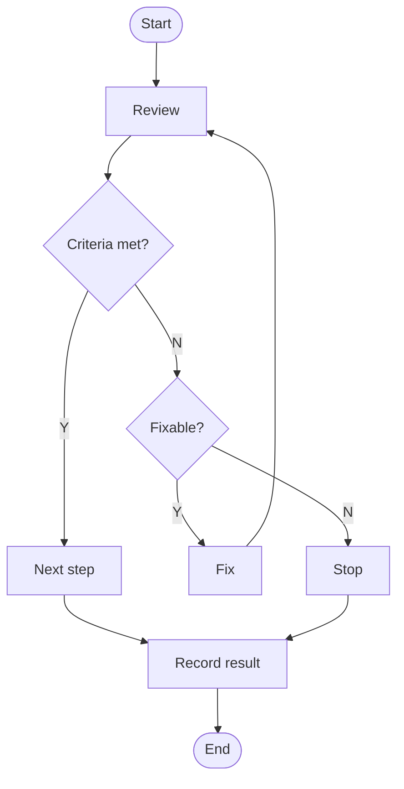
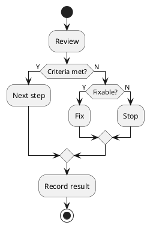
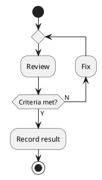
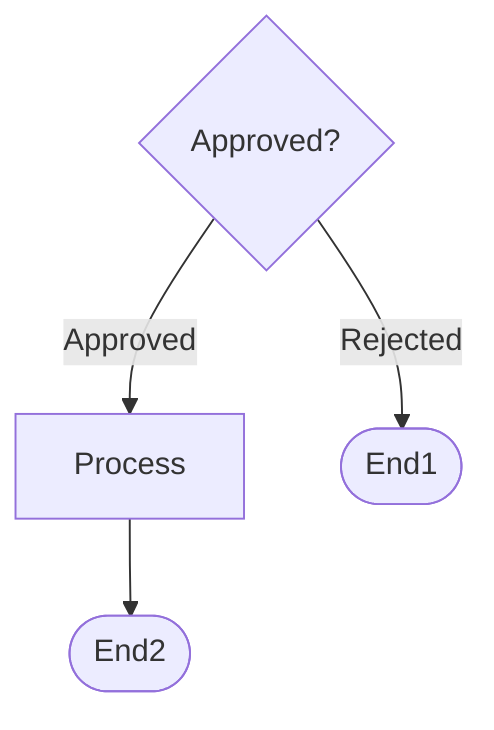
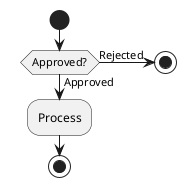

# Code-based diagrams

Draw business processes and system structures as Mermaid or PlantUML code. These rules assume planning and consulting work. Shared rules for color and patterns to avoid follow visual.md.

## Rules that must hold

If any of these rules is broken, stop and regenerate.

- (Branch outputs) Exactly two lines leave each decision node (diamond). Use only Y and N as line labels. Do not use natural-language labels such as Approved, Rejected, Pass, Return, Yes, No, Success, or Fail.
- (Single entry and single exit) There is exactly one start node and exactly one end node. Every path converges on the single end node.
- (Faithful to input) Use only information in the user's input. Do not create nodes or relationships that are not in the input. If the input is unclear, hold off on generating and ask.

## Choosing the tool

| Diagram | Recommended tool | Basis |
|---------|------------------|-------|
| Flowchart, business process | Mermaid, PlantUML | Mermaid for simple branching, PlantUML for complex branching |
| Sequence | Mermaid, PlantUML | Mermaid for simple interactions, PlantUML for detailed messages |
| ER | Mermaid | Table relationships |
| Mind map | Mermaid | Structuring ideas |
| Gantt | Mermaid | Project schedules |
| Class, component | PlantUML | When UML compliance is needed |
| State | PlantUML | Complex state transitions |

- Do not mix Mermaid and PlantUML syntax in one diagram.

## Mermaid flowchart symbols

| Symbol | Syntax | Use | Outgoing lines |
|--------|--------|-----|----------------|
| Stadium | `([text])` | Start and end | 1 for start, 0 for end |
| Rectangle | `[text]` | Normal process | 1 |
| Diamond | `{text?}` | Decision | 2 (Y, N) |
| Rounded rectangle | `(text)` | Subprocess | 1 |
| Line label | `-->\|Y\|`, `-->\|N\|` | Branch direction | - |

## PlantUML activity diagram symbols

| Symbol | Syntax | Use | Outgoing lines |
|--------|--------|-----|----------------|
| Start | `start` | Start point | 1 |
| End | `stop` | End point | 0 |
| Process | `:text;` | Normal task | 1 |
| Branch start | `if (condition?) then (Y)` | Decision | 2 (Y, N) |
| Branch N | `else (N)` | N path | - |
| Branch end | `endif` | Closes the branch block | - |
| Repeat | `repeat` ... `backward :text;` ... `repeat while (condition?) is (N) not (Y)` | Flow that returns | 2 (Y, N) |
| Parallel | `fork` ... `fork again` ... `end fork` | Concurrent work | - |

PlantUML activity diagrams are block-structured, so they cannot draw a line back to an arbitrary node. Express flows that return with a `repeat` block, and branching flows with nested `if` blocks. The merge diamonds PlantUML draws on its own at the end of a branch block are not decision nodes, so the Y and N label rule does not apply to them.

Branch example:

Repeat example:

## Wrong examples

The natural-language labels ("Approved", "Rejected") and the multiple end nodes break the rules.

The natural-language labels ("Approved", "Rejected") and the multiple `stop` nodes break the rules.

## Turning natural language into Y and N

Convert natural-language branches in the user's input into Y and N questions before writing code.

| Natural language | Conversion |
|------------------|------------|
| pass, fail | Pass? Y, N |
| approve, reject | Approved? Y, N |
| met, not met | Met? Y, N |
| possible, impossible | Possible? Y, N |
| success, failure | Succeeded? Y, N |
| exists, does not exist | Exists? Y, N |

With three or more branches, split them by chaining decision nodes. The input "pass if the criteria are met, fix if a fix is needed, stop if the criteria are not met" becomes:

- First decision: Criteria met? Y leads to pass, N leads to the second decision
- Second decision: Fixable? Y leads to fix, N leads to stop

## Structural principles

- Classify elements without overlap and without gaps. If the classification criterion is unclear, confirm with the user before proceeding.
- Keep one process level within a diagram. Do not mix the levels below.

| Level | Name | Description |
|-------|------|-------------|
| L1 | Value chain | Activity flow of the whole company |
| L2 | Process group | Major business areas |
| L3 | Unit process | Individual work procedures |
| L4 | Task | Detailed work units |

## Procedure

- (Analyze input) Extract elements, relationships, and branch conditions. If anything is unclear, hold off and ask. Choose the tool.
- (Y and N table) Convert every branch into a Y and N question, and design three or more branches as chained decisions.
- (Check before generating) Confirm that every decision node has two outgoing lines, every branch label is Y or N, there is exactly one start node and one end node, and the syntax of the chosen tool is followed.
- (Generate code) Write in the chosen tool's syntax and symbol standard.
- (Pattern check) Test the generated code against the criteria below and regenerate if any fails.
- (Deliver) Provide Mermaid as a .mmd or .md file and PlantUML as a .puml or .plantuml file. In an environment that can render, check the rendered result and provide it together with the code.

Mermaid checks:

- A branch label other than `-->|Y|` or `-->|N|` exists
- Three or more lines leave one decision node
- The number of `([` nodes is not exactly 2 (one start, one end)

PlantUML checks:

- A branch label other than `then (Y)`, `else (N)`, or `is (N) not (Y)` exists
- There are two or more `start` or `stop`
- A missing `endif` leaves a branch block unclosed
- Rendering produces a syntax error message

## When to ask before generating

Ask before generating if any of the following is missing:

- The list of elements to include
- The relationships and order between elements
- Branch conditions that can be phrased as Y and N
- The start and end points
- The preferred tool (Mermaid, PlantUML)
