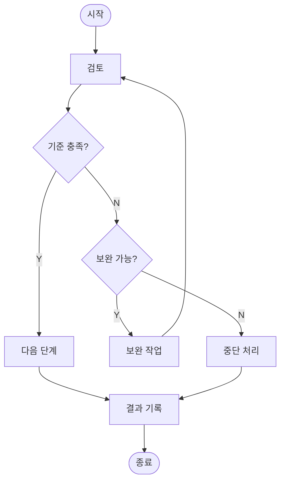
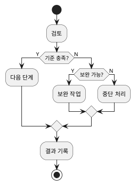
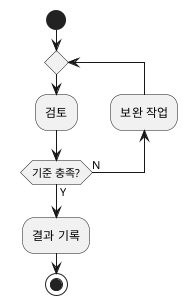
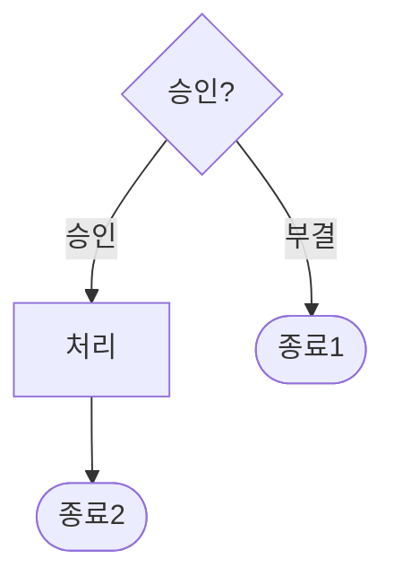
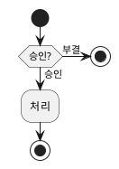

# 코드형 다이어그램

업무 프로세스와 시스템 구조를 Mermaid나 PlantUML 코드로 그린다. 기획과 컨설팅 업무 지원을 기준으로 적었다. 색과 피할 패턴의 공통 규칙은 visual.md를 따른다.

## 반드시 지킬 규칙

아래 규칙을 어기면 생성을 멈추고 다시 만든다.

- (분기 출력) 분기 노드(마름모) 하나에서 나가는 선은 정확히 2개다. 선 레이블은 Y와 N만 쓴다. 승인, 부결, 통과, 반려, Yes, No, 성공, 실패 같은 자연어 레이블은 쓰지 않는다.
- (단일 진입과 단일 종료) 시작 노드와 종료 노드는 각각 정확히 1개다. 모든 경로는 하나의 종료 노드로 모인다.
- (입력 충실) 사용자 입력에 있는 정보만 쓴다. 입력에 없는 노드와 관계를 만들지 않는다. 입력이 불명확하면 생성을 미루고 질문한다.

## 도구 고르기

| 다이어그램 | 권장 도구 | 선택 기준 |
|-----------|-----------|-----------|
| 순서도, 업무 프로세스 | Mermaid, PlantUML | 분기가 단순하면 Mermaid, 복잡하면 PlantUML |
| 시퀀스 | Mermaid, PlantUML | 상호작용이 간단하면 Mermaid, 메시지가 상세하면 PlantUML |
| ER | Mermaid | 테이블 관계 표현 |
| 마인드맵 | Mermaid | 아이디어 구조화 |
| 간트 | Mermaid | 프로젝트 일정 |
| 클래스, 컴포넌트 | PlantUML | UML 표준 준수가 필요할 때 |
| 상태 | PlantUML | 복잡한 상태 전이 |

- 한 다이어그램 안에서 Mermaid와 PlantUML 문법을 섞지 않는다.

## Mermaid 순서도 기호

| 기호 | 문법 | 용도 | 나가는 선 |
|------|------|------|-----------|
| 타원 | `([텍스트])` | 시작과 종료 | 시작 1개, 종료 0개 |
| 직사각형 | `[텍스트]` | 일반 처리 | 1개 |
| 마름모 | `{텍스트?}` | 분기 판단 | 2개(Y, N) |
| 둥근 직사각형 | `(텍스트)` | 하위 프로세스 | 1개 |
| 선 레이블 | `-->\|Y\|`, `-->\|N\|` | 분기 방향 | - |

## PlantUML 활동 다이어그램 기호

| 기호 | 문법 | 용도 | 나가는 선 |
|------|------|------|-----------|
| 시작 | `start` | 시작점 | 1개 |
| 종료 | `stop` | 종료점 | 0개 |
| 처리 | `:텍스트;` | 일반 작업 | 1개 |
| 분기 시작 | `if (조건?) then (Y)` | 분기 판단 | 2개(Y, N) |
| 분기 N | `else (N)` | N 경로 | - |
| 분기 종료 | `endif` | 분기 블록 닫기 | - |
| 반복 | `repeat` ... `backward :텍스트;` ... `repeat while (조건?) is (N) not (Y)` | 되돌아가는 흐름 | 2개(Y, N) |
| 병렬 | `fork` ... `fork again` ... `end fork` | 동시 처리 | - |

PlantUML 활동 다이어그램은 블록 구조라서 임의의 노드로 되돌아가는 선을 그릴 수 없다. 되돌아가는 흐름은 `repeat` 블록으로 표현하고, 분기 흐름은 `if` 블록을 중첩해 표현한다. PlantUML이 분기 블록 끝에 자동으로 그리는 합류 마름모는 분기 노드가 아니므로 Y, N 레이블 규칙을 적용하지 않는다.

분기 예시다.

반복 예시다.

## 잘못된 예시

자연어 레이블("승인", "부결")과 여러 개의 종료 노드가 규칙에 어긋난다.

자연어 레이블("승인", "부결")과 여러 개의 `stop`이 규칙에 어긋난다.

## 자연어를 Y, N으로 바꾸기

사용자 입력의 자연어 분기는 Y, N 질문으로 바꾼 뒤 코드를 만든다.

| 자연어 | 변환 |
|--------|------|
| 통과, 불합격 | 통과? Y, N |
| 승인, 부결 | 승인? Y, N |
| 충족, 미충족 | 충족? Y, N |
| 가능, 불가 | 가능? Y, N |
| 성공, 실패 | 성공? Y, N |
| 존재, 미존재 | 존재? Y, N |

분기가 3개 이상이면 분기 노드를 이어 붙여 나눈다. "기준을 충족하면 통과, 보완이 필요하면 보완, 기준에 못 미치면 중단"이라는 입력은 아래처럼 바꾼다.

- 1차 분기: 기준 충족? Y이면 통과, N이면 2차 분기
- 2차 분기: 보완 가능? Y이면 보완, N이면 중단

## 구조 원칙

- 요소는 겹치지 않고 빠짐없이 분류한다. 분류 기준이 모호하면 사용자에게 확인한 뒤 진행한다.
- 한 다이어그램 안에서는 프로세스 수준을 하나로 통일한다. 아래 수준을 섞지 않는다.

| 수준 | 이름 | 설명 |
|------|------|------|
| L1 | 가치사슬 | 기업 전체의 활동 흐름 |
| L2 | 프로세스 그룹 | 주요 업무 영역 |
| L3 | 단위 프로세스 | 개별 업무 절차 |
| L4 | 태스크 | 세부 작업 단위 |

## 작업 절차

- (입력 분석) 요소, 관계, 분기 조건을 뽑는다. 불명확하면 생성을 미루고 질문한다. 도구를 고른다.
- (Y, N 변환표) 모든 분기를 Y, N 질문으로 바꾸고 3개 이상 분기는 분기를 이어 붙인 구조로 설계한다.
- (생성 전 확인) 모든 분기 노드의 나가는 선이 2개인가, 모든 분기 레이블이 Y와 N인가, 시작 노드와 종료 노드가 각각 1개인가, 고른 도구의 문법을 지키는가를 확인한다.
- (코드 생성) 고른 도구의 문법과 기호 표준을 지켜 작성한다.
- (패턴 검증) 생성한 코드를 아래 기준으로 검사하고 하나라도 걸리면 다시 만든다.
- (결과 제시) Mermaid는 .mmd나 .md 파일로, PlantUML은 .puml이나 .plantuml 파일로 제공한다. 렌더링할 수 있는 환경에서는 코드와 렌더링 결과를 함께 확인해 제공한다.

Mermaid 검증 기준:

- `-->|Y|`, `-->|N|` 외의 분기 레이블이 있다
- 분기 노드 하나에서 선이 3개 이상 나간다
- `([` 노드가 정확히 2개(시작 1개, 종료 1개)가 아니다

PlantUML 검증 기준:

- `then (Y)`, `else (N)`, `is (N) not (Y)` 외의 분기 레이블이 있다
- `start`나 `stop`이 2개 이상이다
- `endif`가 빠져 분기 블록이 닫히지 않았다
- 렌더링했을 때 문법 오류 메시지가 나온다

## 생성 전 질문 기준

아래 항목이 부족하면 생성하기 전에 질문한다.

- 포함할 요소 목록
- 요소 사이의 관계와 순서
- Y, N 형태로 바꿀 수 있는 분기 조건
- 시작점과 종료점
- 선호하는 도구(Mermaid, PlantUML)
