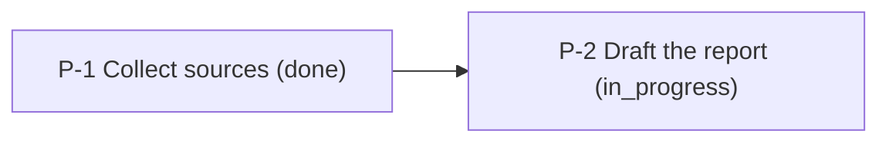
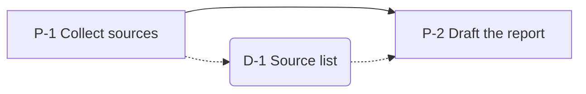

# long-task-ledger

> This skill is an English translation of the Korean original. Differences in wording may make it behave differently from what the original intends.

An agent on a long task loses track of earlier requirements as the conversation grows. When a new session starts, the earlier conversation is gone. Agents also report unfinished work as done, or change the pass criteria after seeing the result.

This skill keeps the task state in a file the agent can re-read at any point. Pass criteria are written before execution and stay fixed during checks. Each process moves on only after passing a check that can produce a real failure, such as running a test or confirming a file.

The skill sets the working order and the record format. It does not raise the model's reasoning ability.

## When to use

Use this skill when:

- the user calls this skill by name or asks for progress tracking, step-by-step verification, or a session handoff
- the user attaches a session_state.json from an earlier session
- the work spans multiple files, sources, or sessions

Skip it for tasks with one obvious approach that finish in a single pass. On such tasks the records grow longer than the result.

## Terms

The terms below carry only the meanings in this table.

| Term | Meaning |
|---|---|
| Task | The whole job the user asked for |
| Process | A unit of execution within the task. IDs follow the pattern P-1, P-2 |
| Deliverable | A result a process produces. IDs follow the pattern D-1, D-2 |
| File deliverable | A deliverable saved as a file on disk |
| Record deliverable | A deliverable stored as text inside the state file, such as a decision or a summary of search results |
| State file | The session_state.json file that holds the full task state |
| Criteria | Pass conditions written for a process before it runs |
| Failable check | A check against the output or an external fact that can return a real failure |
| Check table | A table with one row per process and one column per check item |
| Warning | A minor concern, recorded apart from the check table cells, that could affect the result |
| Blocked | A state in which the agent cannot advance a process on its own. The conditions are under Handling a blocked process |

## Principles

These principles apply to every procedure in this skill.

- Re-read the state file before starting each process. Models make poor use of information in the middle of long inputs, and a new session cannot see the earlier conversation.
- Write the criteria for every process before execution and leave them unchanged during checks. Criteria written after seeing a result tend to fit that result.
- Every check must be able to fail. Running tests, confirming that a file exists in the expected format, opening and reading a source, and comparing the output against the spec all qualify. A model that reads its own output and judges it fine catches few errors.
- Mark a criterion as unverified when no failable check is possible, and keep that mark through the handoff.
- Keep one process in progress at a time. Move to the next process only after the current one passes its check. This prevents batch approval of several processes and catches errors before rework piles up.
- Continue a started process until it passes or you report it as blocked. Do not skip it or mark it as passed on your own.
- Every process leaves at least one deliverable. A process without a deliverable cannot pass. The next process and the next session use these deliverables as input.
- Before reporting a problem, confirm that it exists by running, comparing, or checking the source. Failing to find evidence is not by itself a reason to report a problem.

## State file

The state file is always named session_state.json. Place it at the top of the task folder, or where the user specifies.

- Write file paths relative to the folder that holds the state file, so checks keep working after the folder moves to another computer.
- Save the file as UTF-8.
- Write times in ISO 8601 format, for example 2026-01-15T09:30:00+09:00.
- Use only three process status values: pending, in_progress, done.
- Do not store the check table in the state file. Build it from processes, deliverables, and check_log each time you report.

The example below holds the required fields. Add any fields the task needs.

```json
{
  "meta": {
    "session_id": "market-scan-01",
    "created_at": "2026-01-15T09:30:00+09:00",
    "updated_at": "2026-01-15T11:05:00+09:00",
    "check_mode": "python"
  },
  "request": {
    "original": "The request exactly as the user sent it",
    "goal": "The interpreted goal",
    "scope": "What is in scope and what is out of scope",
    "done_criteria": ["Every research item listed in the request appears in the final report's table of contents"]
  },
  "processes": [
    {
      "id": "P-1",
      "name": "Collect sources",
      "source": "user",
      "depends_on": [],
      "expected_output": "Source list file",
      "status": "done",
      "started_at": "2026-01-15T09:40:00+09:00",
      "finished_at": "2026-01-15T10:20:00+09:00",
      "criteria": {
        "text": "work/sources.md lists at least 5 sources with URLs",
        "verifiable": true,
        "code": "def check(state, base):\n    lines = (base / 'work/sources.md').read_text(encoding='utf-8').splitlines()\n    return sum('https://' in line for line in lines) >= 5"
      }
    },
    {
      "id": "P-2",
      "name": "Draft the report",
      "source": "agent",
      "depends_on": ["P-1"],
      "expected_output": "Report draft file",
      "status": "pending",
      "criteria": {
        "text": "out/report.md has a conclusion section",
        "verifiable": true,
        "code": "def check(state, base):\n    return '## Conclusion' in (base / 'out/report.md').read_text(encoding='utf-8')"
      }
    }
  ],
  "deliverables": [
    {"id": "D-1", "kind": "file", "path": "work/sources.md", "made_by": "P-1", "used_by": ["P-2"]},
    {"id": "D-2", "kind": "record", "content": "Decided to limit the research period to the last 5 years", "made_by": "P-1", "used_by": []}
  ],
  "check_log": [
    {"process": "P-1", "type": "check", "at": "2026-01-15T10:21:00+09:00",
     "cells": {"status": "done", "deliverables": "O", "order": "O", "requirement": "O", "prerequisites": "N/A"}, "result": "PASS"}
  ],
  "warnings": [],
  "session_log": [
    {"at": "2026-01-15T10:05:00+09:00", "event": "Limited the research period to the last 5 years", "why": "The request compares a 5-year period"}
  ]
}
```

| Field | Contents |
|---|---|
| meta | Session ID, creation time, last update time, check mode (python or llm) |
| request | Original request, interpreted goal, what is in and out of scope, done criteria |
| processes | For each process: name, source (user when the user gave it, agent when the agent defined it), prerequisite processes, expected deliverable, status, start time, finish time, criteria |
| deliverables | For each deliverable: kind (file or record), path or content, the process that made it, the processes that used it as input |
| check_log | One entry per check with the check table row and the result |
| warnings | Warning text, time recorded, status (open or reported) |
| session_log | Events in time order. Record decisions, their reasons, and approaches that were tried and failed |

### Managing the state file

- If the user asks to start over, copy the existing file to a name with a colon-free timestamp, such as session_state.backup-20260115T093000.json, then create a new file.
- If the state file cannot be read as JSON, restore it from a backup. If no backup exists, tell the user and create a new file.
- When you take over a state file that was not created in this session and it uses Python mode, show the user the stored criteria functions and get confirmation before running them. Code in the state file runs as-is on the user's computer.

## Check table

Each check fills one row of the check table. The pass condition for each cell is below. These conditions apply to every process in the same way. The only criterion written per process is the one for the Requirement cell.

| Cell | Pass condition |
|---|---|
| Status | The process status is done |
| Deliverables | At least one deliverable made by this process is registered. Each file deliverable exists as a file, and each record deliverable has non-empty content |
| Order | No process is in_progress. The target is the only done process that has no check record or whose last check result is FAIL. Every process listed before the target is done |
| Requirement | The process meets the criteria written for it during planning |
| Prerequisites | Each prerequisite process has PASS as its last check result, and its deliverables meet the Deliverables condition. N/A when there are no prerequisites |
| Result | PASS when all five cells above pass (done, O, or N/A). FAIL when any cell is X |

Mark cells with O for pass, X for fail, N/A for not applicable, and - for not yet checked.

Step 4 of the execution procedure sets the target process to done, so no process should be in_progress at step 5. If the Order cell fails, stop the check and follow the order violation procedure.

The check table below shows the state after P-2 is checked.

| Process | Status | Deliverables | Order | Requirement | Prerequisites | Result |
|---|---|---|---|---|---|---|
| P-1 | done | O | O | O | N/A | PASS |
| P-2 | done | O | O | O | O | PASS |
| P-3 | in_progress | - | - | - | - | - |

## Check modes

The two modes differ in how the Requirement cell is judged.

| Mode | Written during planning | Done at execution step 5 |
|---|---|---|
| Python mode | Criteria text (criteria.text) and a criteria function (criteria.code) | Run the check code below without changes and enter its results in the cells |
| LLM mode | Criteria text (criteria.text) | The agent inspects the deliverables and the disk and fills the cells according to the criteria text |

- Ask the user for a mode when starting a new session. In an environment that cannot run code, set LLM mode and tell the user.
- Record the chosen mode in meta.check_mode. When you take over a state file, keep the recorded mode.
- If the user switches modes midway, apply the new mode to processes registered after the switch. Processes already registered keep the mode used when their criteria were written.
- In both modes, the Deliverables and Prerequisites cells confirm both the registration and the file on disk.
- In LLM mode, check the Order cell first as well. If it fails, leave the other cells empty.
- Write criteria as conditions someone can confirm. Examples: "The report has a conclusion section" and "session_log records that every URL cited in the body was opened and read during this task." A sentence that leaves only a judgment call, such as "The content is thorough," does not qualify as a criterion.
- Set criteria.verifiable to false for a criterion that cannot be written as a confirmable condition. Mark any deliverable that passed under such a criterion as unverified in reports and in the handoff summary.

### Python mode check code

Save the code below as check_process.py in the folder that holds the state file. It uses the standard library only.

- Run a check with `python check_process.py session_state.json P-2`.
- Run a recheck with `python check_process.py session_state.json P-1 --recheck`.
- Exit code 0 means PASS, 1 means FAIL, and 2 means the check stopped on an order violation.
- Append the printed JSON line to check_log as-is. If the check stopped, leave check_log unchanged and follow the order violation procedure.

Define the criteria function in criteria.code with the name `check(state, base)`. state is the whole state file, and base is the folder holding the state file as a pathlib.Path. Return True when the criteria are met. If the function raises an error, the Requirement cell becomes X.

```python
"""Computes one row of the check table. Usage: python check_process.py <state file> <process ID> [--recheck]"""
import json
import sys
from datetime import datetime
from pathlib import Path

PASS, FAIL = "PASS", "FAIL"
EXIT_PASS, EXIT_FAIL, EXIT_STOPPED = 0, 1, 2


def last_result(state, pid):
    results = [c["result"] for c in state["check_log"] if c["process"] == pid]
    return results[-1] if results else None


def deliverables_ok(state, pid, base):
    items = [d for d in state["deliverables"] if d["made_by"] == pid]
    if not items:
        return False
    for item in items:
        if item.get("path"):
            if not (base / item["path"]).is_file():
                return False
        elif not str(item.get("content", "")).strip():
            return False
    return True


def order_problems(state, pid):
    procs = state["processes"]
    ids = [p["id"] for p in procs]
    problems = []
    running = [p["id"] for p in procs if p["status"] == "in_progress"]
    if running:
        problems.append(f"processes in_progress: {running}")
    waiting = [p["id"] for p in procs
               if p["status"] == "done" and last_result(state, p["id"]) != PASS]
    if waiting != [pid]:
        problems.append(f"processes awaiting a check are not only the target: {waiting}")
    not_done = [p["id"] for p in procs[:ids.index(pid)] if p["status"] != "done"]
    if not_done:
        problems.append(f"earlier processes not done: {not_done}")
    return problems


def prerequisites_ok(state, proc, base):
    deps = proc.get("depends_on", [])
    if not deps:
        return None
    return all(last_result(state, d) == PASS and deliverables_ok(state, d, base)
               for d in deps)


def requirement_ok(state, proc, base):
    scope = {}
    try:
        exec(proc["criteria"]["code"], scope)
        return bool(scope["check"](state, base))
    except Exception as error:  # a criteria function that raises an error marks the requirement cell X
        print(f"requirement check error: {error!r}", file=sys.stderr)
        return False


def mark(value):
    return {True: "O", False: "X", None: "N/A"}[value]


def evaluate(state_path, pid, recheck=False):
    state = json.loads(Path(state_path).read_text(encoding="utf-8"))
    base = Path(state_path).resolve().parent
    proc = next(p for p in state["processes"] if p["id"] == pid)
    if not recheck:
        problems = order_problems(state, pid)
        if problems:
            return {"process": pid, "stopped": problems}
    cells = {
        "status": proc["status"],
        "deliverables": mark(deliverables_ok(state, pid, base)),
        "order": mark(None if recheck else True),
        "requirement": mark(requirement_ok(state, proc, base)),
        "prerequisites": mark(prerequisites_ok(state, proc, base)),
    }
    passed = cells["status"] == "done" and "X" not in cells.values()
    return {
        "process": pid,
        "type": "recheck" if recheck else "check",
        "at": datetime.now().astimezone().isoformat(timespec="seconds"),
        "cells": cells,
        "result": PASS if passed else FAIL,
    }


if __name__ == "__main__":
    args = [a for a in sys.argv[1:] if a != "--recheck"]
    entry = evaluate(args[0], args[1], recheck="--recheck" in sys.argv)
    print(json.dumps(entry, ensure_ascii=False))
    if "stopped" in entry:
        sys.exit(EXIT_STOPPED)
    sys.exit(EXIT_PASS if entry["result"] == PASS else EXIT_FAIL)
```

## Procedure 1: Start

- Look for session_state.json among the files the user attached, the task folder, and the outputs of earlier sessions.
- If you find one, load it and report the last state, the check mode, and the remaining processes. Then continue from the remaining processes.
- If there is none, set the check mode, create a new state file, and fill in meta and request.
- In request.done_criteria, write conditions that confirm the whole task is finished, such as "Every research item listed in the request appears in the final report's table of contents."

## Procedure 2: Plan

Split the task into processes and write all criteria before execution.

- If the user gave a list of processes, register every one as given. Do not merge, edit, or drop any of them on your own. Ask the user when something is ambiguous or missing.
- If the user gave no list, define every process needed to reach the goal. Do not cut necessary processes to make the plan simpler.
- For each process, record a name, the expected deliverable, prerequisite processes, and the source. Keep the list order equal to the execution order.
- Each process produces at least one deliverable or decision. Merge any agent-defined process that has nothing to check into the next process.
- Write the Requirement criteria for each process. Python mode needs the criteria text and a criteria function. LLM mode needs the criteria text. See Check examples by work type.
- Create a check table with a row for each process and empty cells.
- Show the user the process list, the prerequisites, and the criteria together. Save the state file after the user confirms.

### Plan changes

When something learned during the work makes the plan wrong, revise the plan.

- Write criteria for any new or changed process before it runs.
- Record each change and its reason in session_log.
- Get user confirmation before dropping or merging a process the user gave.
- Get user confirmation before changing the criteria of a process that has already started.
- If a check shows that the criteria are not enough to decide, ask the user to strengthen them. Redo execution step 5 with the strengthened criteria.

## Procedure 3: Execute

Take each process through the five steps below in order. Only one process goes through these steps at a time.

| Step | Action |
|---|---|
| 1. Prepare | Re-read the state file. Review the request, the done criteria, and this process's criteria. If the process has prerequisites, re-read their deliverables |
| 2. Record start | Set the status to in_progress, record the start time, and save |
| 3. Work | Do the work of the process, using prerequisite deliverables as input |
| 4. Record result | Register the deliverables in deliverables with this process ID in made_by. Add this process ID to used_by of each prerequisite deliverable used as input if it is not there yet. Set the status to done, record the finish time, and save |
| 5. Check | Apply the criteria written during planning without changes and fill this process's row of the check table. Append the result to check_log and save |

- If a prerequisite deliverable is unregistered or its file is missing at step 1, stop before step 3 and report to the user.
- If step 5 returns PASS, move to the next process. Do not start the next process before confirming PASS.
- If you find a passed process with no registered deliverable, report it as an error. This error surfaces in the Prerequisites cell of a later process or in the full review during handoff.

### Handling FAIL

If step 5 returns FAIL, handle it in this order.

1. Report the X cells and their reasons to the user.
2. Set the process status back to in_progress.
3. Remove the deliverables this process registered from deliverables and note the removal in session_log. Leave the files in place and revise them in the next attempt.
4. Write in session_log what you will change in the next attempt before starting it. If you cannot name a change, go to Handling a blocked process.
5. Keep the criteria as they are and restart from step 3.
6. Repeat until the result is PASS.

### Handling order violations

If the Order cell fails, stop the check and handle it as follows.

- Report the broken condition to the user.
- Correct the wrong state, then run the check again. If several processes were set to done in a batch, keep only the earliest unchecked one in the list as done and set the rest back to pending. Remove the deliverables registered by the processes you set back.
- If the same violation occurs a second time, ask the user how to correct it.

### Rechecks

While working on a later process, you may need to revise a deliverable of an earlier process that already passed. A change made later may also make an earlier deliverable wrong.

- When this happens, recheck the earlier process right away against its original criteria and record it in check_log with type set to recheck. A recheck sets the Order cell to N/A.
- If the recheck fails, revise that deliverable again and repeat until the recheck passes. While a failed recheck remains, the current process's check stops at the Order cell.
- If you cannot name a fix, go to Handling a blocked process.

## Procedure 4: Handoff

When all processes are finished, or the user asks for a handoff or to stop, do the following in order.

- Confirm that every done process has PASS as its last check result.
- Confirm that the PASS records with type check in check_log follow the process list order with no gaps.
- Confirm that every passed process has at least one registered deliverable that exists.
- If any process fails these confirmations, report it to the user, correct it, then continue the handoff.
- When all processes are finished, confirm each item in request.done_criteria and list any unmet item in the report.
- When delivering the final output, re-read it as a skeptical reviewer and look for a real weakness. Fix it or tell the user. If you find none, say so. Do not invent a weakness to fill the slot.
- Update meta.updated_at and save the state file.
- Deliver the state file to a location the user can reach.
- Write a handoff summary in Markdown with the task goal, the check mode, the remaining processes, the deliverable list, unverified items, and open warnings.
- Tell the user that calling this skill in the next session and attaching the state file resumes the work from the remaining processes.

## Check examples by work type

Use these when writing criteria during planning.

| Work type | Do first | Example of a failable check |
|---|---|---|
| Software development | Read the relevant code in full before editing. For large changes, write down what will change first. Write tests before or alongside the implementation | Tests run and pass. Both the normal path and the error paths run |
| Research and report writing | Gather sources before writing. For each important claim, write its evidence and what would prove it wrong. Separate confirmed facts from inferences and label inferences as inferences | Every claim that supports a conclusion has a source opened and read during this task |
| Data analysis | Check the shape of the data first. Write the hypothesis before computing. Check missing values, duplicates, and outliers first | Data quality checks run against the actual data and pass |

## Managing warnings

- When a minor concern that could affect the result comes up, add it to warnings with status open.
- Record only concerns you have confirmed, as the principles require.
- When open warnings reach three, stop and report all three to the user at once. Several small concerns may share one cause, so the user decides how to proceed.
- Change reported warnings to reported. Report again when new open warnings reach three.

## Bulk replacement

Follow these rules when replacing strings across files.

- Anchor replacements on word boundaries. Without boundaries, replacing cat with dog turns category into dogegory.
- Word-boundary syntax differs by tool. GNU sed and grep use \b, and BSD sed, including the one on macOS, uses [[:<:]] and [[:>:]]. Unsupported syntax can exit with success while changing nothing.
- After replacing, confirm the number of changes and search for glued or broken words.

## Handling a blocked process

Treat the process as blocked in these cases:

- after a FAIL, you cannot name what to change in the next attempt
- a prerequisite deliverable is missing, so step 3 cannot start
- you cannot name a fix for a failed recheck
- the work appears to be beyond the model's ability

When blocked, report what you tried and where you got stuck. Then follow the user's instructions to retry or redefine the process. Do not skip a blocked process or mark it as passed. Do not fill work beyond the model's ability with plausible guesses.

## Reporting

Report to the user at each point below.

| Point | Report |
|---|---|
| Start | Whether the state file is new or taken over, the check mode, the interpreted goal, the last state |
| Plan | Process list, prerequisites, criteria summary |
| Process complete | Deliverables produced, check table row |
| FAIL | X cells and reasons, what changes in the next attempt |
| Order violation | Broken condition, how to correct it |
| Missing prerequisite deliverable | The missing deliverable and its process |
| Missing deliverable of a passed process | The process and the missing deliverable |
| Warning threshold | All open warnings and the evidence for each |
| Handoff | Results of the full review, state file location, how to start the next session |

Use tables or short lists. Leave out sentences that explain this skill's rules. When reporting a problem, include the evidence you confirmed, such as command output, file paths, or the location in the source.

## Visualization

Create visualizations only when the user asks. If the user does not ask, do not mention the feature. When asked, read the state file and produce all of the following together.

- A process flow diagram that draws processes and prerequisites as a Mermaid flowchart
- A deliverable flow diagram that draws processes, deliverables, creation links, and usage links as a Mermaid flowchart
- The check table as a Markdown table

Follow these drawing rules.

- Use no colors. Keep Mermaid's default style without classDef or subgraph.
- Draw processes as rectangles and deliverables as rounded rectangles.
- Label each node with its ID and name. In the process flow diagram, add the status to each node label.
- Draw prerequisite links as solid arrows. Draw creation links from a process to a deliverable and usage links from a deliverable to a later process as dotted arrows.
- Order the check table rows by the process list, and order the columns as Process, Status, Deliverables, Order, Requirement, Prerequisites, Result.





## Using with other skills

- Register results produced by other skills as deliverables and put the relevant process ID in made_by.
- When another skill defines a work sequence, split that sequence into processes, register them, and write their criteria first.
