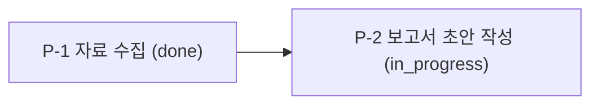
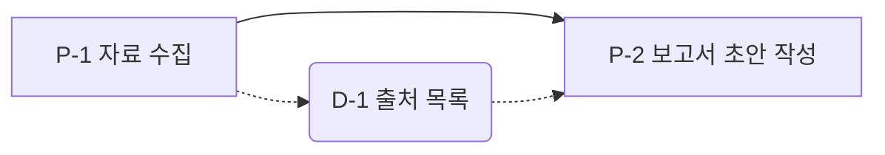

# long-task-ledger

긴 작업을 하는 에이전트는 대화가 길어질수록 앞에서 받은 요구사항을 놓치기 쉽다. 세션이 바뀌면 이전 대화는 아예 남지 않는다. 끝나지 않은 일을 끝났다고 보고하거나 결과를 본 뒤 그 결과에 맞춰 합격 기준을 바꾸는 일도 생긴다.

이 스킬은 작업 상태를 파일에 남겨 에이전트가 언제든 다시 읽게 한다. 합격 기준은 실행 전에 적어 두고 점검할 때 바꾸지 않는다. 각 프로세스는 테스트 실행이나 파일 확인처럼 불합격이 실제로 나올 수 있는 점검을 통과해야 다음으로 넘어간다.

이 스킬은 일하는 순서와 기록 방식을 정한다. 모델의 추론 능력 자체를 높이지는 않는다.

## 사용 조건

다음 경우에 사용한다.

- 사용자가 이 스킬을 직접 부르거나 진행 기록, 단계별 검증, 세션 인계를 요청한 경우
- 사용자가 이전 세션의 session_state.json을 첨부한 경우
- 작업이 여러 파일, 여러 출처, 여러 세션에 걸치는 경우

접근 방법이 하나로 분명하고 한 번에 끝나는 작업에는 사용하지 않는다. 이런 작업에 이 절차를 적용하면 결과보다 기록이 길어진다.

## 용어

아래 용어는 표의 뜻으로만 쓴다.

| 용어 | 뜻 |
|---|---|
| 작업 | 사용자가 요청한 일 전체 |
| 프로세스 | 작업을 나눈 실행 단위. ID는 P-1, P-2처럼 붙인다 |
| 산출물 | 프로세스가 만든 결과. ID는 D-1, D-2처럼 붙인다 |
| 파일 산출물 | 디스크에 파일로 남는 산출물 |
| 기록 산출물 | 결정 사항이나 검색 결과 요약처럼 상태 파일 안에 글로 남기는 산출물 |
| 상태 파일 | 작업의 모든 상태를 담는 session_state.json 파일 |
| 점검 기준 | 프로세스를 실행하기 전에 적어 두는 합격 조건 |
| 실패할 수 있는 점검 | 결과물이나 외부 사실과 대조해서 불합격이 실제로 나올 수 있는 점검 |
| 점검표 | 행은 프로세스, 열은 점검 항목인 표 |
| 경고 | 점검표 칸 판정과 별도로 기록하는, 결과에 영향을 줄 수 있는 작은 우려 |
| 막힘 | 에이전트 혼자서는 프로세스를 더 진행할 수 없는 상태. 판정 조건은 막힘 처리 절에 있다 |

## 원칙

아래 원칙은 이 스킬의 모든 절차에 적용된다.

- 매 프로세스를 시작하기 전에 상태 파일을 다시 읽는다. 모델은 긴 입력의 중간에 있는 정보를 잘 활용하지 못하고 세션이 바뀌면 이전 대화를 볼 수 없다.
- 모든 프로세스의 점검 기준을 실행 전에 적고 점검할 때 고치지 않는다. 결과를 본 뒤에 쓴 기준은 결과에 맞춰지기 쉽다.
- 점검은 실패할 수 있어야 한다. 테스트 실행, 파일의 존재와 형식 확인, 출처를 실제로 열어 읽기, 결과물을 요구 명세와 비교하기가 여기에 해당한다. 모델이 자기 결과를 읽고 괜찮다고 판단하는 방식은 오류를 잘 걸러내지 못한다.
- 실패할 수 있는 점검을 만들 수 없는 기준은 미검증으로 표시하고 인계할 때까지 그 표시를 유지한다.
- 진행 중인 프로세스는 한 번에 하나만 둔다. 점검을 통과해야 다음 프로세스로 넘어간다. 여러 프로세스를 몰아서 합격 처리하는 일을 막고 오류가 늦게 발견되어 되돌릴 작업이 늘어나는 일을 줄이기 위해서다.
- 시작한 프로세스는 PASS가 나오거나 막힘으로 보고할 때까지 계속한다. 건너뛰거나 임의로 합격 처리하지 않는다.
- 모든 프로세스는 산출물을 하나 이상 남긴다. 산출물이 없으면 PASS가 될 수 없다. 다음 프로세스와 다음 세션은 이 산출물을 입력으로 쓴다.
- 문제를 보고하기 전에 실행, 비교, 원문 확인으로 문제가 실제로 있는지 확인한다. 근거를 찾지 못했다는 사실만으로는 문제를 보고하지 않는다.

## 상태 파일

상태 파일 이름은 session_state.json으로 고정한다. 작업 폴더 최상위에 두고 사용자가 위치를 지정하면 그 위치를 따른다.

- 파일 경로는 상태 파일이 있는 폴더를 기준으로 한 상대 경로로 적는다. 폴더를 다른 컴퓨터로 옮겨도 점검이 그대로 작동하게 하기 위해서다.
- 파일은 UTF-8로 저장한다.
- 시각은 2026-01-15T09:30:00+09:00 같은 ISO 8601 형식으로 적는다.
- 프로세스 상태 값은 pending, in_progress, done 세 가지만 쓴다.
- 점검표는 상태 파일에 따로 저장하지 않는다. 보고할 때마다 processes, deliverables, check_log에서 만든다.

아래는 필수 필드를 담은 예시다. 작업에 필요한 필드는 더 추가할 수 있다.

```json
{
  "meta": {
    "session_id": "market-scan-01",
    "created_at": "2026-01-15T09:30:00+09:00",
    "updated_at": "2026-01-15T11:05:00+09:00",
    "check_mode": "python"
  },
  "request": {
    "original": "사용자가 보낸 요청 원문",
    "goal": "해석한 목표",
    "scope": "포함 범위와 제외 범위",
    "done_criteria": ["요청서에 적힌 조사 항목이 최종 보고서 목차에 모두 있다"]
  },
  "processes": [
    {
      "id": "P-1",
      "name": "자료 수집",
      "source": "user",
      "depends_on": [],
      "expected_output": "출처 목록 파일",
      "status": "done",
      "started_at": "2026-01-15T09:40:00+09:00",
      "finished_at": "2026-01-15T10:20:00+09:00",
      "criteria": {
        "text": "work/sources.md에 URL이 있는 출처가 5건 이상 있다",
        "verifiable": true,
        "code": "def check(state, base):\n    lines = (base / 'work/sources.md').read_text(encoding='utf-8').splitlines()\n    return sum('https://' in line for line in lines) >= 5"
      }
    },
    {
      "id": "P-2",
      "name": "보고서 초안 작성",
      "source": "agent",
      "depends_on": ["P-1"],
      "expected_output": "보고서 초안 파일",
      "status": "pending",
      "criteria": {
        "text": "out/report.md에 결론 절이 있다",
        "verifiable": true,
        "code": "def check(state, base):\n    return '## 결론' in (base / 'out/report.md').read_text(encoding='utf-8')"
      }
    }
  ],
  "deliverables": [
    {"id": "D-1", "kind": "file", "path": "work/sources.md", "made_by": "P-1", "used_by": ["P-2"]},
    {"id": "D-2", "kind": "record", "content": "조사 범위를 최근 5년으로 한정하기로 결정", "made_by": "P-1", "used_by": []}
  ],
  "check_log": [
    {"process": "P-1", "type": "check", "at": "2026-01-15T10:21:00+09:00",
     "cells": {"상태": "done", "산출물": "O", "순서": "O", "요구 충족": "O", "선행": "N/A"}, "result": "PASS"}
  ],
  "warnings": [],
  "session_log": [
    {"at": "2026-01-15T10:05:00+09:00", "event": "조사 범위를 최근 5년으로 한정", "why": "요청서의 비교 기간이 5년"}
  ]
}
```

| 필드 | 기록 내용 |
|---|---|
| meta | 세션 ID, 생성 시각, 마지막 수정 시각, 점검 모드(python 또는 llm) |
| request | 요청 원문, 해석한 목표, 포함 범위와 제외 범위, 완료 조건 |
| processes | 프로세스별 이름, 출처(user는 사용자가 제시, agent는 에이전트가 정의), 선행 프로세스, 기대 산출물, 상태, 시작 시각, 완료 시각, 점검 기준 |
| deliverables | 산출물별 종류(file 또는 record), 경로나 내용, 만든 프로세스, 입력으로 쓴 프로세스 목록 |
| check_log | 점검할 때마다 한 건씩 쌓는 점검표 행과 결과 |
| warnings | 경고 내용, 기록 시각, 상태(open 또는 reported) |
| session_log | 시간순 사건 기록. 결정한 내용, 그 이유, 시도했다가 실패한 방법을 적는다 |

### 상태 파일 관리

- 사용자가 처음부터 다시 시작하자고 하면 기존 파일을 session_state.backup-20260115T093000.json처럼 콜론 없는 시각을 붙인 이름으로 복사한 뒤 새 파일을 만든다.
- 상태 파일을 JSON으로 읽을 수 없으면 백업 파일을 찾아 복구한다. 백업이 없으면 사용자에게 알리고 새로 만든다.
- 이번 세션에서 만들지 않은 상태 파일을 Python 모드로 이어받으면 파일에 저장된 판정 함수를 실행하기 전에 사용자에게 보여 주고 확인을 받는다. 상태 파일 안의 코드는 사용자의 컴퓨터에서 그대로 실행된다.

## 점검표

프로세스 하나를 점검할 때마다 점검표의 한 행을 채운다. 칸별 통과 조건은 아래와 같다. 이 조건은 모든 프로세스에 똑같이 적용된다. 프로세스마다 따로 적는 기준은 요구 충족 칸 하나다.

| 칸 | 통과 조건 |
|---|---|
| 상태 | 프로세스 상태가 done이다 |
| 산출물 | 이 프로세스가 만든 산출물이 1건 이상 등록되어 있다. 파일 산출물은 파일이 실제로 있고 기록 산출물은 내용이 비어 있지 않다 |
| 순서 | in_progress 상태인 프로세스가 없다. done 상태인데 점검 기록이 없거나 마지막 점검 결과가 FAIL인 프로세스는 점검 대상 하나뿐이다. 목록에서 점검 대상보다 앞에 있는 프로세스는 모두 done이다 |
| 요구 충족 | 계획 절차에서 적은 이 프로세스의 점검 기준을 충족한다 |
| 선행 | 선행 프로세스마다 마지막 점검 결과가 PASS이고 그 산출물이 산출물 칸의 조건을 충족한다. 선행 프로세스가 없으면 N/A |
| 결과 | 위 다섯 칸이 모두 통과(done, O, N/A)면 PASS, 하나라도 X면 FAIL |

칸 표기는 통과 O, 미통과 X, 해당 없음 N/A, 아직 점검하지 않음 -으로 한다.

실행 절차 4단계에서 대상 프로세스를 done으로 바꾸므로 5단계 점검 시점에는 in_progress 프로세스가 없어야 정상이다. 순서 칸이 통과하지 못하면 점검을 멈추고 실행 절차의 순서 위반 처리를 따른다.

아래는 P-2까지 점검한 뒤의 점검표 예시다.

| 프로세스 | 상태 | 산출물 | 순서 | 요구 충족 | 선행 | 결과 |
|---|---|---|---|---|---|---|
| P-1 | done | O | O | O | N/A | PASS |
| P-2 | done | O | O | O | O | PASS |
| P-3 | in_progress | - | - | - | - | - |

## 점검 모드

요구 충족 칸을 판정하는 방식에 따라 두 모드가 있다.

| 모드 | 계획 절차에서 적는 내용 | 실행 절차 5단계에서 하는 일 |
|---|---|---|
| Python 모드 | 기준 문장(criteria.text)과 판정 함수(criteria.code) | 아래 점검 코드를 고치지 않고 실행한 결과를 칸에 넣는다 |
| LLM 모드 | 기준 문장(criteria.text) | 에이전트가 산출물과 디스크 상태를 직접 확인하고 기준 문장에 따라 칸을 채운다 |

- 새 세션을 시작할 때 사용자에게 모드를 묻는다. 코드를 실행할 수 없는 환경이면 LLM 모드로 정하고 그 사실을 알린다.
- 정한 모드는 meta.check_mode에 적는다. 상태 파일을 이어받으면 적힌 모드를 그대로 쓴다.
- 사용자가 중간에 모드를 바꾸면 그 뒤에 등록하는 프로세스부터 새 모드를 적용한다. 이미 등록한 프로세스는 기준을 적을 때의 모드를 유지한다.
- 두 모드 모두 산출물 칸과 선행 칸에서 등록 여부와 실제 파일 존재를 함께 확인한다.
- LLM 모드에서도 순서 칸을 가장 먼저 확인한다. 순서 칸이 통과하지 못하면 나머지 칸을 채우지 않는다.
- 기준 문장은 확인할 수 있는 조건으로 적는다. "보고서에 결론 절이 있다", "본문에 인용한 URL을 모두 이번 작업에서 열어 읽었다는 기록이 session_log에 있다"가 그 예다. "내용이 충실하다"처럼 판단만 남는 문장은 기준으로 쓰지 않는다.
- 확인할 수 있는 조건으로 적을 수 없는 기준은 criteria.verifiable을 false로 둔다. 이 기준으로 PASS한 산출물은 보고와 인계 요약에서 미검증으로 표시한다.

### Python 모드 점검 코드

아래 코드를 상태 파일과 같은 폴더에 check_process.py로 저장해 쓴다. 표준 라이브러리만 쓴다.

- 점검은 `python check_process.py session_state.json P-2`처럼 실행한다.
- 재점검은 `python check_process.py session_state.json P-1 --recheck`처럼 실행한다.
- 종료 코드 0은 PASS, 1은 FAIL, 2는 순서 위반에 따른 점검 중단을 뜻한다.
- 출력된 JSON 한 줄을 그대로 check_log에 추가한다. 점검 중단이면 check_log에 추가하지 않고 순서 위반 처리를 따른다.

판정 함수는 criteria.code에 `check(state, base)`라는 이름으로 정의한다. state는 상태 파일 전체, base는 상태 파일이 있는 폴더의 경로(pathlib.Path)다. 기준을 충족하면 True를 돌려준다. 함수 실행 중 오류가 나면 요구 충족 칸은 X가 된다.

```python
"""점검표 한 행을 계산한다. 사용법: python check_process.py <상태 파일> <프로세스 ID> [--recheck]"""
import json
import sys
from datetime import datetime
from pathlib import Path

PASS, FAIL = "PASS", "FAIL"
EXIT_PASS, EXIT_FAIL, EXIT_STOPPED = 0, 1, 2


def last_result(state, pid):
    results = [c["result"] for c in state["check_log"] if c["process"] == pid]
    return results[-1] if results else None


def deliverables_ok(state, pid, base):
    items = [d for d in state["deliverables"] if d["made_by"] == pid]
    if not items:
        return False
    for item in items:
        if item.get("path"):
            if not (base / item["path"]).is_file():
                return False
        elif not str(item.get("content", "")).strip():
            return False
    return True


def order_problems(state, pid):
    procs = state["processes"]
    ids = [p["id"] for p in procs]
    problems = []
    running = [p["id"] for p in procs if p["status"] == "in_progress"]
    if running:
        problems.append(f"in_progress 상태 프로세스 있음: {running}")
    waiting = [p["id"] for p in procs
               if p["status"] == "done" and last_result(state, p["id"]) != PASS]
    if waiting != [pid]:
        problems.append(f"점검 대기 프로세스가 대상 하나가 아님: {waiting}")
    not_done = [p["id"] for p in procs[:ids.index(pid)] if p["status"] != "done"]
    if not_done:
        problems.append(f"앞선 프로세스 미완료: {not_done}")
    return problems


def prerequisites_ok(state, proc, base):
    deps = proc.get("depends_on", [])
    if not deps:
        return None
    return all(last_result(state, d) == PASS and deliverables_ok(state, d, base)
               for d in deps)


def requirement_ok(state, proc, base):
    scope = {}
    try:
        exec(proc["criteria"]["code"], scope)
        return bool(scope["check"](state, base))
    except Exception as error:  # 판정 함수가 오류로 끝나면 요구 충족 칸을 X로 판정
        print(f"요구 충족 점검 오류: {error!r}", file=sys.stderr)
        return False


def mark(value):
    return {True: "O", False: "X", None: "N/A"}[value]


def evaluate(state_path, pid, recheck=False):
    state = json.loads(Path(state_path).read_text(encoding="utf-8"))
    base = Path(state_path).resolve().parent
    proc = next(p for p in state["processes"] if p["id"] == pid)
    if not recheck:
        problems = order_problems(state, pid)
        if problems:
            return {"process": pid, "stopped": problems}
    cells = {
        "상태": proc["status"],
        "산출물": mark(deliverables_ok(state, pid, base)),
        "순서": mark(None if recheck else True),
        "요구 충족": mark(requirement_ok(state, proc, base)),
        "선행": mark(prerequisites_ok(state, proc, base)),
    }
    passed = cells["상태"] == "done" and "X" not in cells.values()
    return {
        "process": pid,
        "type": "recheck" if recheck else "check",
        "at": datetime.now().astimezone().isoformat(timespec="seconds"),
        "cells": cells,
        "result": PASS if passed else FAIL,
    }


if __name__ == "__main__":
    args = [a for a in sys.argv[1:] if a != "--recheck"]
    entry = evaluate(args[0], args[1], recheck="--recheck" in sys.argv)
    print(json.dumps(entry, ensure_ascii=False))
    if "stopped" in entry:
        sys.exit(EXIT_STOPPED)
    sys.exit(EXIT_PASS if entry["result"] == PASS else EXIT_FAIL)
```

## 절차 1. 시작

- 사용자가 첨부한 파일, 작업 폴더, 이전 세션의 산출물에서 session_state.json을 찾는다.
- 파일이 있으면 불러온 뒤 마지막 상태, 점검 모드, 남은 프로세스를 짧게 보고하고 남은 프로세스부터 이어간다.
- 파일이 없으면 점검 모드를 정하고 새 상태 파일을 만든 뒤 meta와 request를 채운다.
- request.done_criteria에는 작업 전체가 끝났는지 확인할 수 있는 조건을 적는다. "요청서에 적힌 조사 항목이 최종 보고서 목차에 모두 있다"처럼 확인할 수 있게 적는다.

## 절차 2. 계획

작업을 프로세스로 나누고 실행 전에 모든 점검 기준을 적는다.

- 사용자가 프로세스를 제시했으면 빠짐없이 그대로 등록한다. 임의로 합치거나 고치거나 빼지 않는다. 모호하거나 빠진 부분이 있으면 사용자에게 확인한다.
- 사용자가 프로세스를 제시하지 않았으면 목표 달성에 필요한 프로세스를 빠짐없이 정의한다. 필요한 프로세스를 줄여서 단순하게 만들지 않는다.
- 프로세스마다 이름, 기대 산출물, 선행 프로세스, 출처를 적는다. 목록 순서는 실행 순서와 같게 둔다.
- 프로세스 하나는 산출물이나 결정 사항을 하나 이상 만든다. 에이전트가 정의한 프로세스 중 점검할 산출물이 없는 프로세스는 다음 프로세스와 합친다.
- 프로세스마다 요구 충족 칸의 점검 기준을 적는다. Python 모드는 기준 문장과 판정 함수를 적고 LLM 모드는 기준 문장을 적는다. 작업 유형별 점검 예시 절을 참고한다.
- 행에 프로세스를 채우고 칸은 비운 점검표를 만든다.
- 프로세스 목록, 선행 관계, 점검 기준을 한 번에 사용자에게 보여 주고 확인을 받은 뒤 상태 파일에 저장한다.

### 계획 변경

작업 중 알게 된 사실 때문에 계획이 맞지 않게 되면 계획을 고친다.

- 새로 추가하거나 바꾸는 프로세스는 실행 전에 점검 기준부터 적는다.
- 변경 내용과 이유는 session_log에 적는다.
- 사용자가 제시한 프로세스를 빼거나 합치는 변경은 사용자 확인을 받은 뒤 적용한다.
- 실행을 시작한 프로세스의 점검 기준을 바꾸는 변경도 사용자 확인을 받은 뒤 적용한다.
- 점검 중에 기준이 판정에 부족하다고 확인되면 사용자에게 보강을 요청한다. 보강한 기준으로 실행 절차 5단계를 다시 한다.

## 절차 3. 실행

프로세스 하나마다 아래 다섯 단계를 순서대로 밟는다. 한 번에 한 프로세스만 이 단계를 밟는다.

| 단계 | 할 일 |
|---|---|
| 1. 준비 | 상태 파일을 다시 읽는다. 요청, 완료 조건, 이 프로세스의 점검 기준을 다시 확인한다. 선행 프로세스가 있으면 그 산출물을 다시 읽는다 |
| 2. 시작 기록 | 상태를 in_progress로 바꾸고 시작 시각을 적은 뒤 저장한다 |
| 3. 작업 | 프로세스의 실제 일을 한다. 선행 산출물을 입력으로 쓴다 |
| 4. 결과 기록 | 산출물을 deliverables에 등록하고 made_by에 이 프로세스 ID를 적는다. 입력으로 쓴 선행 산출물의 used_by에 이 프로세스 ID가 없으면 추가한다. 상태를 done으로 바꾸고 완료 시각을 적은 뒤 저장한다 |
| 5. 점검 | 계획 때 적은 기준을 고치지 않고 적용해 점검표의 이 프로세스 행을 채운다. 결과를 check_log에 추가하고 저장한다 |

- 1단계에서 선행 산출물이 등록되어 있지 않거나 파일이 사라졌으면 3단계로 가지 않고 사용자에게 보고한다.
- 5단계 결과가 PASS면 다음 프로세스로 넘어간다. PASS를 확인하기 전에는 다음 프로세스를 시작하지 않는다.
- PASS한 프로세스의 산출물이 등록되어 있지 않은 사실을 발견하면 오류로 보고한다. 이 오류는 뒤 프로세스의 선행 칸이나 인계 절차의 전체 점검에서 드러난다.

### FAIL 처리

5단계 결과가 FAIL이면 아래 순서로 처리한다.

1. X 칸과 그 이유를 사용자에게 보고한다.
2. 프로세스 상태를 in_progress로 되돌린다.
3. 이 프로세스가 등록한 산출물을 deliverables에서 제거하고 session_log에 제거 사실을 적는다. 파일은 그대로 두고 다음 시도에서 고쳐 쓴다.
4. 다음 시도에서 무엇을 바꿀지 session_log에 먼저 적는다. 바꿀 점을 적을 수 없으면 막힘 처리로 넘어간다.
5. 점검 기준은 그대로 두고 3단계부터 다시 한다.
6. PASS가 나올 때까지 반복한다.

### 순서 위반 처리

순서 칸이 통과하지 못하면 점검을 멈추고 아래처럼 처리한다.

- 깨진 조건을 사용자에게 보고한다.
- 잘못된 상태를 바로잡은 뒤 점검을 다시 한다. 여러 프로세스를 몰아서 done으로 바꾼 경우에는 점검하지 않은 프로세스 중 목록에서 가장 앞선 하나만 done으로 두고 나머지는 pending으로 되돌린다. 되돌린 프로세스가 등록한 산출물은 deliverables에서 제거한다.
- 같은 위반이 두 번째로 나오면 사용자에게 바로잡는 방법을 묻는다.

### 재점검

뒤 프로세스를 진행하다가 이미 PASS한 앞 프로세스의 산출물을 고치거나 뒤에서 한 수정 때문에 앞 산출물이 더는 맞지 않게 되는 때가 있다.

- 이런 일이 생기면 바로 앞 프로세스를 원래 점검 기준으로 다시 점검하고 check_log에 type을 recheck로 적는다. 재점검에서 순서 칸은 N/A로 둔다.
- 재점검이 FAIL이면 그 산출물을 다시 고쳐 재점검이 PASS가 될 때까지 반복한다. 재점검 FAIL이 남아 있으면 현재 프로세스의 점검은 순서 칸에서 멈춘다.
- 고칠 방법을 적을 수 없으면 막힘 처리로 넘어간다.

## 절차 4. 인계

모든 프로세스가 끝났거나 사용자가 인계나 종료를 요청하면 아래를 순서대로 한다.

- done 상태인 모든 프로세스의 마지막 점검 결과가 PASS인지 확인한다.
- check_log에서 type이 check인 PASS 기록이 프로세스 목록 순서대로 빠짐없이 쌓였는지 확인한다.
- PASS한 모든 프로세스에 산출물이 1건 이상 등록되어 있고 실제로 존재하는지 확인한다.
- 위 확인에서 조건을 충족하지 못한 프로세스가 있으면 사용자에게 보고하고 바로잡은 뒤 인계를 계속한다.
- 모든 프로세스가 끝났으면 request.done_criteria를 하나씩 확인하고 충족하지 못한 조건은 보고에 적는다.
- 최종 결과물을 전달할 때는 비판적인 검토자의 눈으로 다시 읽고 실제 약점을 찾는다. 약점이 있으면 고치거나 사용자에게 알린다. 찾지 못했으면 찾지 못했다고 적는다. 억지로 약점을 만들어 붙이지 않는다.
- meta.updated_at을 고치고 상태 파일을 저장한다.
- 상태 파일을 사용자가 받을 수 있는 위치로 전달한다.
- 인계 요약을 마크다운으로 작성한다. 요약에는 작업 목표, 점검 모드, 남은 프로세스, 산출물 목록, 미검증 항목, open 경고를 넣는다.
- 다음 세션에서 이 스킬을 부르고 상태 파일을 첨부하면 남은 프로세스부터 이어갈 수 있다고 안내한다.

## 작업 유형별 점검 예시

계획 절차에서 점검 기준을 적을 때 참고한다.

| 작업 유형 | 먼저 할 일 | 실패할 수 있는 점검 예시 |
|---|---|---|
| 소프트웨어 개발 | 관련 코드를 끝까지 읽은 뒤 수정한다. 큰 변경은 바꿀 내용을 먼저 적는다. 테스트는 구현 전이나 구현과 함께 쓴다 | 테스트를 실행해 통과한다. 정상 경로와 오류 경로를 모두 실행한다 |
| 조사와 보고서 작성 | 출처를 모은 뒤 쓴다. 중요한 주장마다 근거와 그 주장이 틀렸다고 볼 조건을 적는다. 확인한 사실과 추론을 구분하고 추론에는 추론임을 표시한다 | 결론을 받치는 주장마다 이번 작업에서 실제로 열어 읽은 출처가 있다 |
| 데이터 분석 | 데이터의 형태를 먼저 확인한다. 계산 전에 가설을 적는다. 결측값, 중복, 이상값을 먼저 점검한다 | 실제 데이터에 품질 점검 코드를 돌려 통과한다 |

## 경고 관리

- 결과에 영향을 줄 수 있는 작은 우려가 생기면 warnings에 open 상태로 적는다.
- 경고도 원칙에 따라 실제로 확인한 우려만 적는다.
- open 경고가 3건이 되면 작업을 멈추고 3건을 한꺼번에 사용자에게 보고한다. 작은 우려 여러 건은 같은 원인에서 나왔을 수 있어서 사용자 판단을 받는다.
- 보고한 경고는 reported로 바꾼다. 다음 보고는 새 open 경고가 다시 3건이 될 때 한다.

## 일괄 치환

파일의 문자열을 일괄로 바꿀 때는 아래를 지킨다.

- 단어 경계를 지정해서 바꾼다. 경계 없이 cat을 dog로 바꾸면 category가 dogegory가 된다.
- 단어 경계 문법은 도구마다 다르다. GNU sed와 grep은 \b를 쓰고 macOS를 포함한 BSD 계열 sed는 [[:<:]]와 [[:>:]]를 쓴다. 지원하지 않는 문법을 쓰면 아무것도 바꾸지 않은 채 정상 종료할 수 있다.
- 치환한 뒤에는 바뀐 건수를 확인하고 단어가 붙거나 깨진 곳이 없는지 검색한다.

## 막힘 처리

아래 경우를 막힘으로 판정한다.

- FAIL 뒤 다음 시도에서 바꿀 점을 적을 수 없는 경우
- 선행 산출물이 없거나 사라져 3단계로 갈 수 없는 경우
- 재점검 FAIL을 고칠 방법을 적을 수 없는 경우
- 작업이 모델의 능력 밖이라고 판단되는 경우

막힘이면 무엇을 시도했고 어디서 막혔는지 사용자에게 보고한다. 이후 사용자의 지시에 따라 다시 시도하거나 프로세스를 다시 정의한다. 막힌 프로세스를 건너뛰거나 합격으로 처리하지 않는다. 능력 밖의 작업을 그럴듯한 추측으로 채우지 않는다.

## 보고

아래 시점마다 사용자에게 보고한다.

| 시점 | 보고 내용 |
|---|---|
| 시작 | 새로 만들었는지 이어받았는지, 점검 모드, 해석한 목표, 마지막 상태 |
| 계획 | 프로세스 목록, 선행 관계, 점검 기준 요약 |
| 프로세스 완료 | 만든 산출물, 점검표 행 |
| FAIL | X 칸과 이유, 다음 시도에서 바꿀 점 |
| 순서 위반 | 깨진 조건, 바로잡을 방법 |
| 선행 산출물 누락 | 누락된 산출물과 해당 프로세스 |
| PASS한 프로세스의 산출물 누락 | 해당 프로세스와 누락된 산출물 |
| 경고 누적 | open 경고 전체와 각 경고의 확인 근거 |
| 인계 | 전체 확인 결과, 상태 파일 위치, 다음 세션 시작 방법 |

보고는 표나 짧은 목록으로 한다. 이 스킬의 규칙을 설명하는 문장은 넣지 않는다. 문제를 보고할 때는 실행 결과, 파일 경로, 원문 위치처럼 확인한 증거를 함께 적는다.

## 시각화

시각화는 사용자가 요청할 때만 만든다. 요청이 없으면 시각화 기능을 언급하지 않는다. 요청을 받으면 상태 파일을 읽어 아래 그림과 표를 모두 함께 만든다.

- 프로세스 흐름도는 프로세스와 선행 관계를 Mermaid flowchart로 그린다.
- 산출물 흐름도는 프로세스, 산출물, 생성 관계, 활용 관계를 Mermaid flowchart로 그린다.
- 점검표는 마크다운 표로 만든다.

그리는 규칙은 다음과 같다.

- 색을 넣지 않는다. classDef와 subgraph를 쓰지 않고 Mermaid 기본 스타일을 쓴다.
- 프로세스는 직사각형, 산출물은 둥근 사각형으로 그린다.
- 노드에는 ID와 이름을 함께 적는다. 프로세스 흐름도의 노드에는 상태도 적는다.
- 선행 관계는 실선 화살표로 그린다. 프로세스에서 산출물로 가는 생성 관계와 산출물에서 후속 프로세스로 가는 활용 관계는 점선 화살표로 그린다.
- 점검표의 행은 프로세스 목록 순서로 두고 열은 프로세스, 상태, 산출물, 순서, 요구 충족, 선행, 결과 순서로 둔다.





## 다른 스킬과 함께 쓰기

- 다른 스킬이 만든 결과도 산출물로 등록하고 made_by에 해당 프로세스 ID를 적는다.
- 다른 스킬이 작업 순서를 정하면 그 순서를 프로세스로 나눠 등록하고 점검 기준부터 적는다.
