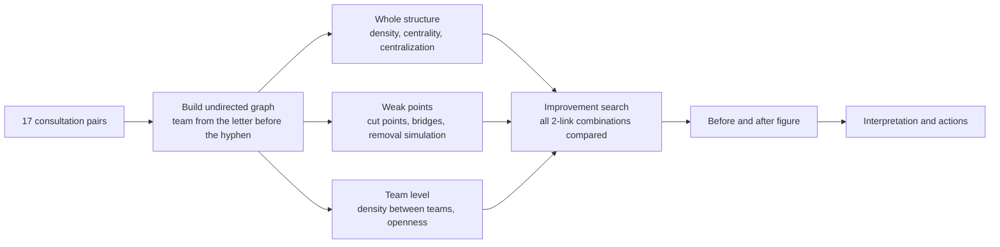

# Hyperscale AI pilot TF work consultation network analysis

## Analysis overview
- (Reading of the question) A practical diagnosis request: find the weak points of the TF's collaboration structure from 2 months of work consultation records and build an improvement from proposed new links
- (Key answer) The connections of the whole TF depend on one person, I-A. If I-A is absent, the TF splits into three groups. Adding 2 links (P-B–I-C, D-C–Q-B) changes it into a structure that stays connected whichever single person is absent
- (Methods) Density and density between teams, openness, degree, closeness and betweenness centrality and centralization, structural holes (constraint), cut points and bridges, member removal simulation, exhaustive search of link combinations
- (Data) 13 people, 17 lines, undirected, unweighted (whether a pair consulted at least once in 2 months), 4 teams (quality 4, design 4, info 3, planning 2)

## Process


## Methods

Common setup code (full code in `tf_analysis.py`, including the font registration fallback)

```python
import sys, itertools
sys.path.insert(0, "<skill folder>/scripts")
from nx_toolkit import *
setup_font()

edges = [
    ("Q-A", "Q-B"), ("Q-A", "Q-C"), ("Q-B", "Q-C"), ("Q-B", "Q-D"), ("Q-C", "Q-D"),
    ("D-A", "D-B"), ("D-A", "D-C"), ("D-B", "D-C"), ("D-B", "D-D"), ("D-C", "D-D"),
    ("I-A", "Q-A"), ("I-A", "D-B"), ("I-A", "I-B"), ("I-B", "I-C"),
    ("P-A", "I-A"), ("P-A", "Q-A"), ("P-A", "P-B"),
]
G = load_from_edges(edges)                       # undirected, unweighted
TEAM_NAME = {"Q": "Quality team", "D": "Design team", "I": "Info team", "P": "Planning team"}
teams = {n: TEAM_NAME[n.split("-")[0]] for n in G.nodes()}   # letter before the hyphen = team
print(recommend_strategy(G))                     # 13 nodes: matrix and graph together
```

### Density, density between teams, openness
- (Definition) Density is the share of possible lines that exist. Density between teams is the share of possible pairs across two teams that consulted. Openness is the share of a team's line ends that point outside the team (0 means a closed team)
- (Formula)
$$
D = \frac{k}{g(g-1)/2} = \frac{17}{13 \cdot 12 / 2} = 0.218, \qquad
D_{st} = \frac{k_{st}}{g_s \, g_t}, \qquad
O_s = \frac{e^{out}_s}{2e^{in}_s + e^{out}_s}
$$
- (Code)
```python
print(describe_graph(G))                          # nodes, lines, density, diameter
team_density = block_density_matrix(G, teams)     # diagonal = density within a team, the rest = between teams
team_open = compute_network_openness(G, teams)
team_table = team_density.copy()
team_table["openness"] = team_open
```

### Centrality and centralization
- (Definition) Betweenness centrality is how often a person lies on the shortest paths between two others. Centralization is the sum of the gaps between the top score and the others, divided by the maximum of a star graph (1 means everything runs through one person)
- (Formula)
$$
C'_B(i) = \frac{1}{(g-1)(g-2)/2}\sum_{j<k} \frac{g_{jk}(i)}{g_{jk}}, \qquad
C_B = \frac{\sum_i \left[\max_j C_B(j) - C_B(i)\right]}{(g-1)^2(g-2)/2}
$$
- (Code)
```python
cent = compute_centralities(G)        # degree, closeness, betweenness centrality (relative)
zcent = compute_centralization(G)     # degree 0.136, closeness 0.413, betweenness 0.557
```

### Structural holes (constraint)
- (Definition) Constraint is how far a person's ties are bound to a few people who already know each other. The lower it is, the more the person brokers between people who do not know each other (Burt 1992)
- (Formula)
$$
c_{ij} = \left(p_{ij} + \sum_{q \ne i,j} p_{iq}\,p_{qj}\right)^2, \qquad C_i = \sum_j c_{ij}
$$
- (Code)
```python
holes = compute_structural_holes(G)   # effective size, constraint, efficiency (lowest constraint first)
```

### Cut points, bridges, removal simulation
- (Definition) A cut point is a person whose absence splits the TF into two or more parts, and a bridge is a link whose loss splits the TF. The minimum removal count (node connectivity) is the smallest number of people whose absence splits the TF
- (Formula) ω is the number of components
$$
v \text{ is a cut point} \iff \omega(G - v) > \omega(G), \qquad
\kappa(G) = \min\{\,|S| : G - S \text{ is disconnected}\,\}
$$
- (Code)
```python
cuts = find_cut_points(G)             # 5 cut points, 4 bridges

def removal_impact(H, people):
    """Number and makeup of the pieces left when one person is absent"""
    rows = {}
    for v in people:
        R = H.copy()
        R.remove_node(v)
        pieces = sorted(find_components(R)["components"], key=len, reverse=True)
        rows[v] = {"pieces": len(pieces),
                   "largest_piece": len(pieces[0]),
                   "cut_off": " / ".join(", ".join(p) for p in pieces[1:])}
    return pd.DataFrame(rows).T

impact = removal_impact(G, cuts["cut_points"]).sort_values("largest_piece")
```

### Improvement search (all link combinations compared)
- (Definition) Test every combination of new links among the 61 pairs that have not consulted yet, and find the smallest combination that brings cut points to zero. A single link cannot do it (0 such links), and 18 combinations of 2 links can
- (Selection rule) Zero cut points is required. After that, lower betweenness centralization first (spreading the brokering load), then shorter average distance
- (Formula) Ē is the set of links that do not exist yet, CP is the set of cut points and d̄ is the average distance
$$
E^{*} = \underset{E' \subset \bar{E},\ |E'| = 2,\ \mathrm{CP}(G + E') = \varnothing}{\arg\min} \Big( C_B(G + E'),\ \bar{d}(G + E') \Big)
$$
- (Code)
```python
non_edges = [e for e in itertools.combinations(sorted(G.nodes()), 2) if not G.has_edge(*e)]
single_fix = [e for e in non_edges
              if not find_cut_points(nx.Graph(list(G.edges()) + [e]))["cut_points"]]   # 0

cands = []
for e1, e2 in itertools.combinations(non_edges, 2):
    H = G.copy()
    H.add_edges_from([e1, e2])
    if find_cut_points(H)["cut_points"]:
        continue
    bc = nx.betweenness_centrality(H)
    top = max(bc, key=bc.get)
    cands.append({"new_link_1": "–".join(e1), "new_link_2": "–".join(e2),
                  "betweenness_centralization": compute_centralization(H)["betweenness_centralization"],
                  "average_distance": compute_distances(H)["avg_distance"],
                  "max_betweenness": bc[top], "max_betweenness_person": top})
cands = (pd.DataFrame(cands)
         .sort_values(["betweenness_centralization", "average_distance", "new_link_1", "new_link_2"])
         .reset_index(drop=True))

best = cands.iloc[0]
new_edges = [tuple(best["new_link_1"].split("–")), tuple(best["new_link_2"].split("–"))]
G2 = G.copy()
G2.add_edges_from(new_edges)          # improved graph
cent2, dist2, cuts2 = compute_centralities(G2), compute_distances(G2), find_cut_points(G2)
```

### Visualization
- (Current structure) Matrix reordered by team, and graph. Node color is the team, node size is betweenness centrality
- (Before and after) The current structure and the improvement drawn side by side on the same layout. Cut points are orange nodes, and new links are orange dashed lines marked "New 1" and "New 2". Team areas are shaded (drawing code in `tf_analysis.py`)
```python
result = draw_matrix_and_network(
    G, title="TF consultations (current)",
    group_dict=teams,
    centrality_dict=cent["betweenness_centrality"].to_dict(),
    layout="kamada_kawai",            # match distances on the figure to path distances
    save_path="tf_current.png", print_markdown=False,
)
print(build_response_block(G, "TF consultations (current)", result, node_table,
                           analysis_name="Position indicators by member"))
```

## Input data matrix

> **TF consultations (current)** (reordered by block) (Block Design team) D-A, D-B, D-C, D-D (Block Info team) I-A, I-B, I-C (Block Planning team) P-A, P-B (Block Quality team) Q-A, Q-B, Q-C, Q-D

| | D-A | D-B | D-C | D-D | I-A | I-B | I-C | P-A | P-B | Q-A | Q-B | Q-C | Q-D |
|---|---|---|---|---|---|---|---|---|---|---|---|---|---|
| **D-A** | 0 | 1 | 1 | 0 | 0 | 0 | 0 | 0 | 0 | 0 | 0 | 0 | 0 |
| **D-B** | 1 | 0 | 1 | 1 | 1 | 0 | 0 | 0 | 0 | 0 | 0 | 0 | 0 |
| **D-C** | 1 | 1 | 0 | 1 | 0 | 0 | 0 | 0 | 0 | 0 | 0 | 0 | 0 |
| **D-D** | 0 | 1 | 1 | 0 | 0 | 0 | 0 | 0 | 0 | 0 | 0 | 0 | 0 |
| **I-A** | 0 | 1 | 0 | 0 | 0 | 1 | 0 | 1 | 0 | 1 | 0 | 0 | 0 |
| **I-B** | 0 | 0 | 0 | 0 | 1 | 0 | 1 | 0 | 0 | 0 | 0 | 0 | 0 |
| **I-C** | 0 | 0 | 0 | 0 | 0 | 1 | 0 | 0 | 0 | 0 | 0 | 0 | 0 |
| **P-A** | 0 | 0 | 0 | 0 | 1 | 0 | 0 | 0 | 1 | 1 | 0 | 0 | 0 |
| **P-B** | 0 | 0 | 0 | 0 | 0 | 0 | 0 | 1 | 0 | 0 | 0 | 0 | 0 |
| **Q-A** | 0 | 0 | 0 | 0 | 1 | 0 | 0 | 1 | 0 | 0 | 1 | 1 | 0 |
| **Q-B** | 0 | 0 | 0 | 0 | 0 | 0 | 0 | 0 | 0 | 1 | 0 | 1 | 1 |
| **Q-C** | 0 | 0 | 0 | 0 | 0 | 0 | 0 | 0 | 0 | 1 | 1 | 0 | 1 |
| **Q-D** | 0 | 0 | 0 | 0 | 0 | 0 | 0 | 0 | 0 | 0 | 1 | 1 | 0 |

## Results

### Position indicators by member

> **Position indicators by member** (highest betweenness centrality first, last column is the value after the improvement)

|  | Team | Degree | Degree centrality | Closeness centrality | Betweenness centrality | Constraint | Cut point | Betweenness after improvement |
|---|---|---|---|---|---|---|---|---|
| I-A | Info team | 4 | 0.333 | 0.571 | 0.667 | 0.334 | O | 0.371 |
| D-B | Design team | 4 | 0.333 | 0.462 | 0.417 | 0.535 | O | 0.235 |
| Q-A | Quality team | 4 | 0.333 | 0.500 | 0.409 | 0.431 | O | 0.250 |
| I-B | Info team | 2 | 0.167 | 0.400 | 0.167 | 0.500 | O | 0.106 |
| P-A | Planning team | 3 | 0.250 | 0.462 | 0.167 | 0.458 | O | 0.167 |
| Q-C | Quality team | 3 | 0.250 | 0.375 | 0.076 | 0.735 |  | 0.045 |
| Q-B | Quality team | 3 | 0.250 | 0.375 | 0.076 | 0.735 |  | 0.205 |
| D-C | Design team | 3 | 0.250 | 0.343 | 0.008 | 0.792 |  | 0.152 |
| Q-D | Quality team | 2 | 0.167 | 0.286 | 0.000 | 0.889 |  | 0.000 |
| D-A | Design team | 2 | 0.167 | 0.333 | 0.000 | 0.835 |  | 0.000 |
| D-D | Design team | 2 | 0.167 | 0.333 | 0.000 | 0.835 |  | 0.000 |
| I-C | Info team | 1 | 0.083 | 0.293 | 0.000 | 1.000 |  | 0.015 |
| P-B | Planning team | 1 | 0.083 | 0.324 | 0.000 | 1.000 |  | 0.045 |

### Split when a cut point is absent

|  | Pieces | Largest piece | Cut off |
|---|---|---|---|
| I-A | 3 | 6 | D-A, D-B, D-C, D-D / I-B, I-C |
| D-B | 2 | 9 | D-A, D-C, D-D |
| Q-A | 2 | 9 | Q-B, Q-C, Q-D |
| I-B | 2 | 11 | I-C |
| P-A | 2 | 11 | P-B |

- (4 bridges) I-A–D-B, I-A–I-B, I-B–I-C, P-A–P-B

### Density within and between teams, openness

> The diagonal is density within a team, the other cells are density between teams

|  | Planning team | Design team | Info team | Quality team | Openness |
|---|---|---|---|---|---|
| Planning team | 1.000 | 0.000 | 0.167 | 0.125 | 0.500 |
| Design team | 0.000 | 0.833 | 0.083 | 0.000 | 0.091 |
| Info team | 0.167 | 0.083 | 0.667 | 0.083 | 0.429 |
| Quality team | 0.125 | 0.000 | 0.083 | 0.833 | 0.167 |

### Improvement candidates (top 6 of the 18 two-link combinations that bring cut points to zero)

|  | New link 1 | New link 2 | Betweenness centralization | Average distance | Max betweenness centrality | Person with max betweenness |
|---|---|---|---|---|---|---|
| 1 | P-B–I-C | D-C–Q-B | 0.270 | 2.346 | 0.371 | I-A |
| 2 | P-B–I-C | D-C–Q-C | 0.270 | 2.346 | 0.371 | I-A |
| 3 | P-B–I-C | D-A–Q-B | 0.279 | 2.385 | 0.384 | I-A |
| 4 | P-B–I-C | D-A–Q-C | 0.279 | 2.385 | 0.384 | I-A |
| 5 | P-B–I-C | D-D–Q-B | 0.279 | 2.385 | 0.384 | I-A |
| 6 | P-B–I-C | D-D–Q-C | 0.279 | 2.385 | 0.384 | I-A |

- (Ranks 1 and 2) Q-B and Q-C hold the same position, tied to the same people, so the results are the same. Choose whichever has more contact with design work
- (The other 12) The full list of 18 is in `tf_improvement_candidates.csv`

### Current structure vs improvement

|  | Current | Improved |
|---|---|---|
| Lines | 17 | 19 |
| Density | 0.218 | 0.244 |
| Lines between teams | 4 | 6 |
| Direct quality team–design team lines | 0 | 1 |
| Average distance | 2.679 | 2.346 |
| Diameter | 5 | 5 |
| Cut points | 5 | 0 |
| Bridges | 4 | 0 |
| Minimum removals to split the TF | 1 | 2 |
| Betweenness centralization | 0.557 | 0.270 |
| I-A betweenness centrality | 0.667 | 0.371 |
| Max betweenness centrality (person) | 0.667 (I-A) | 0.371 (I-A) |

- (Removal simulation) In the improvement, the remaining members stay connected whichever 1 of the 13 is absent
- (Diameter) Pairs at distance 5 fall from 4 pairs (Q-D with D-A, D-C and D-D, and Q-D with I-C) to 1 pair, Q-D–I-C. The Q-D–D-A distance drops from 5 to 3

### Figure files (delivered separately)
- (Before and after) `tf_before_after.png`, current structure on the left, improvement on the right. Orange nodes are cut points, orange dashed lines are proposed new links
- (Current matrix) `tf_current_matrix.png`, adjacency matrix reordered by team, orange lines are team boundaries
- (Current graph) `tf_current_network.png`, colors by team, node size in proportion to betweenness centrality
- (Table files) `tf_node_metrics.csv` indicators by member, `tf_improvement_candidates.csv` the 18 improvement candidates, `tf_improved_edges.csv` the 19 consultation pairs after the improvement, `tf_analysis.py` full code

## Interpretation and implications

### What to improve
- (Single dependence on I-A) I-A is the only person holding the TF together. I-A's betweenness centrality of 0.667 is far above second place (D-B 0.417). If I-A is absent through leave, transfer or overload, the TF splits into three groups: 4 design members, I-B and I-C, and 6 quality and planning members
- (Team silos) Density within teams is high at 0.667 to 1.000, while density between teams is only 0.000 to 0.167. Only 4 of the 17 consultation pairs cross team lines, and the quality–design and planning–design pairs have no direct consultation at all
- (One contact per team) Only D-B in the design team and only Q-A in the quality team consult outside their teams. With openness of 0.091 for design and 0.167 for quality, the two teams are nearly closed. If that one contact is absent, the whole team is cut off from the TF
- (Peripheral members) I-C and P-B each have one partner (constraint 1.000), so they connect to the TF only through I-B and P-A respectively. News from the pilot sites may reach these two late
- (Long distances) Q-D is 5 steps from D-A, D-C and D-D. Quality review comments reach design staff only after passing through Q-A, I-A and D-B in turn

### Structural features
- (Even ties, concentrated brokering) Degree centralization of 0.136 means the number of partners is evenly spread. Betweenness centralization of 0.557 means brokering is concentrated on I-A. I-A, D-B and Q-A each have 4 partners, but only I-A sits between teams
- (Team-centered clusters) The quality and design teams are dense clusters with 5 consulting pairs among 4 people each, and the teams connect only through bridges and cut points in a star shape

### Practical application
- (New 1: P-B–I-C) Set up a regular consultation channel between planning and info staff. It ends the isolation of the two peripheral members and opens a planning–info route that bypasses I-A and P-A
- (New 2: D-C–Q-B) Set up the first direct consultation channel between the design and quality teams (Q-C works the same as Q-B). It creates a second team contact besides D-B and Q-A, and a design–quality route that bypasses I-A
- (Expected effect) Cut points from 5 to 0, bridges from 4 to 0, minimum removals to split the TF from 1 to 2, betweenness centralization from 0.557 to 0.270, average distance from 2.679 to 2.346
- (Managing I-A's load) I-A still has the highest betweenness centrality in the improvement at 0.371. I-A's cross-team consultations need to be recorded in a shared channel and in minutes, with a stand-in named in advance for absences
- (Alternative combination) If direct planning–design consultation is more urgent for the work, the combination of P-B–D-C and I-C–Q-B (candidate 10) also brings cut points to zero. Its betweenness centralization of 0.328 is a little higher than the first-ranked one
- (Remeasure) Collect consultation records the same way in 2 months and check that cut points stay at 0 and the minimum removal count at 2 or more

### Cautions
- (Data scope) Only whether a pair consulted at least once in 2 months is reflected. Frequency and importance are not, so if frequency data exists, the analysis can be rerun as a weighted graph
- (Nature of the improvement) The links were chosen on structural indicators alone. Confirm that D-C and Q-B actually have work to consult on before finalizing
