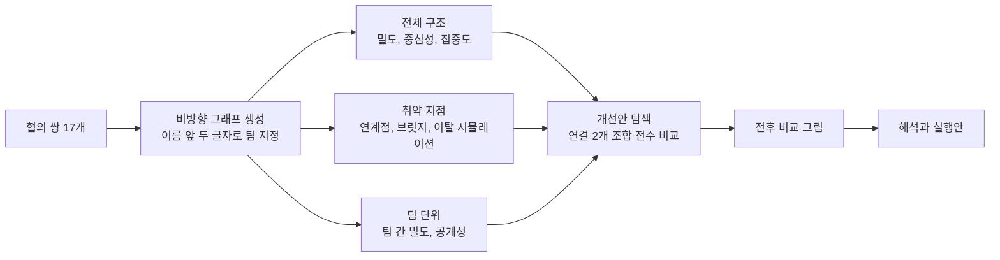

# 초거대AI 시범 도입 TF 업무 협의 네트워크 분석

## 분석 개요
- (질문 해석) 지난 2개월 동안의 업무 협의 기록으로 TF 협업 구조의 약점을 찾고, 신규 연결 제안으로 개선안을 만드는 실무 진단 요청
- (핵심 답) TF 전체 연결이 정보A 한 명에게 의존하는 구조. 정보A 이탈 시 TF가 세 그룹으로 분리. 연결 2개(기획B–정보C, 설계C–품질B) 신설 시 어느 1명이 이탈해도 TF 연결이 유지되는 구조로 전환
- (적용 기법) 밀도와 팀 간 밀도, 공개성, 연결정도·근접·매개 중심성과 집중도, 구조적 틈새(제약), 연계점과 브릿지, 구성원 이탈 시뮬레이션, 연결 추가 조합 전수 탐색
- (데이터 특성) 13명, 17라인, 비방향, 비가중(2개월 동안 1회 이상 협의했는지 여부), 4개 팀(품질 4명, 설계 4명, 정보 3명, 기획 2명)

## 처리 과정


## 분석 방법

공통 준비 코드(전체 코드는 `tf_analysis.py`, 글꼴 등록 보완 코드 포함)

```python
import sys, itertools
sys.path.insert(0, "<스킬 폴더>/scripts")
from nx_toolkit import *
setup_font()

edges = [
    ("품질A", "품질B"), ("품질A", "품질C"), ("품질B", "품질C"), ("품질B", "품질D"), ("품질C", "품질D"),
    ("설계A", "설계B"), ("설계A", "설계C"), ("설계B", "설계C"), ("설계B", "설계D"), ("설계C", "설계D"),
    ("정보A", "품질A"), ("정보A", "설계B"), ("정보A", "정보B"), ("정보B", "정보C"),
    ("기획A", "정보A"), ("기획A", "품질A"), ("기획A", "기획B"),
]
G = load_from_edges(edges)                       # 비방향, 비가중
teams = {n: n[:2] + "팀" for n in G.nodes()}     # 이름 앞 두 글자 = 소속 팀
print(recommend_strategy(G))                     # 13노드: 매트릭스와 그래프 병행 전략
```

### 밀도, 팀 간 밀도, 공개성
- (정의) 밀도는 가능한 라인 대비 실제 라인의 비율. 팀 간 밀도는 두 팀 사이 가능한 쌍 대비 실제 협의 쌍의 비율. 공개성은 팀원 관계의 끝점 중 팀 밖을 향하는 비율(0이면 닫힌 팀)
- (수식)
$$
D = \frac{k}{g(g-1)/2} = \frac{17}{13 \cdot 12 / 2} = 0.218, \qquad
D_{st} = \frac{k_{st}}{g_s \, g_t}, \qquad
O_s = \frac{e^{out}_s}{2e^{in}_s + e^{out}_s}
$$
- (구현)
```python
print(describe_graph(G))                          # 노드, 라인, 밀도, 직경
team_density = block_density_matrix(G, teams)     # 대각선 = 팀 내 밀도, 나머지 = 팀 간 밀도
team_open = compute_network_openness(G, teams)
team_table = team_density.copy()
team_table["공개성"] = team_open
```

### 중심성과 집중도
- (정의) 매개 중심성은 다른 두 사람 사이 최단 경로 위에 놓인 정도. 집중도는 가장 높은 점수와 나머지 점수의 차이를 스타형 그래프의 최댓값으로 나눈 값(1이면 한 사람에게 쏠림)
- (수식)
$$
C'_B(i) = \frac{1}{(g-1)(g-2)/2}\sum_{j<k} \frac{g_{jk}(i)}{g_{jk}}, \qquad
C_B = \frac{\sum_i \left[\max_j C_B(j) - C_B(i)\right]}{(g-1)^2(g-2)/2}
$$
- (구현)
```python
cent = compute_centralities(G)        # 연결정도, 근접, 매개 중심성(상대값)
zcent = compute_centralization(G)     # 연결정도 0.136, 근접 0.413, 매개 0.557
```

### 구조적 틈새(제약)
- (정의) 제약은 한 사람의 관계가 서로 이미 연결된 소수에게 묶인 정도. 낮을수록 서로 모르는 사람들을 잇는 중개 위치(Burt 1992)
- (수식)
$$
c_{ij} = \left(p_{ij} + \sum_{q \ne i,j} p_{iq}\,p_{qj}\right)^2, \qquad C_i = \sum_j c_{ij}
$$
- (구현)
```python
holes = compute_structural_holes(G)   # 유효 규모, 제약, 효율성(제약 낮은 순)
```

### 연계점, 브릿지, 이탈 시뮬레이션
- (정의) 연계점은 이탈 시 TF가 둘 이상으로 분리되는 사람, 브릿지는 단절 시 TF가 분리되는 연결. 최소 이탈 인원(노드 연결도)은 TF 분리에 필요한 최소 이탈 인원 수
- (수식) ω는 컴퍼넌트 수
$$
v \text{는 연계점} \iff \omega(G - v) > \omega(G), \qquad
\kappa(G) = \min\{\,|S| : G - S \text{가 분리됨}\,\}
$$
- (구현)
```python
cuts = find_cut_points(G)             # 연계점 5명, 브릿지 4개

def removal_impact(H, people):
    """한 사람이 빠졌을 때 남는 덩어리 수와 구성"""
    rows = {}
    for v in people:
        R = H.copy()
        R.remove_node(v)
        pieces = sorted(find_components(R)["컴퍼넌트"], key=len, reverse=True)
        rows[v] = {"분리_조각_수": len(pieces),
                   "최대_조각_인원": len(pieces[0]),
                   "분리_인원": " / ".join(", ".join(p) for p in pieces[1:])}
    return pd.DataFrame(rows).T

impact = removal_impact(G, cuts["연계점"]).sort_values("최대_조각_인원")
```

### 개선안 탐색(연결 추가 조합 전수 비교)
- (정의) 아직 협의가 없는 61개 쌍에서 새 연결 조합을 모두 시험해 연계점을 0명으로 만드는 최소 조합을 찾음. 연결 1개로는 불가능(해당 조합 0개), 연결 2개로 가능한 조합 18개를 확인
- (선정 기준) 연계점 0명은 필수 조건. 그다음 매개 집중도가 낮은 순(중개 부담 분산), 평균 거리가 짧은 순
- (수식) Ē는 아직 없는 연결의 집합, CP는 연계점 집합, d̄는 평균 거리
$$
E^{*} = \underset{E' \subset \bar{E},\ |E'| = 2,\ \mathrm{CP}(G + E') = \varnothing}{\arg\min} \Big( C_B(G + E'),\ \bar{d}(G + E') \Big)
$$
- (구현)
```python
non_edges = [e for e in itertools.combinations(sorted(G.nodes()), 2) if not G.has_edge(*e)]
single_fix = [e for e in non_edges
              if not find_cut_points(nx.Graph(list(G.edges()) + [e]))["연계점"]]   # 0개

cands = []
for e1, e2 in itertools.combinations(non_edges, 2):
    H = G.copy()
    H.add_edges_from([e1, e2])
    if find_cut_points(H)["연계점"]:
        continue
    bc = nx.betweenness_centrality(H)
    top = max(bc, key=bc.get)
    cands.append({"신규_연결_1": "–".join(e1), "신규_연결_2": "–".join(e2),
                  "매개_집중도": compute_centralization(H)["매개_집중도"],
                  "평균_거리": compute_distances(H)["avg_distance"],
                  "최대_매개_중심성": bc[top], "최대_매개_인물": top})
cands = (pd.DataFrame(cands)
         .sort_values(["매개_집중도", "평균_거리", "신규_연결_1", "신규_연결_2"])
         .reset_index(drop=True))

best = cands.iloc[0]
new_edges = [tuple(best["신규_연결_1"].split("–")), tuple(best["신규_연결_2"].split("–"))]
G2 = G.copy()
G2.add_edges_from(new_edges)          # 개선안 그래프
cent2, dist2, cuts2 = compute_centralities(G2), compute_distances(G2), find_cut_points(G2)
```

### 시각화
- (현재 구조) 팀 순서로 재정렬한 매트릭스와 그래프. 노드 색은 팀, 노드 크기는 매개 중심성
- (전후 비교) 같은 배치 위에 현재 구조와 개선안을 나란히 그림. 연계점은 주황 노드, 새 연결은 주황 점선과 "신규 1", "신규 2" 표시. 팀 영역은 배경색으로 구분(그리기 코드는 `tf_analysis.py`)
```python
result = draw_matrix_and_network(
    G, title="TF 업무 협의(현재)",
    group_dict=teams,
    centrality_dict=cent["매개_중심성"].to_dict(),
    layout="kamada_kawai",            # 그림 위 거리를 경로 거리에 맞춤
    save_path="tf_current.png", print_markdown=False,
)
print(build_response_block(G, "TF 업무 협의(현재)", result, node_table,
                           analysis_name="구성원별 위치 지표"))
```

## 입력 데이터 매트릭스

> **TF 업무 협의(현재)** (블록 재정렬) (블록 기획팀) 기획A, 기획B (블록 설계팀) 설계A, 설계B, 설계C, 설계D (블록 정보팀) 정보A, 정보B, 정보C (블록 품질팀) 품질A, 품질B, 품질C, 품질D

| | 기획A | 기획B | 설계A | 설계B | 설계C | 설계D | 정보A | 정보B | 정보C | 품질A | 품질B | 품질C | 품질D |
|---|---|---|---|---|---|---|---|---|---|---|---|---|---|
| **기획A** | 0 | 1 | 0 | 0 | 0 | 0 | 1 | 0 | 0 | 1 | 0 | 0 | 0 |
| **기획B** | 1 | 0 | 0 | 0 | 0 | 0 | 0 | 0 | 0 | 0 | 0 | 0 | 0 |
| **설계A** | 0 | 0 | 0 | 1 | 1 | 0 | 0 | 0 | 0 | 0 | 0 | 0 | 0 |
| **설계B** | 0 | 0 | 1 | 0 | 1 | 1 | 1 | 0 | 0 | 0 | 0 | 0 | 0 |
| **설계C** | 0 | 0 | 1 | 1 | 0 | 1 | 0 | 0 | 0 | 0 | 0 | 0 | 0 |
| **설계D** | 0 | 0 | 0 | 1 | 1 | 0 | 0 | 0 | 0 | 0 | 0 | 0 | 0 |
| **정보A** | 1 | 0 | 0 | 1 | 0 | 0 | 0 | 1 | 0 | 1 | 0 | 0 | 0 |
| **정보B** | 0 | 0 | 0 | 0 | 0 | 0 | 1 | 0 | 1 | 0 | 0 | 0 | 0 |
| **정보C** | 0 | 0 | 0 | 0 | 0 | 0 | 0 | 1 | 0 | 0 | 0 | 0 | 0 |
| **품질A** | 1 | 0 | 0 | 0 | 0 | 0 | 1 | 0 | 0 | 0 | 1 | 1 | 0 |
| **품질B** | 0 | 0 | 0 | 0 | 0 | 0 | 0 | 0 | 0 | 1 | 0 | 1 | 1 |
| **품질C** | 0 | 0 | 0 | 0 | 0 | 0 | 0 | 0 | 0 | 1 | 1 | 0 | 1 |
| **품질D** | 0 | 0 | 0 | 0 | 0 | 0 | 0 | 0 | 0 | 0 | 1 | 1 | 0 |

## 분석 결과

### 구성원별 위치 지표

> **구성원별 위치 지표 결과** (매개 중심성 높은 순, 마지막 열은 개선안 적용 후 값)

|  | 팀 | 연결정도 | 연결정도_중심성 | 근접_중심성 | 매개_중심성 | 제약 | 연계점 | 개선안_매개_중심성 |
|---|---|---|---|---|---|---|---|---|
| 정보A | 정보팀 | 4 | 0.333 | 0.571 | 0.667 | 0.334 | O | 0.371 |
| 설계B | 설계팀 | 4 | 0.333 | 0.462 | 0.417 | 0.535 | O | 0.235 |
| 품질A | 품질팀 | 4 | 0.333 | 0.500 | 0.409 | 0.431 | O | 0.250 |
| 정보B | 정보팀 | 2 | 0.167 | 0.400 | 0.167 | 0.500 | O | 0.106 |
| 기획A | 기획팀 | 3 | 0.250 | 0.462 | 0.167 | 0.458 | O | 0.167 |
| 품질C | 품질팀 | 3 | 0.250 | 0.375 | 0.076 | 0.735 |  | 0.045 |
| 품질B | 품질팀 | 3 | 0.250 | 0.375 | 0.076 | 0.735 |  | 0.205 |
| 설계C | 설계팀 | 3 | 0.250 | 0.343 | 0.008 | 0.792 |  | 0.152 |
| 품질D | 품질팀 | 2 | 0.167 | 0.286 | 0.000 | 0.889 |  | 0.000 |
| 설계A | 설계팀 | 2 | 0.167 | 0.333 | 0.000 | 0.835 |  | 0.000 |
| 설계D | 설계팀 | 2 | 0.167 | 0.333 | 0.000 | 0.835 |  | 0.000 |
| 정보C | 정보팀 | 1 | 0.083 | 0.293 | 0.000 | 1.000 |  | 0.015 |
| 기획B | 기획팀 | 1 | 0.083 | 0.324 | 0.000 | 1.000 |  | 0.045 |

### 연계점 이탈 시 분리 결과

|  | 분리_조각_수 | 최대_조각_인원 | 분리_인원 |
|---|---|---|---|
| 정보A | 3 | 6 | 설계A, 설계B, 설계C, 설계D / 정보B, 정보C |
| 설계B | 2 | 9 | 설계A, 설계C, 설계D |
| 품질A | 2 | 9 | 품질B, 품질C, 품질D |
| 정보B | 2 | 11 | 정보C |
| 기획A | 2 | 11 | 기획B |

- (브릿지 4개) 정보A–설계B, 정보A–정보B, 정보B–정보C, 기획A–기획B

### 팀 내외 밀도와 공개성

> 대각선은 팀 내 밀도, 나머지 칸은 팀 간 밀도

|  | 기획팀 | 설계팀 | 정보팀 | 품질팀 | 공개성 |
|---|---|---|---|---|---|
| 기획팀 | 1.000 | 0.000 | 0.167 | 0.125 | 0.500 |
| 설계팀 | 0.000 | 0.833 | 0.083 | 0.000 | 0.091 |
| 정보팀 | 0.167 | 0.083 | 0.667 | 0.083 | 0.429 |
| 품질팀 | 0.125 | 0.000 | 0.083 | 0.833 | 0.167 |

### 개선안 후보(연계점 0명을 만드는 연결 2개 조합 18개 중 상위 6개)

|  | 신규_연결_1 | 신규_연결_2 | 매개_집중도 | 평균_거리 | 최대_매개_중심성 | 최대_매개_인물 |
|---|---|---|---|---|---|---|
| 1 | 기획B–정보C | 설계C–품질B | 0.270 | 2.346 | 0.371 | 정보A |
| 2 | 기획B–정보C | 설계C–품질C | 0.270 | 2.346 | 0.371 | 정보A |
| 3 | 기획B–정보C | 설계A–품질B | 0.279 | 2.385 | 0.384 | 정보A |
| 4 | 기획B–정보C | 설계A–품질C | 0.279 | 2.385 | 0.384 | 정보A |
| 5 | 기획B–정보C | 설계D–품질B | 0.279 | 2.385 | 0.384 | 정보A |
| 6 | 기획B–정보C | 설계D–품질C | 0.279 | 2.385 | 0.384 | 정보A |

- (1순위와 2순위) 품질B와 품질C는 같은 사람들과 연결된 같은 위치라 결과가 같음. 둘 중 설계 업무 접점이 큰 사람을 고르면 됨
- (나머지 12개) 18개 전체 목록은 `tf_improvement_candidates.csv`

### 현재 구조와 개선안 비교

|  | 현재 | 개선안 |
|---|---|---|
| 라인 수 | 17 | 19 |
| 밀도 | 0.218 | 0.244 |
| 팀 간 라인 수 | 4 | 6 |
| 품질팀–설계팀 직접 라인 | 0 | 1 |
| 평균 거리 | 2.679 | 2.346 |
| 직경 | 5 | 5 |
| 연계점 수 | 5 | 0 |
| 브릿지 수 | 4 | 0 |
| TF 분리에 필요한 최소 이탈 인원 | 1 | 2 |
| 매개 집중도 | 0.557 | 0.270 |
| 정보A 매개 중심성 | 0.667 | 0.371 |
| 최대 매개 중심성(인물) | 0.667(정보A) | 0.371(정보A) |

- (이탈 시뮬레이션) 개선안에서는 13명 중 어느 1명이 이탈해도 나머지 인원의 연결 유지
- (직경) 거리 5인 쌍이 4쌍(품질D와 설계A·설계C·설계D, 품질D와 정보C)에서 품질D–정보C 1쌍으로 줄어듦. 품질D–설계A 거리는 5에서 3으로 단축

### 그림 파일(별도 전달)
- (전후 비교) `tf_before_after.png` 왼쪽 현재 구조, 오른쪽 개선안 적용 구조. 주황 노드는 연계점, 주황 점선은 신규 연결 제안
- (현재 매트릭스) `tf_current_matrix.png` 팀 순서로 재정렬한 인접 매트릭스, 주황 선은 팀 경계
- (현재 그래프) `tf_current_network.png` 팀별 색, 매개 중심성에 비례한 노드 크기
- (표 파일) `tf_node_metrics.csv` 구성원별 지표, `tf_improvement_candidates.csv` 개선안 후보 18개, `tf_improved_edges.csv` 개선안 적용 후 협의 쌍 19개, `tf_analysis.py` 전체 코드

## 해석과 시사점

### 개선할 점
- (정보A 단일 의존) TF를 하나로 묶는 사람이 정보A 한 명뿐. 매개 중심성 0.667로 2위(설계B 0.417)보다 크게 높음. 정보A가 휴가, 이동, 업무 과부하로 이탈하면 TF가 설계팀 4명, 정보B·정보C 2명, 품질팀·기획팀 6명의 세 그룹으로 분리
- (팀 사일로) 팀 내 밀도는 0.667에서 1.000으로 촘촘하지만 팀 간 밀도는 0.000에서 0.167에 그침. 17개 협의 쌍 중 팀을 넘는 협의는 4개뿐이고, 품질팀–설계팀, 기획팀–설계팀 사이에는 직접 협의가 전혀 없음
- (팀별 창구 1인 체제) 설계팀은 설계B, 품질팀은 품질A만 팀 밖과 협의함. 설계팀 공개성 0.091, 품질팀 0.167로 거의 닫힌 팀. 창구 1명 이탈 시 팀 전체가 TF에서 분리
- (주변 구성원) 정보C와 기획B는 협의 상대가 1명(제약 1.000)이라 각각 정보B, 기획A를 거쳐야만 TF와 연결. 시범 도입 현장 정보가 이 두 사람에게 늦게 도달할 가능성
- (먼 거리) 품질D에서 설계A·설계C·설계D까지 5단계. 품질 검토 의견이 설계 실무자에게 품질A, 정보A, 설계B를 차례로 거쳐야 전달되는 구조

### 구조적 특징
- (연결 수는 균등, 중개는 집중) 연결정도 집중도 0.136으로 협의 상대 수는 균등하게 분포. 매개 집중도는 0.557로 중개 역할이 정보A에 집중. 정보A, 설계B, 품질A는 모두 상대가 4명으로 같지만 정보A만 팀 사이를 잇는 위치
- (팀 중심 군집) 품질팀과 설계팀은 각각 4명 중 5쌍이 협의하는 밀집 군집이고, 팀 사이는 브릿지와 연계점으로만 이어진 별 모양 구조

### 실무 적용
- (신규 1: 기획B–정보C) 기획 실무자와 정보 실무자 사이 정례 협의 채널 지정. 두 주변 구성원의 고립을 해소하고, 정보A·기획A를 거치지 않는 기획–정보 우회 경로 확보
- (신규 2: 설계C–품질B) 설계팀과 품질팀 사이 첫 직접 협의 채널 지정(품질B 대신 품질C도 같은 효과). 설계B·품질A 외에 두 번째 팀 창구가 생기고 정보A를 거치지 않는 설계–품질 경로 확보
- (기대 효과) 연계점 5명에서 0명, 브릿지 4개에서 0개, TF 분리에 필요한 최소 이탈 인원 1명에서 2명, 매개 집중도 0.557에서 0.270, 평균 거리 2.679에서 2.346
- (정보A 부담 관리) 개선안에서도 정보A의 매개 중심성 0.371로 가장 높음. 정보A가 맡은 팀 간 협의 내용을 공유 채널과 회의록으로 남기고 부재 시 대리인을 미리 정해 둘 필요
- (대안 조합) 기획팀–설계팀 직접 협의가 업무상 더 시급하면 기획B–설계C와 정보C–품질B 조합(후보 10위)도 연계점 0명 달성. 매개 집중도는 0.328로 1순위보다 다소 높음
- (재측정) 2개월 뒤 같은 방식으로 협의 기록을 다시 수집해 연계점 0명, 최소 이탈 인원 2명 이상이 유지되는지 확인

### 유의 사항
- (데이터 범위) 2개월 동안 1회 이상 협의 여부만 반영. 협의 빈도와 중요도는 반영되지 않았으므로 빈도 자료가 있으면 가중 그래프로 다시 분석 가능
- (개선안의 성격) 구조 지표만으로 고른 연결. 실제로 설계C와 품질B 사이에 협의할 업무가 있는지 확인한 뒤 확정 필요
