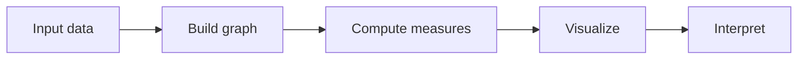
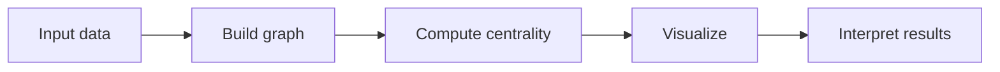
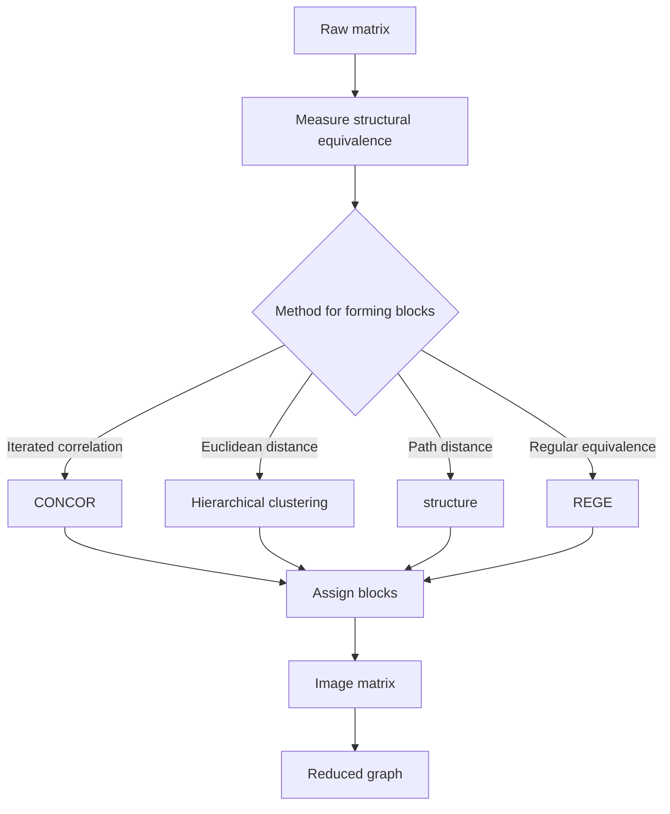
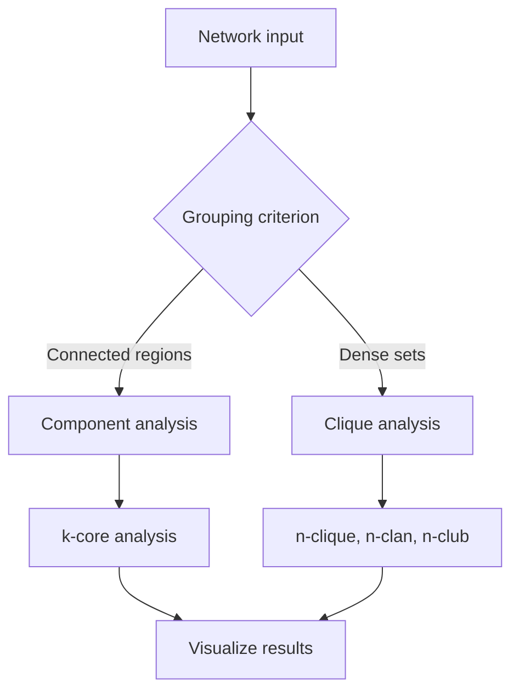

# Answer Templates

> Translated from the Korean edition. Wording may differ from the original intent.

Pick the template that fits the request. Sections may be added or dropped to suit the request, but keep the order of process, calculation, results and interpretation. Replace the bracketed parts of headings with the actual subject and technique names.

## Writing rules

- (Bullets) Write claims as bullets and label them in the form "(keyword) statement". Keep bullets short and factual.
- (Formulas) Define each measure with a LaTeX formula.
- (Code) Show the Python code that produced every number. A reader should get the same result from the same code.
- (Images) Deliver image files separately with the file delivery feature. Leave `` syntax out of the body and write a short line such as "image files sent separately".
- (File check) Confirm that a file was saved before mentioning it. Do not mention files that failed to save.
- (Brevity) Do not repeat the same content across sections.

## Data analysis request (template A)

Use when the user provides data and asks for an analysis.

````markdown
# [Subject] network analysis

## Overview
- (Question) The gist of the user's question in 1-2 sentences
- (Techniques) The analysis techniques chosen
- (Data) Number of nodes and lines, directed or not, weighted or not

## Process


## Methods

### [Technique name]
- (Definition) One or two lines
- (Formula)
$$
LaTeX formula
$$
- (Implementation)
```python
Code that was run
```

## Input matrix
Output of build_response_block or matrix_to_markdown

## Results
Output of dataframe_to_markdown
Image files sent separately

## Interpretation
- (Main finding) The most important result
- (Structure) Features of the network as a whole
- (Practice) Actions that follow in the real setting
````

## Concept question (template B)

Use when the user asks about a concept without data. Demonstrate on a virtual network of 5 to 10 nodes and say that the data is virtual.

````markdown
# [Concept name]

## Definition
- (Definition) Explanation of the concept
- (Source) Original author and year

## How it works
- (Principle name) Explanation

## Demonstration
```python
Code that builds the virtual network and computes the measure
```
Demonstration table, image files sent separately

## Application
- (Use cases) Practical examples
- (Conditions) What to check when interpreting
````

## Exercise (template C)

Use when the user says the problem comes from an exam or an assignment.

````markdown
# [Problem topic] solution

## Reading the problem
- (Given) Data and requirements in the problem
- (Asked) The value to compute or the item to identify

## Solution

### Step 1 [step name]
- (Approach) How to solve it
- (Calculation)
$$
LaTeX formula
$$

### Step 2 code check
```python
NetworkX check code
```

## Answer
Final answer and reasoning

## Verification
Whether the code result matches the hand calculation, image files sent separately
````

## Mermaid flowchart examples

### Basic analysis



### Blockmodeling



### Subgroup analysis


