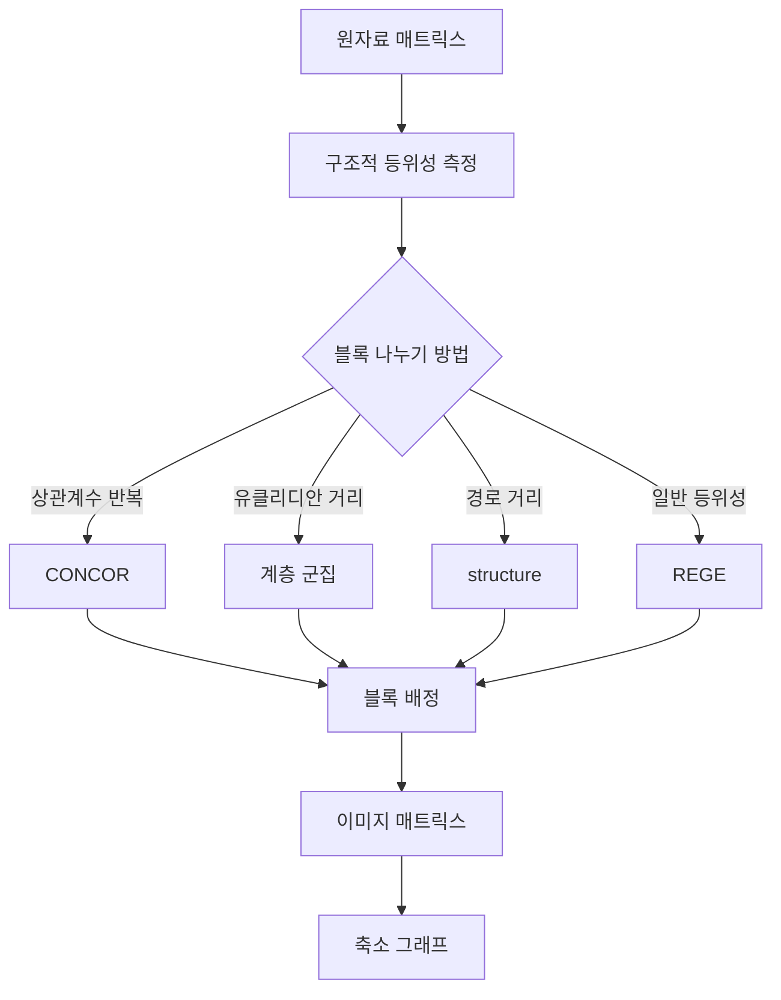
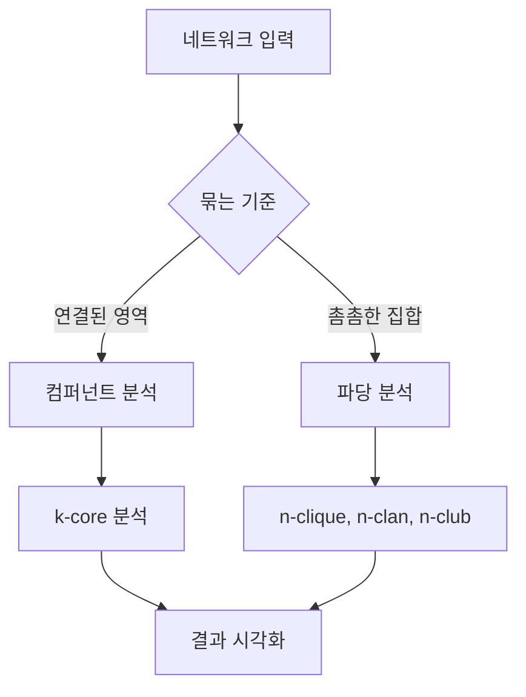

# 응답 템플릿

요청 유형에 맞는 틀을 골라 응답을 구성한다. 요청 특성에 따라 절을 더하거나 뺄 수 있지만 처리 과정, 계산, 결과, 해석의 순서는 유지한다. 절 제목의 대괄호는 실제 분석 대상과 기법 이름으로 바꾼다.

## 작성 원칙

- (개조식) 주장은 불릿으로 쓰고 소제목은 "(키워드) 서술" 형식을 쓴다. 문장은 명사형으로 끝내고 마침표는 생략한다.
- (수식) 지표의 정의는 LaTeX 수식으로 적는다.
- (코드) 모든 계산은 실행한 파이썬 코드를 함께 보여 준다. 독자가 같은 코드로 같은 결과를 얻을 수 있어야 한다.
- (그림) 그림 파일은 파일 전달 기능으로 따로 보낸다. 본문에는 `` 구문을 쓰지 않고 "그림 파일 별도 전달" 정도만 적는다.
- (파일 확인) 그림을 언급하기 전에 파일이 실제로 저장되었는지 확인한다. 생성하지 못한 파일은 언급하지 않는다.
- (간결성) 같은 내용을 여러 절에서 반복하지 않는다.

## 데이터 분석 요청(템플릿 A)

사용자가 데이터를 주고 분석을 요청한 경우에 쓴다.

````markdown
# [분석 대상] 네트워크 분석

## 분석 개요
- (질문 해석) 사용자 질문의 요지 1-2문장
- (적용 기법) 선택한 분석 기법
- (데이터 특성) 노드 수, 라인 수, 방향 여부, 가중치 여부

## 처리 과정


## 분석 방법

### [기법 이름]
- (정의) 개념 정의 1-2줄
- (수식)
$$
LaTeX 수식
$$
- (구현)
```python
실행한 코드
```

## 입력 데이터 매트릭스
build_response_block 또는 matrix_to_markdown 출력

## 분석 결과
dataframe_to_markdown 출력
그림 파일 별도 전달

## 해석과 시사점
- (주요 결론) 가장 중요한 발견
- (구조적 특징) 네트워크 전체 구조의 특징
- (실무 적용) 현실에서 취할 수 있는 조치
````

## 개념 설명 요청(템플릿 B)

사용자가 데이터 없이 개념을 물은 경우에 쓴다. 노드 5개에서 10개의 가상 네트워크로 시연하고 가상 데이터임을 밝힌다.

````markdown
# [개념 이름]

## 개념 정의
- (정의) 개념 설명
- (출처) 원저자와 연도

## 작동 원리
- (원리 이름) 설명

## 시연
```python
가상 네트워크 생성과 계산 코드
```
시연 결과 표, 그림 파일 별도 전달

## 적용
- (활용 사례) 실무 적용 예
- (유의 사항) 해석할 때 확인할 조건
````

## 연습 문제 풀이(템플릿 C)

사용자가 시험이나 과제 문제라고 밝힌 경우에 쓴다.

````markdown
# [문제 주제] 풀이

## 문제 해석
- (주어진 조건) 문제의 데이터와 요구 사항
- (구할 값) 계산하거나 찾아야 할 대상

## 풀이

### 1단계 [단계 이름]
- (접근) 풀이 방법
- (계산)
$$
LaTeX 수식
$$

### 2단계 코드 검증
```python
NetworkX 검증 코드
```

## 정답
최종 답과 근거

## 검산
코드 결과와 손 계산의 일치 여부, 그림 파일 별도 전달
````

## Mermaid 흐름도 예시

### 기본 분석


### 블록모델링



### 하위집단 분석


