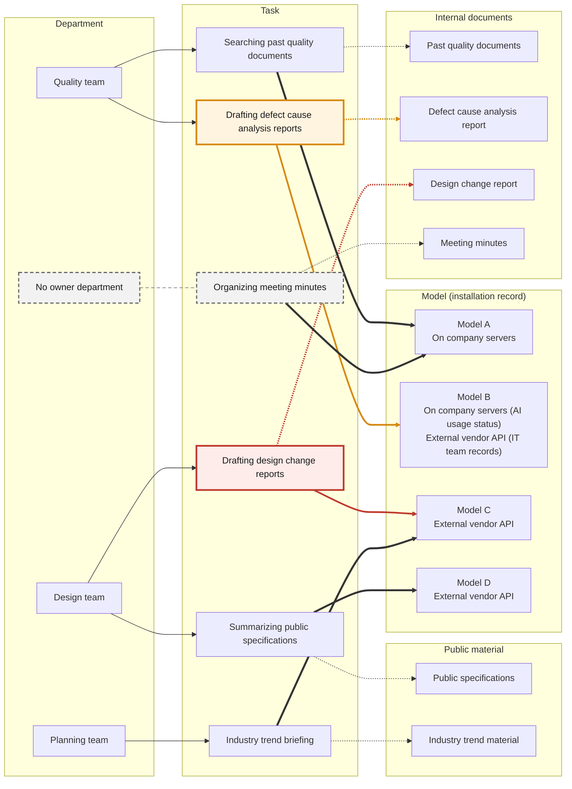

# Stop using external vendor API models for tasks that handle internal documents

## Verdict by task
- The design team's design change report drafting handles internal documents with an external vendor API (Application Programming Interface) model, a breach of the company security rules
- The quality team's defect cause analysis report drafting has no settled verdict because model B's installation records disagree
- Organizing meeting minutes has no owner department, a gap in responsibility for rule compliance

| Task | Owner department | Model used (installation record) | Document handled (type) | Security rule verdict |
|---|---|---|---|---|
| Drafting design change reports | Design team | Model C (external vendor API) | Design change report (internal document) | Violation |
| Drafting defect cause analysis reports | Quality team | Model B (company servers in the AI usage status, external vendor API in the IT team records) | Defect cause analysis report (internal document) | Not settled |
| Organizing meeting minutes | Not set | Model A (company servers) | Meeting minutes (internal document) | Compliant |
| Searching past quality documents | Quality team | Model A (company servers) | Past quality documents (internal document) | Compliant |
| Summarizing public specifications | Design team | Model D (external vendor API) | Public specifications (public material) | Not covered |
| Industry trend briefing | Planning team | Model C (external vendor API) | Industry trend material (public material) | Not covered |

## Task link structure
- Tasks linked both to internal documents and to a model with an external vendor API record are design change report drafting and defect cause analysis report drafting



- Task box borders mark the check result
    + (Red) A task that breaches the security rules, with its model and document links
    + (Orange) A task whose rule compliance is not settled, with its model and document links
    + (Gray dashed) A task with no owner department
- Line styles mark the link type
    + (Thin solid arrow) A task a department owns
    + (Thick solid arrow) A model a task uses
    + (Dashed arrow) A document a task handles

## Results by check item

### Rule breach in drafting design change reports
- (Breach) Using model C to draft design change reports breaches the company security rule that allows only models installed on company servers
    + (Document handled) Design change reports are internal documents
    + (Model record) The AI usage status lists model C as used through an external vendor API
- (Model switch) The model used to draft design change reports needs to switch to one installed on company servers
    + (Candidate) The company server model with no disagreement between sources is model A
    + (Before the switch) Stop using model C for design change report drafting

### Disagreeing installation records for model B
- (Compliance) Whether defect cause analysis report drafting breaches the rules is not settled because model B's installation records disagree
    + (AI usage status) Model B installed and used on company servers
    + (IT team records) Model B used through an external vendor API
    + (Verdict on the IT team records) A breach, as the task handles defect cause analysis reports, which are internal documents
- (Path check) The actual path by which defect cause analysis report drafting calls model B needs confirming
    + A per-task check of the call path also shows whether the company server install and the external vendor API are both in use
    + Record the result identically in the AI usage status and the IT team records
- (Use on hold) Use of model B for defect cause analysis report drafting needs to be held until the path check is done
    + The hold stops further use that may breach the rules from piling up
    + Use resumes if the path turns out to be the company server install

### Owner department gap for organizing meeting minutes
- (Gap) Organizing meeting minutes, a task that handles internal meeting minutes, has no owner department
    + Model A, the model now in use, is recorded as installed on company servers and meets the rule
    + With no owner department, no one decides on rule compliance if the model changes
- (Assign an owner) Name an owner department for organizing meeting minutes and give it responsibility for rule compliance of the model used

## Basis for the check

### Check conditions
- (Basis for verdicts) The tasks, departments, models, documents and installation methods listed in the AI usage status and the IT team records
- (Process) Build, check and figure done in one pass with no prior review of the structure design
- (Automatic classification rules) Only no overlap between item types and the automatic classification of tasks that handle internal documents with a model that has an external vendor API record

### Query results by check question
- (Question 1) Tasks that handle internal documents with a model that has an external vendor API record
    + (Answer) Drafting design change reports (model C, per the AI usage status) and drafting defect cause analysis reports (model B, per the IT team records)
    + (Return value) `[('defect_cause_report_drafting', 'model_b', 'defect_cause_analysis_report', 'IT team records'), ('design_change_report_drafting', 'model_c', 'design_change_report', 'AI usage status')]`

```sparql
SELECT ?task ?model ?document ?source WHERE {
  ?task a :Task .
  ?task :handles_document ?document .
  ?document a :InternalDocument .
  ?task :uses_model ?model .
  ?record :about_model ?model .
  ?record :states_mode :external_api .
  ?record :source_name ?source .
}
```

> (Query) A statement in a standard query language that finds the tasks, models and documents meeting the conditions in the link structure file

- (Question 2) Tasks missing a link to an owner department, a model used or a document handled
    + (Answer) 1 task, organizing meeting minutes, missing its owner department link
    + (Return value) owner department `['meeting_minutes_organizing']`, model used `[]`, document handled `[]`

```sparql
SELECT ?ind WHERE { ?ind a :Task . FILTER NOT EXISTS { ?ind :performed_by ?ref } }
SELECT ?ind WHERE { ?ind a :Task . FILTER NOT EXISTS { ?ind :uses_model ?ref } }
SELECT ?ind WHERE { ?ind a :Task . FILTER NOT EXISTS { ?ind :handles_document ?ref } }
```

- (Question 3) Models with no installation record or with records that differ by source
    + (Answer) 1 model, model B, with records that differ by source
    + (Return value) disagreeing records `[('model_b', 'external_api', 'IT team records', 'on_premise_server', 'AI usage status')]` and no record `[]`

```sparql
SELECT ?model ?mode1 ?source1 ?mode2 ?source2 WHERE {
  ?r1 :about_model ?model . ?r1 :states_mode ?mode1 . ?r1 :source_name ?source1 .
  ?r2 :about_model ?model . ?r2 :states_mode ?mode2 . ?r2 :source_name ?source2 .
  FILTER(STR(?mode1) < STR(?mode2))
}
SELECT ?model WHERE {
  ?model a :AIModel .
  FILTER NOT EXISTS { ?record :about_model ?model }
}
```

### Records not entered
- Installation records for models A, C and D in the IT team records not entered
    + The violation verdict for design change report drafting and the compliant verdicts for tasks using model A rest on the AI usage status records
    + When model B is confirmed, the IT team records for the other models need to be cross-checked
