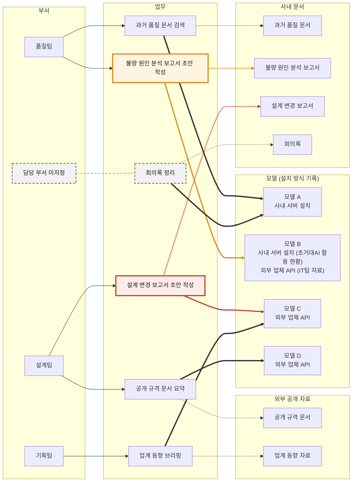

# 사내 문서 처리 업무의 외부 업체 API 모델 사용 중단 필요

## 업무별 판정
- 설계팀의 설계 변경 보고서 초안 작성은 외부 업체 API(Application Programming Interface) 모델로 사내 문서를 다루어 사내 보안 규정 위반
- 품질팀의 불량 원인 분석 보고서 초안 작성은 모델 B의 설치 방식 기록 불일치로 규정 위반 여부 미확정
- 회의록 정리는 담당 부서 미지정으로 규정 준수 관리 책임 공백

| 업무 | 담당 부서 | 사용 모델 (설치 방식 기록) | 처리 문서 (구분) | 보안 규정 판정 |
|---|---|---|---|---|
| 설계 변경 보고서 초안 작성 | 설계팀 | 모델 C (외부 업체 API) | 설계 변경 보고서 (사내 문서) | 위반 |
| 불량 원인 분석 보고서 초안 작성 | 품질팀 | 모델 B (초거대AI 활용 현황 기재 사내 서버 설치 및 IT팀 자료 기재 외부 업체 API) | 불량 원인 분석 보고서 (사내 문서) | 미확정 |
| 회의록 정리 | 미지정 | 모델 A (사내 서버 설치) | 회의록 (사내 문서) | 충족 |
| 과거 품질 문서 검색 | 품질팀 | 모델 A (사내 서버 설치) | 과거 품질 문서 (사내 문서) | 충족 |
| 공개 규격 문서 요약 | 설계팀 | 모델 D (외부 업체 API) | 공개 규격 문서 (외부 공개 자료) | 적용 대상 외 |
| 업계 동향 브리핑 | 기획팀 | 모델 C (외부 업체 API) | 업계 동향 자료 (외부 공개 자료) | 적용 대상 외 |

## 업무 연결 구조
- 사내 문서와 외부 업체 API 사용 기록 모델이 한 업무에 함께 연결된 사례는 설계 변경 보고서 초안 작성 및 불량 원인 분석 보고서 초안 작성



- 업무 상자의 테두리 색으로 점검 결과 구분
    + (빨간색) 보안 규정 위반 업무와 그 업무의 모델 및 문서 연결
    + (주황색) 규정 위반 여부 미확정 업무와 그 업무의 모델 및 문서 연결
    + (회색 점선) 담당 부서 미지정 업무
- 선 모양으로 연결 종류 구분
    + (가는 실선 화살표) 부서가 담당하는 업무
    + (굵은 실선 화살표) 업무가 쓰는 모델
    + (점선 화살표) 업무가 다루는 문서

## 점검 항목별 결과

### 설계 변경 보고서 초안 작성의 규정 위반
- (위반 내용) 설계 변경 보고서 초안 작성의 모델 C 사용은 사내 서버 설치 모델만 허용하는 사내 보안 규정 위반
    + (처리 문서) 설계 변경 보고서는 사내 문서
    + (모델 기록) 모델 C는 초거대AI 활용 현황에 외부 업체 API 방식으로 기재
- (모델 전환) 설계 변경 보고서 초안 작성의 사용 모델을 사내 서버 설치 모델로 전환 필요
    + (전환 후보) 출처 간 기록 차이가 없는 사내 서버 설치 모델은 모델 A
    + (전환 전 조치) 설계 변경 보고서 초안 작성의 모델 C 사용 중단

### 모델 B의 설치 방식 기록 불일치
- (위반 여부) 모델 B의 설치 방식 기록 불일치로 불량 원인 분석 보고서 초안 작성의 규정 위반 여부 미확정
    + (초거대AI 활용 현황) 모델 B를 사내 서버에 설치하여 사용
    + (IT팀 자료) 모델 B를 외부 업체 API 방식으로 사용
    + (IT팀 자료 기준 판정) 사내 문서인 불량 원인 분석 보고서를 다루는 업무의 규정 위반
- (경로 조사) 불량 원인 분석 보고서 초안 작성 업무가 호출하는 모델 B의 실제 경로 확인 필요
    + 업무 단위 호출 경로 조사로 사내 서버 설치와 외부 업체 API의 동시 사용 여부까지 판별
    + 조사 결과를 초거대AI 활용 현황과 IT팀 자료에 같은 내용으로 반영
- (사용 보류) 경로 조사 완료 전까지 불량 원인 분석 보고서 초안 작성의 모델 B 사용 보류 필요
    + 보류로 규정 위반 가능 사용분의 추가 누적 방지
    + 사내 서버 설치 경로로 판명 시 사용 재개

### 회의록 정리의 담당 부서 공백
- (공백 내용) 사내 문서인 회의록을 다루는 회의록 정리 업무의 담당 부서 미지정
    + 현재 사용 모델인 모델 A는 사내 서버 설치 기록 모델로 규정 충족
    + 담당 부서 부재로 사용 모델 변경 시 규정 준수 여부의 판단 주체 공백
- (부서 지정) 회의록 정리의 담당 부서를 지정하여 사용 모델의 규정 준수 관리 책임 부여

## 점검 근거 자료

### 점검 조건
- (판정 근거) 초거대AI 활용 현황과 IT팀 자료에 기재된 업무, 부서, 모델, 문서, 설치 방식
- (진행 방식) 구조 설계안의 사전 확인 없이 구축, 점검, 그림 작성을 한 번에 진행
- (자동 판정 규칙) 항목 유형 간 중복 금지 및 외부 업체 API 사용 기록이 있는 모델로 사내 문서를 다루는 업무의 자동 분류만 적용

### 점검 질문별 질의 결과
- (질문 1) 사내 문서를 다루는 업무 가운데 외부 업체 API 사용 기록이 있는 모델을 쓰는 업무
    + (답) 설계 변경 보고서 초안 작성(초거대AI 활용 현황 기재 모델 C) 및 불량 원인 분석 보고서 초안 작성(IT팀 자료 기재 모델 B)
    + (반환값) `[('defect_cause_report_drafting', 'model_b', 'defect_cause_analysis_report', 'IT팀 자료'), ('design_change_report_drafting', 'model_c', 'design_change_report', '초거대AI 활용 현황')]`

```sparql
SELECT ?task ?model ?document ?source WHERE {
  ?task a :Task .
  ?task :handles_document ?document .
  ?document a :InternalDocument .
  ?task :uses_model ?model .
  ?record :about_model ?model .
  ?record :states_mode :external_api .
  ?record :source_name ?source .
}
```

> (질의문) 연결 구조 파일에서 조건에 맞는 업무, 모델, 문서를 찾는 표준 질의 언어의 문장

- (질문 2) 담당 부서, 사용 모델, 처리 문서 가운데 연결이 누락된 업무
    + (답) 담당 부서 연결이 누락된 회의록 정리 1건
    + (반환값) 담당 부서 `['meeting_minutes_organizing']`, 사용 모델 `[]`, 처리 문서 `[]`

```sparql
SELECT ?ind WHERE { ?ind a :Task . FILTER NOT EXISTS { ?ind :performed_by ?ref } }
SELECT ?ind WHERE { ?ind a :Task . FILTER NOT EXISTS { ?ind :uses_model ?ref } }
SELECT ?ind WHERE { ?ind a :Task . FILTER NOT EXISTS { ?ind :handles_document ?ref } }
```

- (질문 3) 설치 방식 기록이 없거나 출처마다 다른 모델
    + (답) 출처마다 기록이 다른 모델 B 1건
    + (반환값) 기록 불일치 `[('model_b', 'external_api', 'IT팀 자료', 'on_premise_server', '초거대AI 활용 현황')]` 및 기록 없음 `[]`

```sparql
SELECT ?model ?mode1 ?source1 ?mode2 ?source2 WHERE {
  ?r1 :about_model ?model . ?r1 :states_mode ?mode1 . ?r1 :source_name ?source1 .
  ?r2 :about_model ?model . ?r2 :states_mode ?mode2 . ?r2 :source_name ?source2 .
  FILTER(STR(?mode1) < STR(?mode2))
}
SELECT ?model WHERE {
  ?model a :AIModel .
  FILTER NOT EXISTS { ?record :about_model ?model }
}
```

### 입력되지 않은 기록
- IT팀 자료의 모델 A, 모델 C, 모델 D 설치 방식 기재 내용 미입력
    + 설계 변경 보고서 초안 작성의 위반 판정과 모델 A 사용 업무의 충족 판정은 초거대AI 활용 현황의 기록에 근거
    + 모델 B 확인 시 IT팀 자료의 다른 모델 기재 내용 대조 필요
