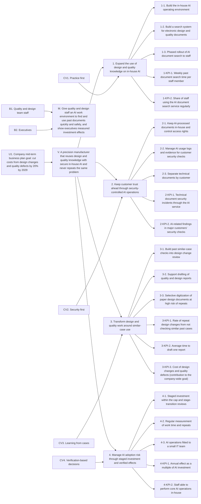

# OO Precision AI strategy framework (one-stop mode)

| Item | Option applied |
|---|---|
| Analysis path | SWOT, fixed, follow-up Y, standard strategy type |
| Issues | Auto draft, refined confirmation |
| Environment analysis | Macro, micro and internal free input, benchmarking skipped |
| Strategic goals | Dual |
| Strategic tasks / implementation tasks | Auto-derived / skipped |
| KPIs | Strategy level, BSC track |
| Time format | Short, mid and long term (defined as short 2027, mid 2028, long 2029) |
| Check method | Script |

---

## Stage 1 Project setup

### Hypothesis and scope

| Item | Content |
|---|---|
| Purpose | Build OO Precision's AI strategy framework |
| Subject | OO Precision, a mid-sized manufacturer |
| Spatial scope | Headquarters and 2 domestic plants |
| Time scope | 2027-2029 |

### Beneficiary needs

| No. | Beneficiary | Need |
|---|---|---|
| B1 | Quality and design team staff | Less time searching past documents and drafting reports |
| B2 | Executives | Confirm the return on AI investment |

### Upper alignment

- U1. Company mid-term business plan goal "cut costs from design changes and quality defects by 20% by 2029." Used as the top-down input when deriving the vision in stage 7

### Draft issues (auto)

Written from the hypothesis, beneficiary needs and upper alignment only. Reviewed again against the implications in stage 6.

| No. | Draft | Basis |
|---|---|---|
| D1 | Time burden on quality and design staff for past document search and report drafting | B1 |
| D2 | No established path for AI to contribute to the goal of cutting design change and quality defect costs | U1 |
| D3 | No means for executives to confirm the return on AI investment | B2 |

- Check (stage 1): passed

---

## Stage 2 External environment analysis (free input)

### Macro environment

- F1. Inference cost of a system performing at the GPT-3.5 level fell more than 280-fold between November 2022 and October 2024 (Stanford HAI, 2025)
- F2. Performance gap between open-weight and closed models on some benchmarks narrowed from 8% to 1.7% in one year (same report)
- F3. Share of companies reporting AI use rose from 55% in 2023 to 78% in 2024 (same report)
- F4. Computing support in the Ministry of Science and ICT's "Plan to Strengthen Hyperscale AI Competitiveness" (April 2023) goes to small and venture companies, universities and research institutes
- F5. The same plan's goal of building 200 kinds of training data and 130 Korean corpora by 2027

### Micro environment

- F6. Two competitors in the same industry adopted AI for design document search in 2025
- F7. Major customers tightened checks on suppliers' technical document security from 2026

### Cautions in interpretation

- F3 is a figure for respondent companies worldwide and is not read as the adoption rate of Korean manufacturers
- F4 and F5 reflect the plan announced in April 2023, and their status as of 2026 is not confirmed by the submitted material
- Mid-sized companies are not among F4's support targets, so government computing support is not treated as an opportunity for the company and is classified as a threat (T1) in stage 6
- F6 states only the fact of adoption, and the competitors' results are not confirmed

### Sources

- Stanford HAI(2025), AI Index Report 2025(https://hai.stanford.edu/ai-index/2025-ai-index-report)
- Ministry of Science and ICT(2023), KRW 390.1 billion invested to strengthen hyperscale AI competitiveness... "accelerating the digital economy"(https://www.korea.kr/news/policyNewsView.do?newsId=148913885)

---

## Stage 3 Internal status analysis (free input)

- F8. Company security rules forbid entering work documents into external generative AI services
- F9. The quality and design teams report a heavy time burden from past document search and report drafting. No measurement of the time spent (as stated in the input)
- F10. IT team of 5 people, no one dedicated to AI
- F11. Design documents kept as electronic files from 2015 onward, and on paper before that
- F12. Space and power for more servers in the headquarters server room
- F13. 48 quality and design team staff
- F14. In a 2-week sample measurement in Q3 2026, past document search took 4.8 hours a week per staff member on average and drafting one report took 6.5 hours on average
- F15. Costs from design changes and quality defects of KRW 5.9 billion in 2025
- F16. 61 of 412 design changes in 2025 were repeats of the same problem because similar past cases were not checked
- F17. AI investment cap of KRW 1.5 billion for 2027-2029 set by executives

### Inconsistency between data

- F9's "no measurement of the time spent" conflicts with F14's "2-week sample measurement"
- This result reads the two statements as "there is no ongoing measurement, only a 2-week sample from Q3 2026" and uses F14 as the baseline for time KPIs. If this reading is wrong, 1-KPI-1, 3-KPI-2 and strategy 1's quantitative goal become invalid, so it needs confirming (confirmation request 1)

---

## Stage 4 Benchmarking

- Skipped (user's choice). The to-be measures in stage 6 and the targets in stage 10 use no external case evidence

---

## Stage 5 Implications

### Macro environment

- I1. The cost barrier to AI adoption is falling as the price of AI at the same performance drops sharply (F1)
- I2. Open-weight models are catching up in performance, widening the choice of models usable in-house without external services, on some benchmarks (F2)
- I3. AI use is entering the stage of becoming everyday work practice at most companies, for respondent companies worldwide (F3)
- I4. Mid-sized companies are not among the targets of government computing support, so AI infrastructure costs must be funded in-house (F4)
- I5. Plans to expand Korean training data and corpora are expected to broaden the base for Korean AI use, with the company's terms of use unconfirmed (F5)
- I6. AI performance and cost structures change sharply every 1-2 years, so an early lump-sum investment in specific models and equipment may become obsolete quickly (F1, F2)

### Micro environment

- I7. Competitors' earlier adoption of AI for design document search may open a relative gap in how fast design knowledge is used (F6)
- I8. Customers' tighter checks on supplier document security make the level of technical document security management a condition for keeping business (F7)

### Internal status

- I9. External generative AI is blocked, so an in-house build is needed, but with no one dedicated to AI the company lacks the capacity to build and run it (F8, F10)
- I10. Security controls that block external input of technical documents are already institutionalized in company rules (F8)
- I11. Electronic design documents accumulated since 2015 form a document asset that can feed AI search right away (F11)
- I12. Design documents before 2015 exist only on paper, a knowledge blind spot that cannot be searched electronically (F11)
- I13. Spare space and power in the headquarters server room give a physical base for in-house AI equipment (F12)
- I14. Repetitive work burden of about 230 hours a week in total on document search for 48 staff (48 × 4.8 hours) and 6.5 hours per report draft. The basis is only a 2-week sample, and there is no ongoing measurement (F9, F13, F14)
- I15. 61 of 412 design changes (14.8%) were repeats from not checking past cases, so accumulated documents are not being used to prevent repeats. The cost of the repeats within the KRW 5.9 billion is not tallied (F15, F16)
- I16. AI investment funding of KRW 1.5 billion for 2027-2029 is set, fixing both the funds and the cap (F17)

### Benchmarking

- Not applicable (stage 4 skipped)

- Check (stages 1-5): passed. All 17 facts reflected in implications, all 16 implications grounded in facts from the same sources

---

## Stage 6 Issue confirmation and strategy derivation

### Confirmed issues (refined)

| Confirmed issue | Stage 1 draft | Supporting implications | Refinement |
|---|---|---|---|
| P1. No in-house AI operating base (equipment, models, operations staff) under security rules that rule out external AI | New | I1, I2, I3, I4, I5, I9, I13 | An execution-base problem missing from the drafts, added from the implications. The ban on external services and the lack of dedicated staff are constraints to solve before any AI use |
| P2. Excessive time spent by quality and design staff on past document search and report drafting | D1 | I7, I11, I14 | Burden quantified as 48 staff, about 230 hours a week in total and 6.5 hours per draft, with the gap from competitors' earlier adoption added |
| P3. Repeat design changes and costs from not using similar past cases | D2 | I11, I12, I15 | "No established path" recast as the concrete path of 61 repeats (14.8%), reflecting the paper document blind spot |
| P4. Technical document security risk from AI adoption as customer security demands tighten | New | I8, I10 | Security split out as a separate issue, reflecting tighter customer checks |
| P5. No measurement system to verify the AI investment effect and no principle for staged investment | D3 | I4, I6, I14, I16 | The lack of measurement extended into an investment principle problem, adding obsolescence risk, exclusion from public support and the investment cap |

### SWOT factors

| No. | Type | Factor | Supporting implication |
|---|---|---|---|
| S1 | Strength | Accumulated electronic design document assets | I11 (internal) |
| S2 | Strength | Infrastructure to host in-house AI | I13 (internal) |
| S3 | Strength | AI investment funds set by executives | I16 (internal) |
| S4 | Strength | Institutionalized technical document security controls | I10 (internal) |
| W1 | Weakness | Lack of capacity to build and run AI in-house | I9 (internal) |
| W2 | Weakness | Search blind spot of past design documents kept on paper | I12 (internal) |
| W3 | Weakness | Repeat design changes from not checking past cases | I15 (internal) |
| W4 | Weakness | Repetitive document work and no impact measurement | I14 (internal) |
| O1 | Opportunity | Sharp drop in AI usage costs | I1 (macro) |
| O2 | Opportunity | Open-weight models catching up in performance | I2 (macro) |
| O3 | Opportunity | AI use becoming common in companies | I3 (macro) |
| O4 | Opportunity | Expansion of Korean training data and corpora | I5 (macro) |
| T1 | Threat | Mid-sized companies excluded from public computing support | I4 (macro) |
| T2 | Threat | Competitors' earlier adoption of design document search AI | I7 (micro) |
| T3 | Threat | Customers' tighter checks on supplier technical document security | I8 (micro) |
| T4 | Threat | Investment obsolescence risk from rapid changes in AI technology and cost | I6 (macro) |

### Strategy derivation (fixed, standard)

| Type | Factors | As-is implications | To-be measures | Strategy |
|---|---|---|---|---|
| SO | S1. Accumulated electronic design document assets S2. Infrastructure to host in-house AI S3. AI investment funds set by executives S4. Institutionalized technical document security controls O1. Sharp drop in AI usage costs O2. Open-weight models catching up in performance O3. AI use becoming common in companies O4. Expansion of Korean training data and corpora | Electronic documents accumulated since 2015 Server room space and power available KRW 1.5 billion investment funds set Rule banning input to external AI in force AI usage costs falling sharply Open-weight model performance close behind Corporate AI use spreading Korean data expansion plan | Build in-house AI on open-weight models in the headquarters server room Connect electronic design and quality documents from 2015 onward as Korean search targets Comply with security rules through a setup where documents never leave the company Pilot with the quality and design teams, then roll out to all staff | 1. Expand the use of design and quality knowledge on in-house AI (growth) |
| ST | S1. Accumulated electronic design document assets S2. Infrastructure to host in-house AI S3. AI investment funds set by executives S4. Institutionalized technical document security controls T1. Mid-sized companies excluded from public computing support T2. Competitors' earlier adoption of design document search AI T3. Customers' tighter checks on supplier technical document security T4. Investment obsolescence risk from rapid changes in AI technology and cost | Electronic documents accumulated since 2015 Server room space and power available KRW 1.5 billion investment funds set Rule banning input to external AI in force Not eligible for public computing support 2 competitors adopted earlier Customers tightening document security checks AI performance and cost changing sharply every 1-2 years | Limit document processing, storage and logs to company servers and separate access by customer Manage AI usage logs as evidence for customer security checks Secure security infrastructure with set funds, without public support Respond to rapid technology change with a setup that allows model replacement Make security trust a differentiator against competitors' earlier adoption | 2. Keep customer trust ahead through security-controlled AI operations (sustain advantage) |
| WO | W1. Lack of capacity to build and run AI in-house W2. Search blind spot of past design documents kept on paper W3. Repeat design changes from not checking past cases W4. Repetitive document work and no impact measurement O1. Sharp drop in AI usage costs O2. Open-weight models catching up in performance O3. AI use becoming common in companies O4. Expansion of Korean training data and corpora | No dedicated AI staff, IT team of 5 Documents before 2015 kept on paper 61 of 412 design changes were repeats Search 4.8 hours a week, drafts 6.5 hours, no ongoing measurement AI usage costs falling sharply Open-weight model performance close behind Corporate AI use spreading Korean data expansion plan | Make up for the staff shortage by adopting open-weight models instead of in-house development Build an AI similar-case check into the design change review step Switch to AI drafting reports with staff reviewing them Digitize paper documents selectively, starting with those at high risk of repeats | 3. Transform design and quality work around similar-case use (innovation) |
| WT | W1. Lack of capacity to build and run AI in-house W2. Search blind spot of past design documents kept on paper W3. Repeat design changes from not checking past cases W4. Repetitive document work and no impact measurement T1. Mid-sized companies excluded from public computing support T2. Competitors' earlier adoption of design document search AI T3. Customers' tighter checks on supplier technical document security T4. Investment obsolescence risk from rapid changes in AI technology and cost | No dedicated AI staff, IT team of 5 Documents before 2015 kept on paper 61 of 412 design changes were repeats No ongoing measurement Not eligible for public computing support 2 competitors adopted earlier Customers tightening document security checks AI performance and cost changing sharply every 1-2 years | Split the investment cap into pilot, expansion and full stages and decide follow-on investment on each stage's measured effects Measure search time, drafting time and repeat rate regularly Prevent operational gaps by naming operations owners and using external expert support Expand the scope of paper document digitization step by step according to its effect on repeats Respond to competitors catching up and customer security demands within verified scope | 4. Manage AI adoption risk through staged investment and verified effects (risk management) |

### Fixed follow-up (Y): confirm strategies and link issues

The strategic directions are confirmed unchanged, and the issues are linked to each strategy.

| Strategy | Type | Issues solved | Beneficiary benefit |
|---|---|---|---|
| 1. Expand the use of design and quality knowledge on in-house AI | SO | P1, P2 | B1 less time searching past documents B2 an in-house base for further AI use |
| 2. Keep customer trust ahead through security-controlled AI operations | ST | P4 | B1 AI use without fear of breaching security rules B2 customer business risk blocked |
| 3. Transform design and quality work around similar-case use | WO | P2, P3 | B1 less drafting time and rework B2 lower repeat costs |
| 4. Manage AI adoption risk through staged investment and verified effects | WT | P1, P5 | B2 return on investment confirmed B1 stable service operation |

- Check (stages 1-6): passed. Factor source rules, full use of factors by type, and the 1-to-1 match of the 4 fixed strategies to SO, ST, WO and WT confirmed

---

## Stage 7 Vision, mission, core values

| Item | Top-down | Bottom-up | Final |
|---|---|---|---|
| Vision | U1 cut design change and quality defect costs by 20% by 2029 | Safe reuse of company document knowledge, the common aim of strategies 1-4 | A precision manufacturer that reuses design and quality knowledge with secure in-house AI and never repeats the same problem |
| Mission | U1 means of delivering the cost cut | B1 time savings, B2 confirmation of investment effects | Give quality and design staff an AI work environment to find and use past documents quickly and safely, and show executives measured investment effects |
| Core values | Accountability for cost savings | Practical use, security, reuse of cases, verification of effects | Practice first, security first, learning from cases, verification-based decisions |

| Strategy no. | Strategy | Core value |
|---|---|---|
| 1 | Expand the use of design and quality knowledge on in-house AI | Practice first: build first the functions staff actually use |
| 2 | Keep customer trust ahead through security-controlled AI operations | Security first: weigh document security before convenience |
| 3 | Transform design and quality work around similar-case use | Learning from cases: check past cases before deciding |
| 4 | Manage AI adoption risk through staged investment and verified effects | Verification-based decisions: decide the next investment on measured effects |

- Check (stages 1-7): passed. Vision linked to upper alignment (U1), mission linked to beneficiaries (B1, B2), and one core value per strategy confirmed

---

## Stage 8 Strategic goals and strategic tasks

### Strategic goals (dual)

| Strategy no. | Strategy | Qualitative strategic goal | Quantitative strategic goal |
|---|---|---|---|
| 1 | Expand the use of design and quality knowledge on in-house AI | Quality and design staff find past documents quickly with in-house AI within the security rules | Cut past document search time per staff member from 4.8 hours a week (Q3 2026 sample) to 2.4 hours or less a week by 2029 |
| 2 | Keep customer trust ahead through security-controlled AI operations | Technical documents stay in-house throughout AI use and customer security check requirements are met | Keep technical document security incidents through the AI service at 0 for 2027-2029 |
| 3 | Transform design and quality work around similar-case use | Checking similar past cases is a standard step in design change review and report writing | Cut the rate of repeat design changes from not checking similar past cases from 14.8% (2025, 61/412) to 7.4% or less by 2029 |
| 4 | Manage AI adoption risk through staged investment and verified effects | Investment grows only in stages whose effect is confirmed, and a small IT team runs AI stably | Reach an annual effect of 1.0 times the AI investment or more by 2029 (within the KRW 1.5 billion cap, provisional) |

- One quantitative strategic goal per strategy, all with baselines from the internal status figures. The logic is in "Basis for targets" in stage 10
- Strategy 4's quantitative goal is provisional. The labor cost rate and cost per design change needed to turn effects into money were not submitted (confirmation request 3)

### Candidate strategic tasks (auto-derived)

| Strategy | Candidate task | Issue / factors | Beneficiary benefit | Decision |
|---|---|---|---|---|
| 1 | Build an in-house AI operating environment by expanding the headquarters server room and adopting open-weight models | P1 / S2, S3, O1, O2 | B1 in-house AI usable | Adopted (1-1) |
| 1 | Organize and index electronic design and quality documents from 2015 onward and build Korean search | P2 / S1, O4 | B1 less search time | Adopted (1-2) |
| 1 | Pilot with the quality and design teams, then roll out to all staff in stages | P2 / O3 | B1 benefit spreads | Adopted (1-3) |
| 1 | Extend coverage to domestic plant floor documents and workers | P2 / O3 | Outside the beneficiary scope | On hold: outside the beneficiary (B1) scope, to be reviewed after 2029 given the investment cap |
| 2 | Limit where AI-processed documents are processed and stored to the company, and control access rights by job | P4 / S2, S4, T3 | B1 rule-compliant use B2 business risk blocked | Adopted (2-1) |
| 2 | Keep AI usage logs (queries, documents viewed) and set up evidence for customer security checks | P4 / S4, T3 | B2 lighter check burden | Adopted (2-2) |
| 2 | Separate technical documents by customer so other customers' documents never mix into search results | P4 / S1, T3 | B2 customer trust kept | Adopted (2-3) |
| 2 | Obtain an external information security certification | P4 / T3 | B2 | On hold: not confirmed whether customer checks require certification |
| 3 | Make attaching AI similar-case search results a mandatory step in design change review | P3 / W3, O2 | B1 less rework B2 lower repeat costs | Adopted (3-1) |
| 3 | Introduce AI drafting with staff review for each quality and design report template | P2 / W4, O2, O4 | B1 less drafting time | Adopted (3-2) |
| 3 | Digitize paper design documents from before 2015 selectively, starting with product lines tied to repeat cases | P3 / W2, O1 | B1 wider search scope B2 fewer repeats | Adopted (3-3) |
| 3 | AI-based automatic drawing generation | None / W1 | Outside beneficiary needs | Excluded: outside beneficiary needs (search, drafting) and too risky while capacity is lacking (W1) |
| 4 | Split the investment cap into pilot (2027), expansion (2028) and full (2029) stages and run stage-transition reviews | P5 / W4, T1, T4 | B2 investment risk controlled | Adopted (4-1) |
| 4 | Measure search time, drafting time and repeat counts regularly with the same method as the baseline | P5 / W4 | B2 effects confirmed | Adopted (4-2) |
| 4 | Set up operations fitted to a small IT team, with a named AI operations owner, external expert support and a setup that allows model replacement | P1 / W1, T4 | B1 stable service B2 lower operational risk | Adopted (4-3) |
| 4 | Create a dedicated AI organization | P1 / W1 | B1, B2 | On hold: excessive for an IT team of 5 and the investment cap, replaced by 4-3 |

### Confirmed strategic tasks (pending approval)

| Strategy no. | Task no. | Strategic task |
|---|---|---|
| 1 | 1-1 | Build the in-house AI operating environment |
| 1 | 1-2 | Build a search system for electronic design and quality documents |
| 1 | 1-3 | Phased rollout of AI document search to staff |
| 2 | 2-1 | Keep AI-processed documents in-house and control access rights |
| 2 | 2-2 | Manage AI usage logs and evidence for customer security checks |
| 2 | 2-3 | Separate technical documents by customer |
| 3 | 3-1 | Build past similar-case checks into design change review |
| 3 | 3-2 | Support drafting of quality and design reports |
| 3 | 3-3 | Selective digitization of paper design documents at high risk of repeats |
| 4 | 4-1 | Staged investment within the cap and stage-transition reviews |
| 4 | 4-2 | Regular measurement of work time and repeats |
| 4 | 4-3 | AI operations fitted to a small IT team |

### Logic linking strategies and tasks

- Strategy 1: a base, target and rollout structure in which 1-1 provides the execution base (P1), 1-2 the documents to search and 1-3 delivers the benefit to staff (P2)
- Strategy 2: a structure that meets customer check requirements (P4) in advance through 2-1 control of processing scope, 2-2 evidence and 2-3 separation by customer
- Strategy 3: a structure that changes the work process itself through 3-1 blocking repeats (P3), 3-2 cutting drafting time (P2) and 3-3 shrinking the blind spot (P3)
- Strategy 4: a structure that caps the cost of failure through 4-1 staged investment (P5), 4-2 impact measurement (P5) and 4-3 preventing operational gaps (P1)
- The pilot (2027), expansion (2028) and full (2029) split of 4-1 applies to all strategies and matches the short, mid and long-term targets of stage 10
- The investment amount per stage is not set in this result because there are no quotes for equipment and digitization

- Check (stages 1-8): passed. Mutual links between the 5 issues and 4 strategies, dual goals stated, task number format and parent strategies confirmed

---

## Stage 9 Implementation tasks

- Skipped (user's choice). The state file records the implementation task stage as not run, with 0 implementation tasks
- Check (stages 1-9): passed

---

## Stage 10 KPIs (strategy level, BSC)

### Rules applied

- Level applied: strategy level. KPIs set for the 4 strategies only
- KPI types: only Outcome and Impact, the strategy-level types in the BSC track
- At least 2 KPIs per strategy, placed across the financial, customer, internal process and learning and growth perspectives
- Deadlines: short term 2027, mid term 2028, long term 2029

### Candidate KPIs and selection

| Strategy | Candidate KPI | Type | BSC perspective | Decision |
|---|---|---|---|---|
| 1 | Weekly past document search time per staff member | Outcome | Internal process | Adopted (1-KPI-1) |
| 1 | Share of staff using the AI document search service regularly | Outcome | Customer (internal beneficiaries) | Adopted (1-KPI-2) |
| 1 | Share of electronic documents indexed for search | Output | Internal process | Excluded: not a strategy-level type. Used to manage task 1-2 |
| 1 | Staff satisfaction with search | Outcome | Customer (internal beneficiaries) | On hold: no baseline. Review after the first measurement in 2027 |
| 2 | Technical document security incidents through the AI service | Outcome | Internal process | Adopted (2-KPI-1) |
| 2 | AI-related findings in major customers' security checks | Outcome | Customer (external customers) | Adopted (2-KPI-2) |
| 2 | Share of documents with access rights applied | Output | Internal process | Excluded: not a strategy-level type |
| 3 | Rate of repeat design changes from not checking similar past cases | Outcome | Internal process | Adopted (3-KPI-1) |
| 3 | Average time to draft one report | Outcome | Internal process | Adopted (3-KPI-2) |
| 3 | Cost of design changes and quality defects | Impact | Financial | Adopted (3-KPI-3, contribution to the company-wide goal) |
| 3 | Number of paper documents digitized | Output | Internal process | Excluded: a simple count, not a strategy-level type |
| 4 | Annual effect as a multiple of AI investment | Impact | Financial | Adopted (4-KPI-1, provisional) |
| 4 | Staff able to perform core AI operations in-house | Outcome | Learning and growth | Adopted (4-KPI-2) |
| 4 | Spending against the investment cap | Input | Financial | Excluded: an input KPI. Used to manage task 4-1 |

### Confirmed KPIs

| No. | Parent element | KPI | Type | Measurement | Target | Deadline |
|---|---|---|---|---|---|---|
| 1-KPI-1 | Mission | Weekly past document search time per staff member | Outcome | (Sample) work logs of the 48 quality and design staff for 2 weeks in Q3 each year, average weekly search time per person | Short 4.3 hours or less Mid 3.4 hours or less Long 2.4 hours or less | Short (2027) Mid (2028) Long (2029) |
| 1-KPI-2 | Mission | Share of staff using the AI document search service regularly | Outcome | (Formula) staff with 4+ uses a month / quality and design staff × 100 | Short 25% or more (12) Mid 60% or more (29) Long 90% or more (44) | Short (2027) Mid (2028) Long (2029) |
| 2-KPI-1 | Vision | Technical document security incidents through the AI service | Outcome | (Count) annual total from AI usage log reviews and security incident reports | Short 0 Mid 0 Long 0 | Short (2027) Mid (2028) Long (2029) |
| 2-KPI-2 | Vision | AI-related findings in major customers' security checks | Outcome | (Count) annual total of AI-related findings in major customers' checks of supplier technical document security | Short 0 Mid 0 Long 0 | Short (2027) Mid (2028) Long (2029) |
| 3-KPI-1 | Vision | Rate of repeat design changes from not checking similar past cases | Outcome | (Formula) repeat design changes from not checking similar past cases / all design changes × 100 | Short 13.3% or less Mid 10.4% or less Long 7.4% or less | Short (2027) Mid (2028) Long (2029) |
| 3-KPI-2 | Mission | Average time to draft one report | Outcome | (Sample) average time per report draft written during 2 weeks in Q3 each year | Short 5.9 hours or less Mid 4.9 hours or less Long 3.9 hours or less | Short (2027) Mid (2028) Long (2029) |
| 3-KPI-3 | Vision | Cost of design changes and quality defects (contribution to the company-wide goal) | Impact | (Total) annual cost of design changes and quality defects, with repeat costs tallied separately | Short KRW 5.31 billion or less Mid KRW 5.015 billion or less Long KRW 4.72 billion or less | Short (2027) Mid (2028) Long (2029) |
| 4-KPI-1 | Mission | Annual effect as a multiple of AI investment | Impact | (Formula) (work hours saved × hourly labor cost + reduction in repeat design changes × average cost per case) / annualized AI investment (cumulative spending ÷ years elapsed) | Short: benefit criteria set Mid: long-term target reset from measured results Long: 1.0 times or more (provisional) | Short (2027) Mid (2028) Long (2029) |
| 4-KPI-2 | Vision | Staff able to perform core AI operations in-house | Outcome | (Count) IT staff confirmed in a practical assessment to have performed model replacement, incident recovery and permission management without external support | Short 1 or more Mid 2 or more Long 2 or more | Short (2027) Mid (2028) Long (2029) |

### Basis for targets

| KPI | Baseline (source) | Target-setting logic | Limits and items to confirm |
|---|---|---|---|
| 1-KPI-1 | 4.8 hours a week (F14, 2-week sample in Q3 2026) | 10%, 30% and 50% below baseline for the pilot, expansion and full stages (rounded to one decimal) At the long-term target, the 48 staff's weekly total search time falls from 230.4 hours to 115.2 hours, saving 115.2 hours a week Paper documents before 2015 are searchable only where digitized, and time to check originals remains, so 50% is the ceiling | The reduction rates are judgment values with no external basis (benchmarking skipped). Adjust after the 2027 pilot measurement Measuring with the same Q3 2-week sample method as the baseline is needed to rule out seasonal differences |
| 1-KPI-2 | 0% (service not running) | Pilot 12 (25%), expansion 29 (60%), full 44 (90%) 90% instead of 100%, given roles with little search demand | Update the denominator each year to current staff numbers |
| 2-KPI-1 | Not applicable (new service) | 0 incidents, with no tolerance level for security incidents | Agree the definition of a security incident (whether leaks and viewing beyond rights count) with the security officer |
| 2-KPI-2 | 0 (no AI running) | Keep findings at 0 after AI adoption | 2026 customer check results and check items not submitted (confirmation request 5) |
| 3-KPI-1 | 14.8% (F16, 61/412 in 2025) | 10%, 30% and 50% below baseline (rounded to one decimal) A rate rather than a count rules out the effect of changes in total design changes If the source case is from the paper document era, AI search cannot find it, so 50% is the ceiling | The 61 similar cases need classifying by whether they were in documents from before or after 2015 (confirmation request 4) Update the baseline when 2026 results come out |
| 3-KPI-2 | 6.5 hours (F14, 2-week sample in Q3 2026) | 10%, 25% and 40% below baseline (rounded to one decimal) AI drafts still need fact-checking and editing time, so the reduction is set lower than for search | Total hours saved cannot be calculated without annual report counts (confirmation request 3) |
| 3-KPI-3 | KRW 5.9 billion (F15, 2025) | U1's 20% cut spread evenly from the 2025 baseline at 5 percentage points a year: 2027 −10% (KRW 5.31 billion), 2028 −15% (KRW 5.015 billion), 2029 −20% (KRW 4.72 billion) | A contribution KPI for a company-wide goal, so not treated as the AI strategy's result alone Base year and annual targets of the mid-term plan need confirming (confirmation request 2) Repeat costs must be tallied separately to isolate AI's contribution |
| 4-KPI-1 | Annualized investment of KRW 500 million (F17, KRW 1.5 billion ÷ 3 years) | The break-even point where the 2029 annual effect equals or exceeds annualized investment is set as the minimum target | Achievability cannot be verified without the labor cost rate and cost per design change (confirmation request 3) Reference calculation: even applying 52 weeks a year, reaching 1.0 times from search time savings alone (115.2 hours a week, about 5,990 hours a year) needs a value of about KRW 83,000 an hour or more, and applying actual working weeks raises the rate needed. So the monetary value of fewer repeats and shorter drafting decides whether the target is met |
| 4-KPI-2 | 0 (F10, no dedicated AI staff) | Relying on one person leaves an operations gap when they are absent, so 2 or more in the long term and 1 in the short term | Confirm how many of the IT team of 5 can be assigned |

### KPI logic links (BSC)

- A structure running from task outputs (1-1 equipment, 1-2 indexed documents, 3-1 procedure, 3-2 drafting function) to usage results (1-KPI-2), work results (1-KPI-1, 3-KPI-2, 3-KPI-1) and wider effects (3-KPI-3, 4-KPI-1)
- 4-KPI-1 converts the hours saved in 1-KPI-1 and 3-KPI-2 and the repeat reduction in 3-KPI-1 into money and adds them up (additive method)
- 2-KPI-1 and 2-KPI-2 are conditions that limit the rollout pace. A security incident or finding puts expansion on hold at the 4-1 stage-transition review
- Perspectives: financial 2 (3-KPI-3, 4-KPI-1), customer 2 (1-KPI-2, 2-KPI-2), internal process 4 (1-KPI-1, 2-KPI-1, 3-KPI-1, 3-KPI-2), learning and growth 1 (4-KPI-2). The learning and growth perspective is thin, so adding a KPI on staff AI capability is worth reviewing

### SMART check

- 7 of 9 meet the criteria
- 2-KPI-2: measurability needs work. Customer check results and items not submitted
- 4-KPI-1: feasibility not verified, no numeric short or mid-term targets. To be set after the calculation data is submitted

- Check (stages 1-10): passed. KPI number format, existence of the strategies measured, no KPIs outside the strategy-level scope, and KPIs for all 4 strategies confirmed

---

## Final vision house

| Item | Content |
|---|---|
| Vision | A precision manufacturer that reuses design and quality knowledge with secure in-house AI and never repeats the same problem |
| Mission | Give quality and design staff an AI work environment to find and use past documents quickly and safely, and show executives measured investment effects |
| Core values | Practice first, security first, learning from cases, verification-based decisions |

The implementation task stage was skipped, so the implementation task column is left out. The KPIs are strategy level, so the key KPI column shows the strategy KPI each task contributes to.

### Strategy 1 Expand the use of design and quality knowledge on in-house AI

| Item | Content |
|---|---|
| Core value | Practice first |
| Qualitative strategic goal | Quality and design staff find past documents quickly with in-house AI within the security rules |
| Quantitative strategic goal | Cut past document search time per staff member from 4.8 hours a week (Q3 2026 sample) to 2.4 hours or less a week by 2029 |

| Strategic task | Key KPI |
|---|---|
| 1-1. Build the in-house AI operating environment | 1-KPI-2 Share of staff using the AI document search service regularly |
| 1-2. Build a search system for electronic design and quality documents | 1-KPI-1 Weekly past document search time per staff member |
| 1-3. Phased rollout of AI document search to staff | 1-KPI-1 Weekly past document search time per staff member 1-KPI-2 Share of staff using the AI document search service regularly |

### Strategy 2 Keep customer trust ahead through security-controlled AI operations

| Item | Content |
|---|---|
| Core value | Security first |
| Qualitative strategic goal | Technical documents stay in-house throughout AI use and customer security check requirements are met |
| Quantitative strategic goal | Keep technical document security incidents through the AI service at 0 for 2027-2029 |

| Strategic task | Key KPI |
|---|---|
| 2-1. Keep AI-processed documents in-house and control access rights | 2-KPI-1 Technical document security incidents through the AI service |
| 2-2. Manage AI usage logs and evidence for customer security checks | 2-KPI-2 AI-related findings in major customers' security checks |
| 2-3. Separate technical documents by customer | 2-KPI-1 Technical document security incidents through the AI service 2-KPI-2 AI-related findings in major customers' security checks |

### Strategy 3 Transform design and quality work around similar-case use

| Item | Content |
|---|---|
| Core value | Learning from cases |
| Qualitative strategic goal | Checking similar past cases is a standard step in design change review and report writing |
| Quantitative strategic goal | Cut the rate of repeat design changes from not checking similar past cases from 14.8% (2025, 61/412) to 7.4% or less by 2029 |

| Strategic task | Key KPI |
|---|---|
| 3-1. Build past similar-case checks into design change review | 3-KPI-1 Rate of repeat design changes from not checking similar past cases 3-KPI-3 Cost of design changes and quality defects (contribution to the company-wide goal) |
| 3-2. Support drafting of quality and design reports | 3-KPI-2 Average time to draft one report |
| 3-3. Selective digitization of paper design documents at high risk of repeats | 3-KPI-1 Rate of repeat design changes from not checking similar past cases |

### Strategy 4 Manage AI adoption risk through staged investment and verified effects

| Item | Content |
|---|---|
| Core value | Verification-based decisions |
| Qualitative strategic goal | Investment grows only in stages whose effect is confirmed, and a small IT team runs AI stably |
| Quantitative strategic goal | Reach an annual effect of 1.0 times the AI investment or more by 2029 (within the KRW 1.5 billion cap, provisional) |

| Strategic task | Key KPI |
|---|---|
| 4-1. Staged investment within the cap and stage-transition reviews | 4-KPI-1 Annual effect as a multiple of AI investment |
| 4-2. Regular measurement of work time and repeats | 4-KPI-1 Annual effect as a multiple of AI investment |
| 4-3. AI operations fitted to a small IT team | 4-KPI-2 Staff able to perform core AI operations in-house |

### Link chart (check script `--chart` output)

Trace chart (implications, issues, SWOT factors, strategy candidates, strategies, strategic tasks, KPIs)

```mermaid
graph LR
    I_I1["I1. The cost barrier to AI adoption is falling as the price of AI at the same performance drops sharply"]
    P_P1["P1. No in-house AI operating base (equipment, models, operations staff) under security rules that rule out external AI"]
    I_I1 --> P_P1
    I_I2["I2. Open-weight models catching up widens the choice of models usable in-house without external services (on some benchmarks)"]
    I_I2 --> P_P1
    I_I3["I3. AI use is entering the stage of becoming everyday work practice at most companies (respondent companies worldwide)"]
    I_I3 --> P_P1
    I_I4["I4. Mid-sized companies are not among the targets of government computing support, so AI infrastructure must be funded in-house"]
    I_I4 --> P_P1
    I_I5["I5. Plans to expand Korean training data and corpora are expected to broaden the base for Korean AI use (company terms of use unconfirmed)"]
    I_I5 --> P_P1
    I_I9["I9. External generative AI is blocked, so an in-house build is needed, but with no dedicated AI staff the capacity to build and run it is lacking"]
    I_I9 --> P_P1
    I_I13["I13. Spare space and power in the headquarters server room give a physical base for in-house AI equipment"]
    I_I13 --> P_P1
    I_I7["I7. Competitors' earlier adoption of design document search AI may open a relative gap in how fast design knowledge is used"]
    P_P2["P2. Excessive time spent by quality and design staff on past document search and report drafting"]
    I_I7 --> P_P2
    I_I11["I11. Electronic design documents accumulated since 2015 form a document asset that can feed AI search right away"]
    I_I11 --> P_P2
    I_I14["I14. Repetitive work of about 230 hours a week in total on document search for 48 staff and 6.5 hours per report draft, based only on a 2-week sample with no ongoing measurement"]
    I_I14 --> P_P2
    P_P3["P3. Repeat design changes and costs from not using similar past cases"]
    I_I11 --> P_P3
    I_I12["I12. Design documents before 2015 exist only on paper, a knowledge blind spot that cannot be searched electronically"]
    I_I12 --> P_P3
    I_I15["I15. 61 of 412 design changes (14.8%) were repeats from not checking past cases, so accumulated documents are not used to prevent repeats (repeat costs within the KRW 5.9 billion not tallied)"]
    I_I15 --> P_P3
    I_I8["I8. Customers' tighter checks on supplier document security make technical document security a condition for keeping business"]
    P_P4["P4. Technical document security risk from AI adoption as customer security demands tighten"]
    I_I8 --> P_P4
    I_I10["I10. Security controls that block external input of technical documents are already institutionalized in company rules"]
    I_I10 --> P_P4
    P_P5["P5. No measurement system to verify the AI investment effect and no principle for staged investment"]
    I_I4 --> P_P5
    I_I6["I6. AI performance and cost structures change sharply every 1-2 years, so early lump-sum investment in specific models and equipment may become obsolete quickly"]
    I_I6 --> P_P5
    I_I14 --> P_P5
    I_I16["I16. AI investment funding of KRW 1.5 billion for 2027-2029 is set, fixing both the funds and the cap"]
    I_I16 --> P_P5
    F_S1["S1. Accumulated electronic design document assets"]
    C_SO["SO. Building on accumulated electronic documents, server room conditions, set funds and security controls, use cheaper and better open-weight models and Korean data to build and roll out an in-house AI document search service in step with the spread of AI"]
    F_S1 --> C_SO
    F_S2["S2. Infrastructure to host in-house AI"]
    F_S2 --> C_SO
    F_S3["S3. AI investment funds set by executives"]
    F_S3 --> C_SO
    F_S4["S4. Institutionalized technical document security controls"]
    F_S4 --> C_SO
    F_O1["O1. Sharp drop in AI usage costs"]
    F_O1 --> C_SO
    F_O2["O2. Open-weight models catching up in performance"]
    F_O2 --> C_SO
    F_O3["O3. AI use becoming common in companies"]
    F_O3 --> C_SO
    F_O4["O4. Expansion of Korean training data and corpora"]
    F_O4 --> C_SO
    C_ST["ST. With security controls and in-house servers, set up AI operations where documents are processed only in-house to meet customer security checks, narrow the gap from competitors' earlier adoption with the company's own electronic documents, and secure security infrastructure that allows model replacement with set funds and no public support"]
    F_S1 --> C_ST
    F_S2 --> C_ST
    F_S3 --> C_ST
    F_S4 --> C_ST
    F_T1["T1. Mid-sized companies excluded from public computing support"]
    F_T1 --> C_ST
    F_T2["T2. Competitors' earlier adoption of design document search AI"]
    F_T2 --> C_ST
    F_T3["T3. Customers' tighter checks on supplier technical document security"]
    F_T3 --> C_ST
    F_T4["T4. Investment obsolescence risk from rapid changes in AI technology and cost"]
    F_T4 --> C_ST
    F_W1["W1. Lack of capacity to build and run AI in-house"]
    C_WO["WO. Make up for the staff shortage by adopting models with little development burden, thanks to falling costs and open-weight models, turn similar-case checks in design change review and report drafting into AI-supported steps using Korean data and the spread of AI, and digitize paper documents selectively, starting with those at high risk of repeats"]
    F_W1 --> C_WO
    F_W2["W2. Search blind spot of past design documents kept on paper"]
    F_W2 --> C_WO
    F_W3["W3. Repeat design changes from not checking past cases"]
    F_W3 --> C_WO
    F_W4["W4. Repetitive document work and no impact measurement"]
    F_W4 --> C_WO
    F_O1 --> C_WO
    F_O2 --> C_WO
    F_O3 --> C_WO
    F_O4 --> C_WO
    C_WT["WT. To reduce the risk of lump-sum investment in fast-changing technology without public support while capacity and measurement are lacking, split investment into stages, verify time savings and repeat reductions at each stage to set the scope of paper digitization and the rollout pace, and respond to competitors and customer security demands within verified scope"]
    F_W1 --> C_WT
    F_W2 --> C_WT
    F_W3 --> C_WT
    F_W4 --> C_WT
    F_T1 --> C_WT
    F_T2 --> C_WT
    F_T3 --> C_WT
    F_T4 --> C_WT
    S_1["1. Expand the use of design and quality knowledge on in-house AI"]
    C_SO --> S_1
    P_P1 --> S_1
    P_P2 --> S_1
    S_2["2. Keep customer trust ahead through security-controlled AI operations"]
    C_ST --> S_2
    P_P4 --> S_2
    S_3["3. Transform design and quality work around similar-case use"]
    C_WO --> S_3
    P_P2 --> S_3
    P_P3 --> S_3
    S_4["4. Manage AI adoption risk through staged investment and verified effects"]
    C_WT --> S_4
    P_P1 --> S_4
    P_P5 --> S_4
    T_1_2d_1["1-1. Build the in-house AI operating environment"]
    S_1 --> T_1_2d_1
    T_1_2d_2["1-2. Build a search system for electronic design and quality documents"]
    S_1 --> T_1_2d_2
    T_1_2d_3["1-3. Phased rollout of AI document search to staff"]
    S_1 --> T_1_2d_3
    T_2_2d_1["2-1. Keep AI-processed documents in-house and control access rights"]
    S_2 --> T_2_2d_1
    T_2_2d_2["2-2. Manage AI usage logs and evidence for customer security checks"]
    S_2 --> T_2_2d_2
    T_2_2d_3["2-3. Separate technical documents by customer"]
    S_2 --> T_2_2d_3
    T_3_2d_1["3-1. Build past similar-case checks into design change review"]
    S_3 --> T_3_2d_1
    T_3_2d_2["3-2. Support drafting of quality and design reports"]
    S_3 --> T_3_2d_2
    T_3_2d_3["3-3. Selective digitization of paper design documents at high risk of repeats"]
    S_3 --> T_3_2d_3
    T_4_2d_1["4-1. Staged investment within the cap and stage-transition reviews"]
    S_4 --> T_4_2d_1
    T_4_2d_2["4-2. Regular measurement of work time and repeats"]
    S_4 --> T_4_2d_2
    T_4_2d_3["4-3. AI operations fitted to a small IT team"]
    S_4 --> T_4_2d_3
    K_1_2d_KPI_2d_1["1-KPI-1. Weekly past document search time per staff member"]
    S_1 --> K_1_2d_KPI_2d_1
    K_1_2d_KPI_2d_2["1-KPI-2. Share of staff using the AI document search service regularly"]
    S_1 --> K_1_2d_KPI_2d_2
    K_2_2d_KPI_2d_1["2-KPI-1. Technical document security incidents through the AI service"]
    S_2 --> K_2_2d_KPI_2d_1
    K_2_2d_KPI_2d_2["2-KPI-2. AI-related findings in major customers' security checks"]
    S_2 --> K_2_2d_KPI_2d_2
    K_3_2d_KPI_2d_1["3-KPI-1. Rate of repeat design changes from not checking similar past cases"]
    S_3 --> K_3_2d_KPI_2d_1
    K_3_2d_KPI_2d_2["3-KPI-2. Average time to draft one report"]
    S_3 --> K_3_2d_KPI_2d_2
    K_3_2d_KPI_2d_3["3-KPI-3. Cost of design changes and quality defects (contribution to the company-wide goal)"]
    S_3 --> K_3_2d_KPI_2d_3
    K_4_2d_KPI_2d_1["4-KPI-1. Annual effect as a multiple of AI investment"]
    S_4 --> K_4_2d_KPI_2d_1
    K_4_2d_KPI_2d_2["4-KPI-2. Staff able to perform core AI operations in-house"]
    S_4 --> K_4_2d_KPI_2d_2
```

Vision house chart (upper alignment, beneficiaries, vision, mission, core values, strategies, strategic tasks, KPIs)

---

## Check results by stage

| Stage | Scope checked | Result |
|---|---|---|
| 1 | Hypothesis, beneficiaries, upper alignment, draft issues | Passed |
| 5 | Stages 1-5 (facts reflected, sources of implications) | Passed |
| 6 | Stages 1-6 (issue induction, SWOT factor sources and combinations, fixed matching) | Passed |
| 7 | Stages 1-7 (vision and mission links, core value matching) | Passed |
| 8 | Stages 1-8 (issue-strategy links, dual goals, task numbers) | Passed |
| 9 | Stages 1-9 (implementation tasks skipped, matching 0 tasks) | Passed |
| 10 | All of stages 1-10 (`--step all --chart`) | Passed |

- 0 violations, 0 recommendations

---

## Confirmation requests

1. (Data inconsistency) The internal status says both "there is no measurement of the time spent" and "a 2-week sample measurement in Q3 2026." Confirm whether the sample measurement actually happened. If not, change 1-KPI-1, 3-KPI-2 and strategy 1's quantitative goal to "set after measuring the baseline in the first half of 2027" and move 4-2 up as the first task
2. (Base year of the upper alignment) Confirm the base year and annual targets of the mid-term plan's "20% cut." If the base year is not 2025 (KRW 5.9 billion), the 3-KPI-3 targets are recalculated
3. (Data for the investment effect) Submit the hourly labor cost of quality and design staff, the number of report drafts a year and the average cost per design change (or the cost of the 61 repeats). Once submitted, the provisional mark on 4-KPI-1 and strategy 4's quantitative goal is lifted or the target is lowered
4. (Era of the documents behind repeats) Classify whether the similar cases behind the 61 repeats were in paper documents before 2015 or electronic documents after. If paper documents make up a large share, raise the priority of 3-3 and adjust the 3-KPI-1 target
5. (Customer checks) Submit the 2026 results and check items of major customers' security checks. They are used to set the 2-KPI-2 baseline and the scope of task 2-2
6. (Reading of the security rule) This strategy assumes that AI processed only on company servers does not breach the rule banning "input into external generative AI services." Needs confirmation from the security officer
7. (Time format) Whether to keep the definition of short term 2027, mid term 2028 and long term 2029
8. (Strategic task approval) Approve or revise the 12 adopted and 4 held or excluded items among the auto-derived candidates
