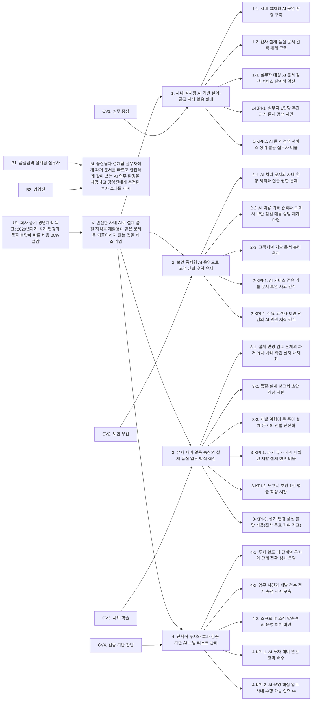

# OO정밀 AI 활용 전략체계 수립 결과(원스톱 모드)

| 항목 | 적용 옵션 |
|---|---|
| 분석 경로 | SWOT, 고정형, 후속 Y, 전략유형 표준형 |
| 문제이슈 | 초안 자동, 확정 고도화 |
| 환경 분석 | 거시·미시·내부 자유입력, 벤치마킹 생략 |
| 전략목표 | 이중형 |
| 전략과제 / 이행과제 | 자동도출 / 생략 |
| 성과지표 | 전략형, BSC 트랙 |
| 시간 형식 | 단중장기(단기 2027년, 중기 2028년, 장기 2029년으로 정의) |
| 점검 방식 | 스크립트 |

---

## 1단계 과제 설정

### 가설과 범위

| 항목 | 내용 |
|---|---|
| 목적 | OO정밀 AI 활용 전략체계 수립 |
| 주체 | 중견 제조기업 OO정밀 |
| 공간 범위 | 본사와 국내 공장 2곳 |
| 시간 범위 | 2027-2029년 |

### 수요자 요구

| 번호 | 수요자 | 요구 |
|---|---|---|
| B1 | 품질팀과 설계팀 실무자 | 과거 문서 검색과 보고서 초안 작성 시간 단축 |
| B2 | 경영진 | AI 투자 대비 효과 확인 |

### 상위 정렬

- U1. 회사 중기 경영계획 목표 "2029년까지 설계 변경과 품질 불량에 따른 비용 20% 절감". 7단계 비전 도출 시 위에서 내려오는 입력으로 사용

### 문제이슈 초안(자동)

가설, 수요자 요구, 상위 정렬만 근거로 작성함. 6단계에서 시사점에 비추어 다시 검토함.

| 번호 | 초안 | 근거 |
|---|---|---|
| D1 | 품질·설계 실무자의 과거 문서 검색과 보고서 초안 작성 시간 부담 | B1 |
| D2 | 설계 변경·품질 불량 비용 절감 목표에 대한 AI 활용의 기여 경로 미정립 | U1 |
| D3 | AI 투자 대비 효과를 경영진이 확인할 수단 부재 | B2 |

- 점검(1단계): 통과

---

## 2단계 외부환경 분석(자유입력)

### 거시환경

- F1. GPT-3.5 수준 성능 시스템의 추론 비용, 2022년 11월-2024년 10월 사이 280배 넘게 하락(Stanford HAI, 2025)
- F2. 일부 벤치마크에서 공개 가중치 모델과 비공개 모델의 성능 차이, 1년 사이 8%에서 1.7%로 축소(같은 보고서)
- F3. AI를 사용한다고 답한 기업 비율, 2023년 55%에서 2024년 78%로 증가(같은 보고서)
- F4. 과학기술정보통신부 「초거대 AI 경쟁력 강화방안」(2023년 4월)의 컴퓨팅 자원 지원 대상은 중소·벤처기업, 대학, 연구소
- F5. 같은 방안의 2027년까지 학습용 데이터 200종, 한국어 말뭉치 130종 구축 계획

### 미시환경

- F6. 동종 업계 경쟁사 2곳의 2025년 설계 문서 검색 AI 도입
- F7. 주요 고객사의 2026년부터 협력사 기술 문서 보안 관리 수준 점검 강화

### 해석 유의 사항

- F3은 전 세계 응답 기업 기준 수치로, 국내 제조업 도입률로 해석하지 않음
- F4·F5는 2023년 4월 발표 계획 기준이며 2026년 현재 이행 현황은 제출 자료로 확인되지 않음
- F4의 지원 대상에 중견기업이 없으므로 정부 컴퓨팅 자원 지원을 당사 기회로 간주하지 않고 6단계에서 위협(T1)으로 분류함
- F6은 도입 사실만 있고 경쟁사의 도입 효과는 확인되지 않음

### 출처

- Stanford HAI(2025), AI Index Report 2025(https://hai.stanford.edu/ai-index/2025-ai-index-report)
- 과학기술정보통신부(2023), 초거대 AI 경쟁력 강화에 3901억 투입…"디지털 경제 가속화"(https://www.korea.kr/news/policyNewsView.do?newsId=148913885)

---

## 3단계 내부현황 분석(자유입력)

- F8. 사내 보안 규정상 외부 생성형 AI 서비스에 업무 문서 입력 불가
- F9. 품질팀과 설계팀의 과거 문서 검색, 보고서 초안 작성 시간 부담 호소. 소요 시간 측정 자료 없음(원문 기재)
- F10. IT팀 인력 5명, AI 전담 인력 없음
- F11. 2015년 이후 설계 문서는 전자 파일, 그 이전 문서는 종이로 보관
- F12. 본사 서버실에 서버 증설이 가능한 공간과 전력 보유
- F13. 품질팀과 설계팀 실무자 48명
- F14. 2026년 3분기 2주 표본 측정 결과, 실무자 1인 과거 문서 검색 시간 주 평균 4.8시간, 보고서 초안 1건 작성 시간 평균 6.5시간
- F15. 2025년 설계 변경과 품질 불량에 따른 비용 59억 원
- F16. 2025년 설계 변경 412건 중 61건이 과거 유사 사례 미확인에 따른 동일 문제 재발
- F17. 경영진이 확정한 2027-2029년 AI 투자 한도 15억 원

### 자료 간 불일치

- F9의 "소요 시간 측정 자료 없음"과 F14의 "2주 표본 측정 결과"가 서로 충돌함
- 이번 결과는 두 진술을 "상시 측정 자료는 없고 2026년 3분기 2주 표본 측정치만 있음"으로 해석하고 F14를 시간 지표의 기준선으로 사용함. 이 해석이 틀리면 1-KPI-1, 3-KPI-2와 전략 1 정량 전략목표가 무효가 되므로 확인 필요(확인 요청 1)

---

## 4단계 벤치마킹

- 생략(사용자 선택). 6단계 To-be 방안과 10단계 목표치에는 외부 사례 근거를 쓰지 않음

---

## 5단계 시사점 도출

### 거시환경

- I1. 동일 성능 AI의 이용 비용 급락으로 AI 도입의 비용 장벽이 낮아지는 추세(F1)
- I2. 공개 가중치 모델이 성능을 따라잡아 외부 서비스 없이 자체 환경에서 쓸 수 있는 모델 선택지 확대, 일부 벤치마크 기준(F2)
- I3. AI 활용이 다수 기업의 일상 업무 방식으로 확산되는 단계에 진입, 전 세계 응답 기업 기준(F3)
- I4. 정부 컴퓨팅 자원 지원 대상에 중견기업이 없어 AI 인프라 비용을 자체 재원으로 부담해야 하는 여건(F4)
- I5. 한국어 학습 데이터와 말뭉치 확충 계획으로 한국어 AI 활용 기반이 넓어질 전망, 당사 활용 조건은 미확인(F5)
- I6. AI 성능과 비용 구조가 1-2년 단위로 급변해 특정 모델과 장비에 대한 조기 일괄 투자가 빠르게 진부화될 가능성(F1, F2)

### 미시환경

- I7. 경쟁사의 설계 문서 검색 AI 선행 도입으로 설계 지식 활용 속도의 상대적 격차 발생 가능성(F6)
- I8. 고객사의 협력사 문서 보안 점검 강화로 기술 문서 보안 관리 수준이 거래 유지 조건으로 부상(F7)

### 내부현황

- I9. 외부 생성형 AI 사용이 막혀 사내 구축이 필요하나 AI 전담 인력이 없어 자체 구축·운영 역량 부족(F8, F10)
- I10. 기술 문서의 외부 입력을 막는 보안 통제가 사내 규정으로 이미 제도화된 상태(F8)
- I11. 2015년 이후 전자 설계 문서가 축적되어 AI 검색 대상으로 바로 연결할 수 있는 문서 자산 보유(F11)
- I12. 2015년 이전 설계 문서는 종이로만 남아 전산 검색이 불가능한 지식 사각지대 존재(F11)
- I13. 본사 서버실의 증설 공간과 전력으로 사내 설치형 AI 장비를 수용할 물리 기반 보유(F12)
- I14. 실무자 48명의 문서 검색에 주 합계 약 230시간(48명 × 4.8시간), 보고서 초안 1건에 6.5시간이 소요되는 반복 업무 부담. 근거는 2주 표본뿐이고 상시 측정 체계는 부재(F9, F13, F14)
- I15. 설계 변경 412건 중 61건(14.8%)이 과거 사례 미확인 재발로, 축적 문서가 재발 방지에 쓰이지 못하는 상태. 59억 원 중 재발분 비용은 미집계(F15, F16)
- I16. 2027-2029년 AI 투자 재원 15억 원이 확정되어 재원과 상한이 함께 정해진 상태(F17)

### 벤치마킹

- 해당 없음(4단계 생략)

- 점검(1-5단계): 통과. 팩트 17건 모두 시사점에 반영, 시사점 16건 모두 같은 출처 팩트에 근거

---

## 6단계 문제이슈 확정과 전략 도출

### 문제이슈 확정(고도화)

| 확정 문제이슈 | 1단계 초안 | 근거 시사점 | 고도화 내용 |
|---|---|---|---|
| P1. 외부 AI를 쓸 수 없는 보안 제약 아래 사내 AI 운영 기반(장비, 모델, 운영 인력) 부재 | 신규 | I1, I2, I3, I4, I5, I9, I13 | 초안에 없던 실행 기반 문제를 시사점에서 추가. 외부 서비스 금지와 전담 인력 부재가 모든 AI 활용에 앞서 풀어야 할 제약임 |
| P2. 품질·설계 실무자의 과거 문서 검색과 보고서 초안 작성 시간 과다 | D1 | I7, I11, I14 | 실무자 48명, 주 합계 약 230시간, 초안 1건 6.5시간으로 부담 규모를 구체화하고 경쟁사 선행 도입에 따른 격차 관점 추가 |
| P3. 과거 유사 사례 미활용에 따른 설계 변경 재발과 비용 발생 | D2 | I11, I12, I15 | "기여 경로 미정립"을 재발 61건(14.8%)이라는 구체 경로로 재구성하고 종이 문서 사각지대 반영 |
| P4. 고객사 보안 요구 강화 속 AI 도입에 따른 기술 문서 보안 리스크 | 신규 | I8, I10 | 고객사 점검 강화를 반영해 보안을 독립 문제이슈로 분리 |
| P5. AI 투자 효과를 검증할 측정 체계와 단계적 투자 원칙 부재 | D3 | I4, I6, I14, I16 | 측정 수단 부재에 기술 진부화 위험, 공공 지원 제외, 투자 상한을 더해 투자 원칙의 문제로 확장 |

### SWOT 요인

| 번호 | 구분 | 요인 | 근거 시사점 |
|---|---|---|---|
| S1 | 강점 | 축적된 전자 설계 문서 자산 | I11(내부) |
| S2 | 강점 | 사내 설치형 AI 수용 인프라 여건 | I13(내부) |
| S3 | 강점 | 경영진의 AI 투자 재원 확정 | I16(내부) |
| S4 | 강점 | 제도화된 기술 문서 보안 통제 | I10(내부) |
| W1 | 약점 | AI 자체 구축·운영 역량 부족 | I9(내부) |
| W2 | 약점 | 종이 보관 과거 설계 문서의 검색 사각지대 | I12(내부) |
| W3 | 약점 | 과거 사례 미확인에 따른 설계 변경 재발 | I15(내부) |
| W4 | 약점 | 반복 문서 업무 부담과 효과 측정 체계 미비 | I14(내부) |
| O1 | 기회 | AI 이용 비용의 급격한 하락 | I1(거시) |
| O2 | 기회 | 공개 가중치 모델의 성능 추격 | I2(거시) |
| O3 | 기회 | 기업 AI 활용의 보편화 | I3(거시) |
| O4 | 기회 | 한국어 학습 데이터와 말뭉치 확충 | I5(거시) |
| T1 | 위협 | 공공 컴퓨팅 지원의 중견기업 제외 | I4(거시) |
| T2 | 위협 | 경쟁사의 설계 문서 검색 AI 선행 도입 | I7(미시) |
| T3 | 위협 | 고객사의 협력사 기술 문서 보안 점검 강화 | I8(미시) |
| T4 | 위협 | AI 기술·비용 급변에 따른 투자 진부화 위험 | I6(거시) |

### 전략 도출(고정형, 표준형)

| 구분 | 요인 | As-is 시사점 | To-be 방안 | 전략 |
|---|---|---|---|---|
| SO | S1. 축적된 전자 설계 문서 자산 S2. 사내 설치형 AI 수용 인프라 여건 S3. 경영진의 AI 투자 재원 확정 S4. 제도화된 기술 문서 보안 통제 O1. AI 이용 비용의 급격한 하락 O2. 공개 가중치 모델의 성능 추격 O3. 기업 AI 활용의 보편화 O4. 한국어 학습 데이터와 말뭉치 확충 | 2015년 이후 전자 문서 축적 서버실 증설 공간·전력 보유 투자 재원 15억 원 확정 외부 AI 입력 금지 규정 시행 AI 이용 비용 급락 공개 가중치 모델 성능 근접 기업 AI 활용 확산 한국어 데이터 확충 계획 | 본사 서버실에 공개 가중치 모델 기반 사내 설치형 AI 구축 2015년 이후 전자 설계·품질 문서를 한국어 검색 대상으로 연결 문서가 사내 밖으로 나가지 않는 구조로 보안 규정 준수 품질팀·설계팀 시범 적용 후 실무자 전원으로 확산 | 1. 사내 설치형 AI 기반 설계·품질 지식 활용 확대(성장) |
| ST | S1. 축적된 전자 설계 문서 자산 S2. 사내 설치형 AI 수용 인프라 여건 S3. 경영진의 AI 투자 재원 확정 S4. 제도화된 기술 문서 보안 통제 T1. 공공 컴퓨팅 지원의 중견기업 제외 T2. 경쟁사의 설계 문서 검색 AI 선행 도입 T3. 고객사의 협력사 기술 문서 보안 점검 강화 T4. AI 기술·비용 급변에 따른 투자 진부화 위험 | 2015년 이후 전자 문서 축적 서버실 증설 공간·전력 보유 투자 재원 15억 원 확정 외부 AI 입력 금지 규정 시행 공공 컴퓨팅 지원 대상 아님 경쟁사 2곳 선행 도입 고객사 문서 보안 점검 강화 AI 성능·비용 1-2년 단위 급변 | 문서 처리·저장·기록을 사내 서버로 한정하고 고객사별로 접근 구분 AI 이용 기록을 고객사 보안 점검 증빙으로 관리 확정 재원으로 공공 지원 없이 보안 인프라 자체 확보 모델을 교체할 수 있는 구조로 기술 급변 대응 보안 신뢰를 경쟁사 선행 도입에 맞서는 차별 요소로 확보 | 2. 보안 통제형 AI 운영으로 고객 신뢰 우위 유지(경쟁우위 유지) |
| WO | W1. AI 자체 구축·운영 역량 부족 W2. 종이 보관 과거 설계 문서의 검색 사각지대 W3. 과거 사례 미확인에 따른 설계 변경 재발 W4. 반복 문서 업무 부담과 효과 측정 체계 미비 O1. AI 이용 비용의 급격한 하락 O2. 공개 가중치 모델의 성능 추격 O3. 기업 AI 활용의 보편화 O4. 한국어 학습 데이터와 말뭉치 확충 | AI 전담 인력 없음, IT 5명 2015년 이전 문서 종이 보관 재발 설계 변경 61건/412건 검색 주 4.8시간·초안 6.5시간, 상시 측정 없음 AI 이용 비용 급락 공개 가중치 모델 성능 근접 기업 AI 활용 확산 한국어 데이터 확충 계획 | 자체 개발 대신 공개 가중치 모델 도입형 방식으로 인력 부족 보완 설계 변경 검토 단계에 AI 유사 사례 확인 절차 내장 보고서 초안은 AI가 작성하고 실무자가 검토하는 방식으로 전환 재발 위험이 큰 종이 문서부터 선별 전산화 | 3. 유사 사례 활용 중심의 설계·품질 업무 방식 혁신(혁신) |
| WT | W1. AI 자체 구축·운영 역량 부족 W2. 종이 보관 과거 설계 문서의 검색 사각지대 W3. 과거 사례 미확인에 따른 설계 변경 재발 W4. 반복 문서 업무 부담과 효과 측정 체계 미비 T1. 공공 컴퓨팅 지원의 중견기업 제외 T2. 경쟁사의 설계 문서 검색 AI 선행 도입 T3. 고객사의 협력사 기술 문서 보안 점검 강화 T4. AI 기술·비용 급변에 따른 투자 진부화 위험 | AI 전담 인력 없음, IT 5명 2015년 이전 문서 종이 보관 재발 설계 변경 61건/412건 상시 측정 없음 공공 컴퓨팅 지원 대상 아님 경쟁사 2곳 선행 도입 고객사 문서 보안 점검 강화 AI 성능·비용 1-2년 단위 급변 | 투자 한도를 시범·확대·전면 단계로 나누고 단계마다 효과 측정 결과로 후속 투자 결정 검색 시간·초안 시간·재발 비율 정기 측정 운영 담당 지정과 외부 전문 지원으로 운영 공백 방지 종이 문서 전산화 범위는 재발 감축 효과에 따라 단계 확대 경쟁사 추격과 고객 보안 요구에는 검증된 범위 안에서 대응 | 4. 단계적 투자와 효과 검증 기반 AI 도입 리스크 관리(리스크 관리) |

### 고정형 후속(Y): 전략 확정과 문제이슈 연결

전략 방향은 바꾸지 않고 확정하며 문제이슈를 각 전략에 연결함.

| 전략 | 구분 | 해결 문제이슈 | 수요자 편익 |
|---|---|---|---|
| 1. 사내 설치형 AI 기반 설계·품질 지식 활용 확대 | SO | P1, P2 | B1 과거 문서 검색 시간 단축 B2 후속 AI 활용의 사내 기반 확보 |
| 2. 보안 통제형 AI 운영으로 고객 신뢰 우위 유지 | ST | P4 | B1 보안 규정 위반 우려 없는 AI 사용 B2 고객 거래 리스크 차단 |
| 3. 유사 사례 활용 중심의 설계·품질 업무 방식 혁신 | WO | P2, P3 | B1 보고서 초안 시간 단축과 재작업 감소 B2 재발 비용 감소 |
| 4. 단계적 투자와 효과 검증 기반 AI 도입 리스크 관리 | WT | P1, P5 | B2 투자 대비 효과 확인 B1 서비스 운영 안정성 확보 |

- 점검(1-6단계): 통과. 요인 출처 규칙, 구분별 요인 전수 사용, 고정형 전략 4개의 SO·ST·WO·WT 1대1 대응 확인

---

## 7단계 비전, 미션, 핵심가치

| 항목 | 탑다운 | 바텀업 | 최종 도출 |
|---|---|---|---|
| 비전 | U1 2029년까지 설계 변경·품질 불량 비용 20% 절감 | 전략 1-4의 공통 지향점인 사내 문서 지식의 안전한 재활용 | 안전한 사내 AI로 설계·품질 지식을 재활용해 같은 문제를 되풀이하지 않는 정밀 제조 기업 |
| 미션 | U1 비용 절감을 실행하는 수단 | B1의 시간 단축, B2의 투자 효과 확인 | 품질팀과 설계팀 실무자에게 과거 문서를 빠르고 안전하게 찾아 쓰는 AI 업무 환경을 제공하고 경영진에게 측정된 투자 효과를 제시 |
| 핵심가치 | 비용 절감 성과에 대한 책임 | 실무 활용, 보안, 사례 재활용, 효과 검증 | 실무 중심, 보안 우선, 사례 학습, 검증 기반 판단 |

| 전략 번호 | 전략명 | 대응 핵심가치 |
|---|---|---|
| 1 | 사내 설치형 AI 기반 설계·품질 지식 활용 확대 | 실무 중심: 실무자가 실제로 쓰는 기능부터 구축 |
| 2 | 보안 통제형 AI 운영으로 고객 신뢰 우위 유지 | 보안 우선: 편의보다 문서 보안을 먼저 판단 |
| 3 | 유사 사례 활용 중심의 설계·품질 업무 방식 혁신 | 사례 학습: 판단 전에 과거 사례부터 확인 |
| 4 | 단계적 투자와 효과 검증 기반 AI 도입 리스크 관리 | 검증 기반 판단: 측정된 효과로 다음 투자 결정 |

- 점검(1-7단계): 통과. 비전-상위 정렬(U1), 미션-수요자(B1, B2) 연결과 전략별 핵심가치 1개 대응 확인

---

## 8단계 전략목표와 전략과제

### 전략목표(이중형)

| 전략 번호 | 전략명 | 정성 전략목표 | 정량 전략목표 |
|---|---|---|---|
| 1 | 사내 설치형 AI 기반 설계·품질 지식 활용 확대 | 품질·설계 실무자가 보안 규정 안에서 사내 AI로 과거 문서를 빠르게 찾는 상태 | 실무자 1인당 과거 문서 검색 시간을 주 4.8시간(2026년 3분기 표본)에서 2029년 주 2.4시간 이하로 단축 |
| 2 | 보안 통제형 AI 운영으로 고객 신뢰 우위 유지 | AI 활용 전 과정에서 기술 문서가 사내에 머물고 고객사 보안 점검 요구를 충족하는 상태 | 2027-2029년 AI 서비스 경유 기술 문서 보안 사고 0건 유지 |
| 3 | 유사 사례 활용 중심의 설계·품질 업무 방식 혁신 | 설계 변경 검토와 보고서 작성에 과거 유사 사례 확인이 기본 절차로 정착한 상태 | 과거 유사 사례 미확인 재발 설계 변경 비율을 14.8%(2025년, 61/412건)에서 2029년 7.4% 이하로 감축 |
| 4 | 단계적 투자와 효과 검증 기반 AI 도입 리스크 관리 | 효과가 확인된 단계에만 투자를 늘리고 소규모 IT 조직이 AI를 안정적으로 운영하는 상태 | 2029년 AI 투자 대비 연간 효과 1.0배 이상 달성(투자 한도 15억 원 이내, 잠정) |

- 정량 전략목표는 전략당 1개이며 기준선은 모두 내부현황 수치임. 산정 논리는 10단계 「목표치 산정 근거」에 정리
- 전략 4의 정량 전략목표는 잠정임. 효과를 금액으로 바꾸는 데 필요한 인건비 단가와 설계 변경 건당 비용이 제출되지 않음(확인 요청 3)

### 전략과제 후보군(자동도출)

| 전략 | 후보 과제 | 대응 문제이슈 / 요인 | 수요자 편익 | 판단 |
|---|---|---|---|---|
| 1 | 본사 서버실 증설과 공개 가중치 모델 도입으로 사내 설치형 AI 운영 환경 구축 | P1 / S2, S3, O1, O2 | B1 사내 AI 사용 가능 | 채택(1-1) |
| 1 | 2015년 이후 전자 설계·품질 문서의 정비, 색인, 한국어 검색 체계 구축 | P2 / S1, O4 | B1 검색 시간 단축 | 채택(1-2) |
| 1 | 품질팀·설계팀 시범 적용 후 실무자 전원으로 단계 확산 | P2 / O3 | B1 편익 확산 | 채택(1-3) |
| 1 | 국내 공장 생산 현장 문서와 작업자로 대상 확대 | P2 / O3 | 수요자 범위 밖 | 보류: 수요자(B1) 범위 밖이고 투자 한도를 고려해 2029년 이후 검토 |
| 2 | AI가 처리하는 문서의 처리·저장 위치를 사내로 한정하고 직무별 접근 권한 통제 | P4 / S2, S4, T3 | B1 규정 준수 사용 B2 거래 리스크 차단 | 채택(2-1) |
| 2 | AI 이용 기록(질의, 열람 문서) 보존과 고객사 보안 점검 대응 증빙 체계 마련 | P4 / S4, T3 | B2 점검 대응 부담 경감 | 채택(2-2) |
| 2 | 고객사별 기술 문서를 구분해 다른 고객사 문서가 검색 결과에 섞이지 않도록 관리 | P4 / S1, T3 | B2 고객사 신뢰 유지 | 채택(2-3) |
| 2 | 외부 정보보호 인증 취득 | P4 / T3 | B2 | 보류: 고객사 점검 기준이 인증을 요구하는지 미확인 |
| 3 | 설계 변경 검토서에 AI 유사 사례 검색 결과 첨부를 필수 절차로 지정 | P3 / W3, O2 | B1 재작업 감소 B2 재발 비용 감소 | 채택(3-1) |
| 3 | 품질·설계 보고서 양식별 AI 초안 작성과 실무자 검토 방식 도입 | P2 / W4, O2, O4 | B1 초안 시간 단축 | 채택(3-2) |
| 3 | 재발 사례와 관련된 제품군부터 2015년 이전 종이 설계 문서 선별 전산화 | P3 / W2, O1 | B1 검색 범위 확대 B2 재발 감소 | 채택(3-3) |
| 3 | AI 기반 도면 자동 생성 | 해당 없음 / W1 | 수요자 요구 밖 | 제외: 수요자 요구(검색, 초안) 밖이고 역량 부족(W1) 상태에서 위험 과다 |
| 4 | 투자 한도를 시범(2027년)·확대(2028년)·전면(2029년) 단계로 나누고 단계 전환 심사 운영 | P5 / W4, T1, T4 | B2 투자 위험 통제 | 채택(4-1) |
| 4 | 검색 시간, 초안 시간, 재발 건수를 기준선과 같은 방식으로 정기 측정 | P5 / W4 | B2 효과 확인 | 채택(4-2) |
| 4 | AI 운영 담당 지정, 외부 전문 지원, 모델 교체가 가능한 구조로 소규모 IT 조직 맞춤형 운영 체계 마련 | P1 / W1, T4 | B1 서비스 안정 B2 운영 위험 축소 | 채택(4-3) |
| 4 | AI 전담 조직 신설 | P1 / W1 | B1, B2 | 보류: IT 5명 규모와 투자 한도에 비해 과도하며 4-3으로 대체 |

### 확정 전략과제(승인 대기)

| 전략 번호 | 전략과제 번호 | 전략과제명 |
|---|---|---|
| 1 | 1-1 | 사내 설치형 AI 운영 환경 구축 |
| 1 | 1-2 | 전자 설계·품질 문서 검색 체계 구축 |
| 1 | 1-3 | 실무자 대상 AI 문서 검색 서비스 단계적 확산 |
| 2 | 2-1 | AI 처리 문서의 사내 한정 처리와 접근 권한 통제 |
| 2 | 2-2 | AI 이용 기록 관리와 고객사 보안 점검 대응 증빙 체계 마련 |
| 2 | 2-3 | 고객사별 기술 문서 분리 관리 |
| 3 | 3-1 | 설계 변경 검토 단계의 과거 유사 사례 확인 절차 내재화 |
| 3 | 3-2 | 품질·설계 보고서 초안 작성 지원 |
| 3 | 3-3 | 재발 위험이 큰 종이 설계 문서의 선별 전산화 |
| 4 | 4-1 | 투자 한도 내 단계별 투자와 단계 전환 심사 운영 |
| 4 | 4-2 | 업무 시간과 재발 건수 정기 측정 체계 구축 |
| 4 | 4-3 | 소규모 IT 조직 맞춤형 AI 운영 체계 마련 |

### 전략과 전략과제 연결 논리

- 전략 1: 1-1이 실행 기반(P1), 1-2가 검색 대상 문서, 1-3이 실무자 편익 실현(P2)을 맡는 기반, 대상, 확산 구조
- 전략 2: 2-1 처리 범위 통제, 2-2 증빙, 2-3 고객사 단위 구분으로 고객사 점검 요구(P4)를 미리 충족하는 구조
- 전략 3: 3-1 재발 차단(P3), 3-2 초안 시간 단축(P2), 3-3 사각지대 축소(P3)로 업무 절차 자체를 바꾸는 구조
- 전략 4: 4-1 투자 단계화(P5), 4-2 효과 측정(P5), 4-3 운영 공백 방지(P1)로 실패 비용의 상한을 정하는 구조
- 4-1의 시범(2027년), 확대(2028년), 전면(2029년) 구분을 전 전략에 공통 적용하고 10단계의 단기·중기·장기 목표치와 일치
- 단계별 투자 배분액은 장비와 전산화 견적 자료가 없어 이번 결과에서 정하지 않음

- 점검(1-8단계): 통과. 문제이슈 5건과 전략 4개의 상호 연결, 이중형 목표 기재, 전략과제 번호 형식과 상위 전략 확인

---

## 9단계 이행과제

- 생략(사용자 선택). 상태 파일에 이행과제 단계 미수행으로 기록, 이행과제 0건
- 점검(1-9단계): 통과

---

## 10단계 성과지표(전략형, BSC)

### 적용 기준

- 적용 계층: 전략형. 전략 4개에만 지표 설정
- 지표 유형: BSC 트랙의 전략 계층 기준인 Outcome과 Impact만 사용
- 전략마다 지표 2개 이상, 재무·고객·내부 프로세스·학습과 성장 네 관점에 배치
- 달성 시한: 단기 2027년, 중기 2028년, 장기 2029년

### 지표 후보군과 선별

| 전략 | 지표 후보 | 유형 | BSC 관점 | 판단 |
|---|---|---|---|---|
| 1 | 실무자 1인당 주간 과거 문서 검색 시간 | Outcome | 내부 프로세스 | 채택(1-KPI-1) |
| 1 | AI 문서 검색 서비스 정기 활용 실무자 비율 | Outcome | 고객(내부 수요자) | 채택(1-KPI-2) |
| 1 | 검색 대상 전자 문서 색인 비율 | Output | 내부 프로세스 | 제외: 전략 계층 유형 아님. 1-2 과제 관리용으로 활용 |
| 1 | 실무자 검색 만족도 | Outcome | 고객(내부 수요자) | 보류: 기준선 없음. 2027년 첫 측정 후 추가 검토 |
| 2 | AI 서비스 경유 기술 문서 보안 사고 건수 | Outcome | 내부 프로세스 | 채택(2-KPI-1) |
| 2 | 주요 고객사 보안 점검의 AI 관련 지적 건수 | Outcome | 고객(외부 고객사) | 채택(2-KPI-2) |
| 2 | 접근 권한 적용 문서 비율 | Output | 내부 프로세스 | 제외: 전략 계층 유형 아님 |
| 3 | 과거 유사 사례 미확인 재발 설계 변경 비율 | Outcome | 내부 프로세스 | 채택(3-KPI-1) |
| 3 | 보고서 초안 1건 평균 작성 시간 | Outcome | 내부 프로세스 | 채택(3-KPI-2) |
| 3 | 설계 변경·품질 불량 비용 | Impact | 재무 | 채택(3-KPI-3, 전사 목표 기여 지표) |
| 3 | 종이 문서 전산화 건수 | Output | 내부 프로세스 | 제외: 단순 건수이며 전략 계층 유형 아님 |
| 4 | AI 투자 대비 연간 효과 배수 | Impact | 재무 | 채택(4-KPI-1, 잠정) |
| 4 | AI 운영 핵심 업무 사내 수행 가능 인력 수 | Outcome | 학습과 성장 | 채택(4-KPI-2) |
| 4 | 투자 한도 대비 집행률 | Input | 재무 | 제외: 투입 지표. 4-1 과제 관리용으로 활용 |

### 확정 성과지표

| 번호 | 상위 요소 | 지표명 | 지표 유형 | 측정 방식 | 목표치 | 달성 시한 |
|---|---|---|---|---|---|---|
| 1-KPI-1 | 미션 | 실무자 1인당 주간 과거 문서 검색 시간 | Outcome | (표본 측정) 매년 3분기 2주간 품질·설계 실무자 48명 업무 기록, 1인 주 평균 검색 시간 | 단기 4.3시간 이하 중기 3.4시간 이하 장기 2.4시간 이하 | 단기(2027년) 중기(2028년) 장기(2029년) |
| 1-KPI-2 | 미션 | AI 문서 검색 서비스 정기 활용 실무자 비율 | Outcome | (산식) 월 4회 이상 이용 기록 실무자 수 / 품질·설계 실무자 수 × 100 | 단기 25% 이상(12명) 중기 60% 이상(29명) 장기 90% 이상(44명) | 단기(2027년) 중기(2028년) 장기(2029년) |
| 2-KPI-1 | 비전 | AI 서비스 경유 기술 문서 보안 사고 건수 | Outcome | (집계) AI 이용 기록 점검과 보안 사고 보고의 연간 건수 합산 | 단기 0건 중기 0건 장기 0건 | 단기(2027년) 중기(2028년) 장기(2029년) |
| 2-KPI-2 | 비전 | 주요 고객사 보안 점검의 AI 관련 지적 건수 | Outcome | (집계) 주요 고객사 협력사 기술 문서 보안 점검 결과 중 AI 관련 지적 연간 합산 | 단기 0건 중기 0건 장기 0건 | 단기(2027년) 중기(2028년) 장기(2029년) |
| 3-KPI-1 | 비전 | 과거 유사 사례 미확인 재발 설계 변경 비율 | Outcome | (산식) 과거 유사 사례 미확인 재발 설계 변경 건수 / 전체 설계 변경 건수 × 100 | 단기 13.3% 이하 중기 10.4% 이하 장기 7.4% 이하 | 단기(2027년) 중기(2028년) 장기(2029년) |
| 3-KPI-2 | 미션 | 보고서 초안 1건 평균 작성 시간 | Outcome | (표본 측정) 매년 3분기 2주간 작성한 보고서 초안의 건당 평균 작성 시간 | 단기 5.9시간 이하 중기 4.9시간 이하 장기 3.9시간 이하 | 단기(2027년) 중기(2028년) 장기(2029년) |
| 3-KPI-3 | 비전 | 설계 변경·품질 불량 비용(전사 목표 기여 지표) | Impact | (집계) 연간 설계 변경·품질 불량 비용 합산, 재발 건 비용 분리 집계 | 단기 53.1억 원 이하 중기 50.15억 원 이하 장기 47.2억 원 이하 | 단기(2027년) 중기(2028년) 장기(2029년) |
| 4-KPI-1 | 미션 | AI 투자 대비 연간 효과 배수 | Impact | (산식) (업무시간 절감량 × 시간당 인건비 + 재발 설계 변경 감축 건수 × 건당 평균 비용) / 연환산 AI 투자액(누적 집행액 ÷ 경과 연수) | 단기 산정 기준 확정 중기 측정 결과로 장기 목표 재확정 장기 1.0배 이상(잠정) | 단기(2027년) 중기(2028년) 장기(2029년) |
| 4-KPI-2 | 비전 | AI 운영 핵심 업무 사내 수행 가능 인력 수 | Outcome | (집계) 모델 교체, 장애 복구, 권한 관리 3개 업무를 외부 지원 없이 수행한 것으로 실무 평가에서 확인된 IT 인력 수 | 단기 1명 이상 중기 2명 이상 장기 2명 이상 | 단기(2027년) 중기(2028년) 장기(2029년) |

### 목표치 산정 근거

| 지표 | 기준선(출처) | 목표 설정 논리 | 한계와 확인 필요 |
|---|---|---|---|
| 1-KPI-1 | 주 4.8시간(F14, 2026년 3분기 2주 표본) | 시범·확대·전면 단계에 따라 기준선 대비 10%·30%·50% 단축(소수 첫째 자리 반올림) 장기 달성 시 실무자 48명의 주 합계 검색 시간이 230.4시간에서 115.2시간으로 줄어 주 115.2시간 절감 2015년 이전 종이 문서는 전산화한 범위만 검색되고 원문 확인 시간이 남으므로 50%를 상한으로 둠 | 단축률은 외부 근거 없는 판단값(벤치마킹 생략). 2027년 시범 측정 후 보정 기준선과 같은 3분기 2주 표본 방식으로 측정해야 계절 차이를 배제할 수 있음 |
| 1-KPI-2 | 0%(서비스 미운영) | 시범 12명(25%), 확대 29명(60%), 전면 44명(90%) 검색 수요가 적은 직무를 고려해 100% 대신 90% | 분모는 해마다 재직 실무자 수로 갱신 |
| 2-KPI-1 | 해당 없음(신규 서비스) | 보안 사고는 허용 수준을 두지 않는 0건 기준 | 보안 사고의 정의(유출, 권한 밖 열람 포함 여부)를 보안 담당과 확정 |
| 2-KPI-2 | 0건(AI 미운영) | AI 도입 후에도 지적 0건 유지 | 2026년 고객사 점검 결과와 점검 항목 미제출(확인 요청 5) |
| 3-KPI-1 | 14.8%(F16, 2025년 61/412건) | 기준선 대비 10%·30%·50% 감축(소수 첫째 자리 반올림) 건수 대신 비율을 사용해 설계 변경 총량 변동의 영향을 배제 원인 사례가 종이 문서 시기에 있으면 AI 검색으로 찾을 수 없으므로 50%를 상한으로 둠 | 61건의 유사 사례가 2015년 이전과 이후 중 어느 문서에 있었는지 분류 필요(확인 요청 4) 2026년 실적이 나오면 기준선 갱신 |
| 3-KPI-2 | 6.5시간(F14, 2026년 3분기 2주 표본) | 기준선 대비 10%·25%·40% 단축(소수 첫째 자리 반올림) AI 초안도 사실 확인과 수정 시간이 남으므로 검색 시간보다 단축 폭을 낮게 둠 | 연간 보고서 작성 건수가 없어 총 절감 시간 산출 불가(확인 요청 3) |
| 3-KPI-3 | 59억 원(F15, 2025년) | 상위 정렬 U1의 20% 절감을 2025년 기준선에서 해마다 5%포인트씩 균등 배분: 2027년 −10%(53.1억 원), 2028년 −15%(50.15억 원), 2029년 −20%(47.2억 원) | 전사 공동 목표에 대한 기여 지표이므로 AI 전략만의 성과로 보지 않음 중기 경영계획의 기준 연도와 연도별 목표 확인 필요(확인 요청 2) 재발분 비용을 별도 집계해야 AI 기여분을 가려낼 수 있음 |
| 4-KPI-1 | 연환산 투자액 5억 원(F17, 15억 원 ÷ 3년) | 2029년 연간 효과가 연환산 투자액 이상이 되는 손익분기점을 하한 목표로 설정 | 인건비 단가와 설계 변경 건당 비용이 없어 달성 가능성 검증 불가(확인 요청 3) 참고 계산: 연 52주를 단순 적용해도 검색 시간 절감분(주 115.2시간, 연 약 5,990시간)만으로 1.0배에 이르려면 시간당 약 8.3만 원 이상의 가치가 필요하고, 실제 근무 주수를 적용하면 필요 단가 상승. 따라서 재발 감축과 초안 시간 절감의 금액 환산이 달성 여부를 결정 |
| 4-KPI-2 | 0명(F10, AI 전담 인력 없음) | 1인에 의존하면 부재 시 운영 공백이 생기므로 장기 2명 이상, 단기 1명 | IT팀 5명 중 지정 가능 인원 확인 |

### 지표 논리 연결(BSC)

- 전략과제 산출(1-1 장비, 1-2 색인 문서, 3-1 절차, 3-2 초안 기능)에서 활용 결과(1-KPI-2), 업무 결과(1-KPI-1, 3-KPI-2, 3-KPI-1), 파급 효과(3-KPI-3, 4-KPI-1)로 이어지는 구조
- 4-KPI-1은 1-KPI-1과 3-KPI-2의 절감 시간, 3-KPI-1의 재발 감축 건수를 금액으로 환산해 합산함(합산 방식)
- 2-KPI-1, 2-KPI-2는 확산 속도를 제약하는 조건. 보안 사고나 지적이 생기면 4-1 단계 전환 심사에서 확대 보류
- 관점 배치: 재무 2개(3-KPI-3, 4-KPI-1), 고객 2개(1-KPI-2, 2-KPI-2), 내부 프로세스 4개(1-KPI-1, 2-KPI-1, 3-KPI-1, 3-KPI-2), 학습과 성장 1개(4-KPI-2). 학습과 성장 관점이 얇아 실무자 AI 활용 역량 지표의 추가 여부를 검토할 대상임

### SMART 점검

- 9개 중 7개 충족
- 2-KPI-2: 측정 가능성 보완 필요. 고객사 점검 결과와 항목 미제출
- 4-KPI-1: 실현 가능성 미검증, 단기·중기 수치 목표 없음. 산정 자료 제출 후 확정

- 점검(1-10단계): 통과. 지표 번호 형식, 측정 대상 전략 존재, 전략형 범위 밖 지표 없음, 전략 4개 모두 지표 보유 확인

---

## 최종 비전하우스

| 구분 | 내용 |
|---|---|
| 비전 | 안전한 사내 AI로 설계·품질 지식을 재활용해 같은 문제를 되풀이하지 않는 정밀 제조 기업 |
| 미션 | 품질팀과 설계팀 실무자에게 과거 문서를 빠르고 안전하게 찾아 쓰는 AI 업무 환경을 제공하고 경영진에게 측정된 투자 효과를 제시 |
| 핵심가치 | 실무 중심, 보안 우선, 사례 학습, 검증 기반 판단 |

이행과제 단계를 생략했으므로 이행과제 열은 제외. 성과지표가 전략형이므로 핵심 지표 열에는 해당 전략과제가 기여하는 전략 지표를 기재.

### 전략 1 사내 설치형 AI 기반 설계·품질 지식 활용 확대

| 항목 | 내용 |
|---|---|
| 핵심가치 | 실무 중심 |
| 정성 전략목표 | 품질·설계 실무자가 보안 규정 안에서 사내 AI로 과거 문서를 빠르게 찾는 상태 |
| 정량 전략목표 | 실무자 1인당 과거 문서 검색 시간을 주 4.8시간(2026년 3분기 표본)에서 2029년 주 2.4시간 이하로 단축 |

| 전략과제 | 핵심 지표 |
|---|---|
| 1-1. 사내 설치형 AI 운영 환경 구축 | 1-KPI-2 AI 문서 검색 서비스 정기 활용 실무자 비율 |
| 1-2. 전자 설계·품질 문서 검색 체계 구축 | 1-KPI-1 실무자 1인당 주간 과거 문서 검색 시간 |
| 1-3. 실무자 대상 AI 문서 검색 서비스 단계적 확산 | 1-KPI-1 실무자 1인당 주간 과거 문서 검색 시간 1-KPI-2 AI 문서 검색 서비스 정기 활용 실무자 비율 |

### 전략 2 보안 통제형 AI 운영으로 고객 신뢰 우위 유지

| 항목 | 내용 |
|---|---|
| 핵심가치 | 보안 우선 |
| 정성 전략목표 | AI 활용 전 과정에서 기술 문서가 사내에 머물고 고객사 보안 점검 요구를 충족하는 상태 |
| 정량 전략목표 | 2027-2029년 AI 서비스 경유 기술 문서 보안 사고 0건 유지 |

| 전략과제 | 핵심 지표 |
|---|---|
| 2-1. AI 처리 문서의 사내 한정 처리와 접근 권한 통제 | 2-KPI-1 AI 서비스 경유 기술 문서 보안 사고 건수 |
| 2-2. AI 이용 기록 관리와 고객사 보안 점검 대응 증빙 체계 마련 | 2-KPI-2 주요 고객사 보안 점검의 AI 관련 지적 건수 |
| 2-3. 고객사별 기술 문서 분리 관리 | 2-KPI-1 AI 서비스 경유 기술 문서 보안 사고 건수 2-KPI-2 주요 고객사 보안 점검의 AI 관련 지적 건수 |

### 전략 3 유사 사례 활용 중심의 설계·품질 업무 방식 혁신

| 항목 | 내용 |
|---|---|
| 핵심가치 | 사례 학습 |
| 정성 전략목표 | 설계 변경 검토와 보고서 작성에 과거 유사 사례 확인이 기본 절차로 정착한 상태 |
| 정량 전략목표 | 과거 유사 사례 미확인 재발 설계 변경 비율을 14.8%(2025년, 61/412건)에서 2029년 7.4% 이하로 감축 |

| 전략과제 | 핵심 지표 |
|---|---|
| 3-1. 설계 변경 검토 단계의 과거 유사 사례 확인 절차 내재화 | 3-KPI-1 과거 유사 사례 미확인 재발 설계 변경 비율 3-KPI-3 설계 변경·품질 불량 비용(전사 목표 기여 지표) |
| 3-2. 품질·설계 보고서 초안 작성 지원 | 3-KPI-2 보고서 초안 1건 평균 작성 시간 |
| 3-3. 재발 위험이 큰 종이 설계 문서의 선별 전산화 | 3-KPI-1 과거 유사 사례 미확인 재발 설계 변경 비율 |

### 전략 4 단계적 투자와 효과 검증 기반 AI 도입 리스크 관리

| 항목 | 내용 |
|---|---|
| 핵심가치 | 검증 기반 판단 |
| 정성 전략목표 | 효과가 확인된 단계에만 투자를 늘리고 소규모 IT 조직이 AI를 안정적으로 운영하는 상태 |
| 정량 전략목표 | 2029년 AI 투자 대비 연간 효과 1.0배 이상 달성(투자 한도 15억 원 이내, 잠정) |

| 전략과제 | 핵심 지표 |
|---|---|
| 4-1. 투자 한도 내 단계별 투자와 단계 전환 심사 운영 | 4-KPI-1 AI 투자 대비 연간 효과 배수 |
| 4-2. 업무 시간과 재발 건수 정기 측정 체계 구축 | 4-KPI-1 AI 투자 대비 연간 효과 배수 |
| 4-3. 소규모 IT 조직 맞춤형 AI 운영 체계 마련 | 4-KPI-2 AI 운영 핵심 업무 사내 수행 가능 인력 수 |

### 연결도(점검 스크립트 `--chart` 출력)

추적 연결도(시사점, 문제이슈, SWOT 요인, 전략 후보, 전략, 전략과제, 지표)

```mermaid
graph LR
    I_I1["I1. 동일 성능 AI의 이용 비용 급락으로 AI 도입의 비용 장벽이 낮아지는 추세"]
    P_P1["P1. 외부 AI를 쓸 수 없는 보안 제약 아래 사내 AI 운영 기반(장비, 모델, 운영 인력) 부재"]
    I_I1 --> P_P1
    I_I2["I2. 공개 가중치 모델의 성능 추격으로 외부 서비스 없이 자체 환경에서 쓸 수 있는 모델 선택지 확대(일부 벤치마크 기준)"]
    I_I2 --> P_P1
    I_I3["I3. AI 활용이 다수 기업의 일상 업무 방식으로 확산되는 단계 진입(전 세계 응답 기업 기준)"]
    I_I3 --> P_P1
    I_I4["I4. 정부 컴퓨팅 자원 지원 대상에 중견기업이 없어 AI 인프라 비용을 자체 재원으로 부담해야 하는 여건"]
    I_I4 --> P_P1
    I_I5["I5. 한국어 학습 데이터와 말뭉치 확충 계획으로 한국어 AI 활용 기반이 넓어질 전망(당사 활용 조건 미확인)"]
    I_I5 --> P_P1
    I_I9["I9. 외부 생성형 AI 사용이 막혀 사내 구축이 필요하나 AI 전담 인력이 없어 자체 구축·운영 역량 부족"]
    I_I9 --> P_P1
    I_I13["I13. 본사 서버실의 증설 공간과 전력으로 사내 설치형 AI 장비를 수용할 물리 기반 보유"]
    I_I13 --> P_P1
    I_I7["I7. 경쟁사의 설계 문서 검색 AI 선행 도입으로 설계 지식 활용 속도의 상대적 격차 발생 가능성"]
    P_P2["P2. 품질·설계 실무자의 과거 문서 검색과 보고서 초안 작성 시간 과다"]
    I_I7 --> P_P2
    I_I11["I11. 2015년 이후 전자 설계 문서가 축적되어 AI 검색 대상으로 바로 연결 가능한 문서 자산 보유"]
    I_I11 --> P_P2
    I_I14["I14. 실무자 48명의 문서 검색에 주 합계 약 230시간, 보고서 초안 1건에 6.5시간이 소요되는 반복 업무 부담이 있으나 근거는 2주 표본뿐이고 상시 측정 체계 부재"]
    I_I14 --> P_P2
    P_P3["P3. 과거 유사 사례 미활용에 따른 설계 변경 재발과 비용 발생"]
    I_I11 --> P_P3
    I_I12["I12. 2015년 이전 설계 문서는 종이로만 남아 전산 검색이 불가능한 지식 사각지대 존재"]
    I_I12 --> P_P3
    I_I15["I15. 설계 변경 412건 중 61건(14.8%)이 과거 사례 미확인 재발로, 축적 문서가 재발 방지에 쓰이지 못하는 상태(59억 원 중 재발분 비용은 미집계)"]
    I_I15 --> P_P3
    I_I8["I8. 고객사의 협력사 문서 보안 점검 강화로 기술 문서 보안 관리 수준이 거래 유지 조건으로 부상"]
    P_P4["P4. 고객사 보안 요구 강화 속 AI 도입에 따른 기술 문서 보안 리스크"]
    I_I8 --> P_P4
    I_I10["I10. 기술 문서의 외부 입력을 막는 보안 통제가 사내 규정으로 이미 제도화된 상태"]
    I_I10 --> P_P4
    P_P5["P5. AI 투자 효과를 검증할 측정 체계와 단계적 투자 원칙 부재"]
    I_I4 --> P_P5
    I_I6["I6. AI 성능과 비용 구조가 1-2년 단위로 급변해 특정 모델과 장비에 대한 조기 일괄 투자가 빠르게 진부화될 가능성"]
    I_I6 --> P_P5
    I_I14 --> P_P5
    I_I16["I16. 2027-2029년 AI 투자 재원 15억 원이 확정되어 재원과 상한이 함께 정해진 상태"]
    I_I16 --> P_P5
    F_S1["S1. 축적된 전자 설계 문서 자산"]
    C_SO["SO. 축적 전자 문서, 서버실 여건, 확정 재원, 보안 통제를 바탕으로 비용이 낮아지고 성능이 올라온 공개 가중치 모델과 한국어 데이터 기반을 활용해 AI 보편화 흐름에 맞춘 사내 설치형 AI 문서 검색 서비스 구축과 확산"]
    F_S1 --> C_SO
    F_S2["S2. 사내 설치형 AI 수용 인프라 여건"]
    F_S2 --> C_SO
    F_S3["S3. 경영진의 AI 투자 재원 확정"]
    F_S3 --> C_SO
    F_S4["S4. 제도화된 기술 문서 보안 통제"]
    F_S4 --> C_SO
    F_O1["O1. AI 이용 비용의 급격한 하락"]
    F_O1 --> C_SO
    F_O2["O2. 공개 가중치 모델의 성능 추격"]
    F_O2 --> C_SO
    F_O3["O3. 기업 AI 활용의 보편화"]
    F_O3 --> C_SO
    F_O4["O4. 한국어 학습 데이터와 말뭉치 확충"]
    F_O4 --> C_SO
    C_ST["ST. 보안 통제와 사내 서버 여건으로 문서가 사내에서만 처리되는 AI 운영 체계를 갖추어 고객사 보안 점검에 대응하고, 자체 전자 문서 자산으로 경쟁사 선행 도입 격차를 좁히며, 확정 재원으로 공공 지원 없이 모델 교체가 가능한 보안 인프라 확보"]
    F_S1 --> C_ST
    F_S2 --> C_ST
    F_S3 --> C_ST
    F_S4 --> C_ST
    F_T1["T1. 공공 컴퓨팅 지원의 중견기업 제외"]
    F_T1 --> C_ST
    F_T2["T2. 경쟁사의 설계 문서 검색 AI 선행 도입"]
    F_T2 --> C_ST
    F_T3["T3. 고객사의 협력사 기술 문서 보안 점검 강화"]
    F_T3 --> C_ST
    F_T4["T4. AI 기술·비용 급변에 따른 투자 진부화 위험"]
    F_T4 --> C_ST
    F_W1["W1. AI 자체 구축·운영 역량 부족"]
    C_WO["WO. 비용 하락과 공개 가중치 모델로 개발 부담이 적은 도입형 방식을 택해 인력 부족을 보완하고, 한국어 데이터 기반과 AI 보편화 흐름을 활용해 설계 변경 검토의 유사 사례 확인과 보고서 초안 작성을 AI 지원 절차로 바꾸며 재발 위험이 큰 종이 문서부터 선별 전산화"]
    F_W1 --> C_WO
    F_W2["W2. 종이 보관 과거 설계 문서의 검색 사각지대"]
    F_W2 --> C_WO
    F_W3["W3. 과거 사례 미확인에 따른 설계 변경 재발"]
    F_W3 --> C_WO
    F_W4["W4. 반복 문서 업무 부담과 효과 측정 체계 미비"]
    F_W4 --> C_WO
    F_O1 --> C_WO
    F_O2 --> C_WO
    F_O3 --> C_WO
    F_O4 --> C_WO
    C_WT["WT. 운영 역량과 측정 체계가 부족한 상태에서 공공 지원 없이 급변하는 기술에 일괄 투자하는 위험을 줄이기 위해 투자를 단계로 나누고 단계마다 시간 단축과 재발 감축 효과를 검증해 종이 문서 전산화 범위와 확산 속도를 결정하며, 경쟁사 추격과 고객 보안 요구에는 검증된 범위에서 대응"]
    F_W1 --> C_WT
    F_W2 --> C_WT
    F_W3 --> C_WT
    F_W4 --> C_WT
    F_T1 --> C_WT
    F_T2 --> C_WT
    F_T3 --> C_WT
    F_T4 --> C_WT
    S_1["1. 사내 설치형 AI 기반 설계·품질 지식 활용 확대"]
    C_SO --> S_1
    P_P1 --> S_1
    P_P2 --> S_1
    S_2["2. 보안 통제형 AI 운영으로 고객 신뢰 우위 유지"]
    C_ST --> S_2
    P_P4 --> S_2
    S_3["3. 유사 사례 활용 중심의 설계·품질 업무 방식 혁신"]
    C_WO --> S_3
    P_P2 --> S_3
    P_P3 --> S_3
    S_4["4. 단계적 투자와 효과 검증 기반 AI 도입 리스크 관리"]
    C_WT --> S_4
    P_P1 --> S_4
    P_P5 --> S_4
    T_1_2d_1["1-1. 사내 설치형 AI 운영 환경 구축"]
    S_1 --> T_1_2d_1
    T_1_2d_2["1-2. 전자 설계·품질 문서 검색 체계 구축"]
    S_1 --> T_1_2d_2
    T_1_2d_3["1-3. 실무자 대상 AI 문서 검색 서비스 단계적 확산"]
    S_1 --> T_1_2d_3
    T_2_2d_1["2-1. AI 처리 문서의 사내 한정 처리와 접근 권한 통제"]
    S_2 --> T_2_2d_1
    T_2_2d_2["2-2. AI 이용 기록 관리와 고객사 보안 점검 대응 증빙 체계 마련"]
    S_2 --> T_2_2d_2
    T_2_2d_3["2-3. 고객사별 기술 문서 분리 관리"]
    S_2 --> T_2_2d_3
    T_3_2d_1["3-1. 설계 변경 검토 단계의 과거 유사 사례 확인 절차 내재화"]
    S_3 --> T_3_2d_1
    T_3_2d_2["3-2. 품질·설계 보고서 초안 작성 지원"]
    S_3 --> T_3_2d_2
    T_3_2d_3["3-3. 재발 위험이 큰 종이 설계 문서의 선별 전산화"]
    S_3 --> T_3_2d_3
    T_4_2d_1["4-1. 투자 한도 내 단계별 투자와 단계 전환 심사 운영"]
    S_4 --> T_4_2d_1
    T_4_2d_2["4-2. 업무 시간과 재발 건수 정기 측정 체계 구축"]
    S_4 --> T_4_2d_2
    T_4_2d_3["4-3. 소규모 IT 조직 맞춤형 AI 운영 체계 마련"]
    S_4 --> T_4_2d_3
    K_1_2d_KPI_2d_1["1-KPI-1. 실무자 1인당 주간 과거 문서 검색 시간"]
    S_1 --> K_1_2d_KPI_2d_1
    K_1_2d_KPI_2d_2["1-KPI-2. AI 문서 검색 서비스 정기 활용 실무자 비율"]
    S_1 --> K_1_2d_KPI_2d_2
    K_2_2d_KPI_2d_1["2-KPI-1. AI 서비스 경유 기술 문서 보안 사고 건수"]
    S_2 --> K_2_2d_KPI_2d_1
    K_2_2d_KPI_2d_2["2-KPI-2. 주요 고객사 보안 점검의 AI 관련 지적 건수"]
    S_2 --> K_2_2d_KPI_2d_2
    K_3_2d_KPI_2d_1["3-KPI-1. 과거 유사 사례 미확인 재발 설계 변경 비율"]
    S_3 --> K_3_2d_KPI_2d_1
    K_3_2d_KPI_2d_2["3-KPI-2. 보고서 초안 1건 평균 작성 시간"]
    S_3 --> K_3_2d_KPI_2d_2
    K_3_2d_KPI_2d_3["3-KPI-3. 설계 변경·품질 불량 비용(전사 목표 기여 지표)"]
    S_3 --> K_3_2d_KPI_2d_3
    K_4_2d_KPI_2d_1["4-KPI-1. AI 투자 대비 연간 효과 배수"]
    S_4 --> K_4_2d_KPI_2d_1
    K_4_2d_KPI_2d_2["4-KPI-2. AI 운영 핵심 업무 사내 수행 가능 인력 수"]
    S_4 --> K_4_2d_KPI_2d_2
```

비전하우스 연결도(상위 정렬, 수요자, 비전, 미션, 핵심가치, 전략, 전략과제, 지표)

---

## 단계별 점검 결과

| 단계 | 점검 범위 | 결과 |
|---|---|---|
| 1 | 가설, 수요자, 상위 정렬, 문제이슈 초안 | 통과 |
| 5 | 1-5단계(팩트 반영, 시사점 출처) | 통과 |
| 6 | 1-6단계(문제이슈 귀납, SWOT 요인 출처와 결합, 고정형 대응) | 통과 |
| 7 | 1-7단계(비전·미션 연결, 핵심가치 대응) | 통과 |
| 8 | 1-8단계(문제이슈-전략 연결, 이중형 목표, 전략과제 번호) | 통과 |
| 9 | 1-9단계(이행과제 생략 설정과 0건 일치) | 통과 |
| 10 | 1-10단계 전체(`--step all --chart`) | 통과 |

- 위반 0건, 권고 0건

---

## 확인 요청 사항

1. (자료 불일치) 내부현황의 "소요 시간을 측정한 자료는 없다"와 "2026년 3분기 2주 표본 측정"이 충돌함. 표본 측정이 실제로 있었는지 확인 필요. 없었다면 1-KPI-1, 3-KPI-2와 전략 1 정량 전략목표를 "2027년 상반기 기준선 측정 후 확정"으로 바꾸고 4-2를 첫 과제로 우선 배치
2. (상위 정렬 기준 연도) 중기 경영계획 "20% 절감"의 기준 연도와 연도별 목표 확인 필요. 기준 연도가 2025년(59억 원)이 아니면 3-KPI-3 목표치를 다시 산정함
3. (투자 효과 산정 자료) 품질·설계 실무자의 시간당 인건비 단가, 연간 보고서 초안 작성 건수, 설계 변경 건당 평균 비용(또는 재발 61건의 비용) 제출 필요. 제출되면 4-KPI-1과 전략 4 정량 전략목표의 잠정 표시를 풀거나 하향 조정함
4. (재발 원인 문서 시기) 재발 61건의 유사 사례가 2015년 이전 종이 문서와 이후 전자 문서 중 어디에 있었는지 분류 필요. 종이 문서 비중이 크면 3-3의 우선순위를 높이고 3-KPI-1 목표를 조정함
5. (고객사 점검) 2026년 주요 고객사 보안 점검 결과와 점검 항목 제출 필요. 2-KPI-2 기준선과 2-2 과제 범위를 정하는 데 사용함
6. (보안 규정 해석) 이번 전략은 사내 서버에서만 처리하는 AI가 "외부 생성형 AI 서비스 입력 금지" 규정에 저촉되지 않는다는 해석을 전제로 함. 보안 담당 확인 필요
7. (시간 형식) 단기 2027년, 중기 2028년, 장기 2029년 정의의 유지 여부
8. (전략과제 승인) 자동도출 후보군 중 채택 12건과 보류·제외 4건의 승인 또는 수정
